# Ware IoT — Documentação Técnica

IHM portátil no celular · Flutter / Dart · Versão 1.4.0 (prévia da etapa 4, build 11)

## 1. Visão geral

O Ware IoT transforma o celular numa **IHM (interface homem-máquina) montada pelo próprio usuário**. A pessoa cadastra o equipamento (CLP, inversor, IHM, conversor) pelo IP, dá nome às memórias que interessam (as **variáveis**) e monta **telas** arrastando elementos gráficos — botões, lâmpadas, mostradores, gráficos — ligados a essas variáveis. A tela fica salva no aparelho e pode ser exportada como arquivo para outro celular.

O app nasce **genérico**: fala Modbus TCP com qualquer equipamento. Perfis de fabricante (Inovance, INVT, WEG, Delta e inversores, §4.6) entram por cima, sem mudar o resto do sistema, porque entre marcas o protocolo é o mesmo — muda só onde cada área de memória começa.

### 1.1. Para quem e para quê

| Quem | O que faz com o app |
|---|---|
| Integrador / programador de CLP | Deixa o mapa de memória pronto no CLP, monta as telas no celular e entrega o arquivo do projeto ao cliente. |
| Dono ou líder de produção | Importa o projeto e acompanha as máquinas no celular; monta uma "tela de líder" com 1–2 dados de cada máquina. |
| Operador | Opera a máquina pela tela montada: liga, desliga, ajusta parâmetros. |
| Máquina sem IHM | Ganha uma IHM sem comprar hardware: basta o CLP falar Modbus TCP na rede. |

### 1.2. Escopo da versão 1.0

Combinado na reunião de 24/09/2026 (Pedro × cliente):

- IHM personalizada no celular, sobre Modbus TCP;
- variáveis intermediárias: elementos de tela apontam para variáveis, nunca para endereço cru;
- telas nomeadas, salvas no aparelho, com elementos de vários equipamentos na mesma tela;
- um tema visual só; os elementos variam por função;
- genérico primeiro; perfis de fabricante depois;
- entrega em etapas: (1) refatoração + UX/UI, (2) funcionalidade nova + testes, (3) Play Store — separada, por ter prazo imprevisível.

Fora da versão 1.0, registrado como ideia: conversões/script de variável calculada, backup e comparação de parâmetros de inversor, conversores RS-485/CANopen, Siemens, licenciamento.

**Versão 1.1** — recursos básicos de IHM que o cliente cobrou depois de ver o vídeo (áudios de 26 e 27/09/2026):

- **escala** na variável (fator e soma): o equipamento manda 752, a tela mostra 75,2 °C, e gravar 75,2 manda 752;
- **texto ASCII**: nome da máquina, receita, lote — memória inicial + tamanho, 2 letras por registrador;
- **botão com retorno**: grava numa memória e acende pela outra, com o estado "aguardando" quando a máquina não confirma;
- **troca de tela**: botão "Ir para tela" e, em qualquer mostrador, "ao tocar, abrir a tela";
- **imagem por etapa**: uma imagem por código da variável, inclusive um PDF importado (página N = código N).

Script livre (JavaScript) na variável ficou de fora de propósito: a escala linear cobre os casos de manual, e uma fórmula qualquer não tem conta inversa — o botão e o ajuste não conseguiriam gravar.

### 1.3. Princípios que guiaram o projeto

- **Fácil e visual antes de tudo.** Escolhas em cartões, valor lido ao vivo enquanto se configura, tutorial em cada tela, nenhum jargão sem tradução.
- **Menos à vista, mais respiro.** Cada tela mostra só o que a maioria usa; o resto fica em "Mais opções", já com o resumo do que está configurado. Espaçamento generoso e sem bordas decorativas — a separação vem do tom do fundo.
- **Nada de "Salvar".** Toda edição é gravada na hora. Quem monta tela no chão de fábrica não pode perder trabalho.
- **Só se lê o que está na tela.** A varredura de um equipamento inclui apenas as variáveis dos elementos abertos agora — menos tráfego na rede da fábrica, menos bateria.
- **Segurança ao escrever.** Confirmação antes de gravar, tela "só acompanhamento", limites no ajuste de valor, botão de pulso que nunca fica preso.
- **Estado real, não imaginado.** O botão acende quando o equipamento confirma que ligou; na queda de comunicação a tela mostra o último valor esmaecido, nunca um zero falso.
- **Erro com nome.** "Endereço inexistente", "sem resposta", "sem conexão" são coisas diferentes e aparecem diferentes.

### 1.4. Pilha tecnológica

| Camada | Tecnologia |
|---|---|
| Linguagem / framework | Dart 3.13 e Flutter 3.47 (Material 3, tema escuro próprio). |
| Comunicação industrial | Modbus TCP/IP sobre socket TCP cru, sem biblioteca Modbus externa. |
| MQTT | Cliente MQTT 3.1.1 do pacote `mqtt_client` (Dart puro, MIT) — seção 4.18. |
| Siemens S7 | Cliente S7 clássico (ISO-on-TCP, PUT/GET) próprio, em Dart puro — seção 4.16. |
| OPC UA | Cliente OPC UA (UA-TCP, OPC UA Binary, modo de segurança None) próprio, em Dart puro — seção 4.19. |
| Arduino / ESP (cru) | Sockets TCP e UDP do `dart:io` e um interpretador próprio de perfil de mensagem, sem biblioteca — seção 4.17. |
| Cabo USB-OTG (serial) | Canal Kotlin próprio (`celiware/usb`) sobre a usb-serial-for-android 3.11.0 (MIT, Java puro, via JitPack); Modbus RTU/ASCII e protocolo cru em Dart — seção 4.20. |
| Persistência | JSON num arquivo na pasta privada do app (`path_provider`). Histórico dos registros em SQLite (`sqflite`, o do Android — §6.10). |
| Arquivos | Exportar/importar projeto e escolher imagem (`file_picker`). |
| PDF | Página de PDF → imagem, para a imagem por etapa (`printing`, que usa o renderizador do próprio Android). |
| Marcas por aparelho | "Tutorial já visto", aparência, preferências de voz (`shared_preferences`). |
| Voz | Avisos de alarme e narração de eventos no fone (`flutter_tts`), com fila própria em Dart (§6.9). |
| Câmeras IP | Vídeo RTSP pelo ExoPlayer (Media3 1.9.2, só o módulo RTSP) num canal próprio (`CameraRtsp.kt`) que desenha numa textura do Flutter; senha no cofre do Android (`flutter_secure_storage`) — §6.14. |
| Idioma | Só português do Brasil, inclusive o que vem do próprio Flutter (licenças, dicas dos botões, copiar/colar, leitor de tela): `flutter_localizations` com `pt_BR` fixo, qualquer que seja o idioma do celular. |
| Logs | `logging`. |
| Estado | `ValueNotifier` / `ChangeNotifier` / `InheritedNotifier` — sem biblioteca de estado. |
| Simulação | Simulador interno em Dart + simulador externo em Python (pymodbus 3.8.6). |

## 2. Arquitetura

### 2.1. Camadas

| Camada | Pasta | Responsabilidade |
|---|---|---|
| Aplicação | `lib/app` | Controlador do projeto, injeção de dependência, dados fixos do app. |
| Núcleo | `lib/core` | Pilha Modbus, tema visual, utilitários. Não conhece telas nem projeto. |
| Modelos | `lib/models` | Tipos imutáveis: equipamento, variável, tela, projeto. Não conhecem rede nem disco. |
| Serviços | `lib/services` | Motor de execução (varredura, codec, escrita), demonstração, armazenamento. |
| Telas | `lib/screens` | Páginas do app. Dependem de modelos e serviços, nunca da pilha Modbus direto. |
| Widgets | `lib/widgets` | Elementos de IHM, tutorial, componentes comuns. |

### 2.2. Fluxo de dados ponta a ponta

Leitura:

```
CLP ──Modbus TCP──> ModbusClientTcp ──> DeviceSession (varredura agrupada)
    ──> TagCodec (registradores → valor) ──> TagStore (um ValueNotifier por variável)
    ──> TagBuilder ──> elemento da tela (só ele redesenha)
```

Escrita:

```
toque no elemento ──> WriteActions (só leitura? confirmação?) ──> HmiRuntime.write
    ──> DeviceSession.write ──> TagCodec (valor → registradores) ──> ModbusClientTcp ──> CLP
    ──> a sessão acorda e relê: o elemento mostra o valor confirmado pelo equipamento
```

### 2.3. As três peças centrais

- **ProjectController** (`lib/app/project_controller.dart`) — dono do projeto aberto. Toda edição passa por ele: troca o `Project` imutável, avisa as telas, repassa ao runtime e grava no disco (com 400 ms de atraso para juntar várias edições seguidas numa gravação).
- **HmiRuntime** (`lib/services/runtime/hmi_runtime.dart`) — dono das conexões e das leituras. As telas pedem para acompanhar variáveis (`subscribe`), observam valores (`watch`) e pedem escritas (`write`, `press`/`release`). Mantém uma `DeviceSession` por equipamento em uso.
- **AppScope** (`lib/app/app_scope.dart`) — injeção de dependência pela árvore de widgets. Qualquer tela obtém controlador e runtime com `AppScope.of(context)`; `AppScope.watch(context)` reconstrói a tela quando o projeto muda. Por ser por árvore (e não estático global), os testes de widget montam o app com runtime e pasta de teste próprios.

### 2.4. Ciclo de vida

Quando o app vai para segundo plano, `main.dart` solta todos os botões de pulso, para a varredura (rede e bateria), cala a voz (§6.9), para as regras entre máquinas (a pergunta pendente sai, §6.12) e grava o que estiver pendente. Ao voltar, a varredura religa com as mesmas inscrições.

## 3. Estrutura de pastas

```
lib/
├── main.dart                         Entrada: monta runtime + controlador; ciclo de vida.
├── app/
│   ├── app_info.dart                 Nome, versão, link de vídeos.
│   ├── app_scope.dart                Injeção de dependência (InheritedNotifier).
│   └── project_controller.dart       Edições do projeto + gravação automática.
├── core/
│   ├── modbus/
│   │   ├── modbus_pdu.dart           Montagem/leitura de PDUs (funções puras) e limites.
│   │   ├── modbus_exception.dart     Erros tipados, com mensagem para o operador.
│   │   ├── modbus_client.dart        Cliente base: fn01…fn16 implementadas uma vez.
│   │   ├── modbus_client_tcp.dart    Transporte TCP (MBAP, um pedido por vez, reconexão).
│   │   ├── modbus_client_simulated.dart  Transporte para a máquina de demonstração.
│   │   ├── modbus_memory.dart        Memória Modbus em RAM + lógica de escravo.
│   │   └── modbus_tcp_server.dart    Escravo TCP em Dart (testes de integração).
│   ├── s7/
│   │   ├── s7_address.dart           Endereço do TIA (DB1.DBW4, M10.3, IW64 = EW64).
│   │   ├── s7_codec.dart             Bytes ⇄ valor (big-endian, STRING do S7).
│   │   ├── s7_pdu.dart               TPKT/COTP/S7: montagem e leitura (funções puras).
│   │   ├── s7_error.dart             Erros tipados, inclusive por item.
│   │   ├── s7_client.dart            Cliente ISO-on-TCP (um pedido por vez, PDU, reconexão).
│   │   └── s7_test_server.dart       CLP S7 em Dart (testes de integração).
│   ├── opcua/
│   │   ├── opcua_types.dart          NodeId (texto da norma), Variant, DataValue, endpoint, referência.
│   │   ├── opcua_binary.dart         OPC UA Binary: leitor e escritor (funções puras).
│   │   ├── opcua_messages.dart       UA-TCP, pedaços e os serviços: canal, sessão, Read, Write, Browse.
│   │   ├── opcua_status.dart         StatusCodes da norma.
│   │   ├── opcua_error.dart          Erros tipados, inclusive por nó.
│   │   ├── opcua_crypto.dart         Senha cifrada com o certificado do servidor (RSA-OAEP, SHA-1).
│   │   └── opcua_client.dart         Cliente: canal None, sessão, um pedido por vez, reconexão.
│   ├── mqtt/                         Regras de tópico (curingas) e erro de comunicação MQTT.
│   ├── link/byte_link.dart           Cano de bytes: TCP e UDP (protocolos sem cabeçalho de tamanho).
│   ├── serial/                       Cabo USB-OTG: parâmetros da linha, fronteira com o Android, porta dividida (§4.20).
│   ├── rawlink/                      Protocolo cru: perfil, interpretador, cliente, conexão dividida, Arduino falso.
│   ├── theme/app_theme.dart          Tokens de cor, tipografia, tema Material.
│   └── utils/                        ids, validação de IP, redução de imagem.
├── models/
│   ├── device.dart                   Equipamento.
│   ├── tag.dart                      Variável (tipo, área, endereço, ordem de bytes).
│   ├── calc.dart                     Variável calculada: a conta (CalcSpec) e o equipamento virtual.
│   ├── logic_rule.dart               Regra entre máquinas (quando… durar… gravar…).
│   ├── vendor_profiles.dart          Perfis de fabricante: "D200" ⇄ área + endereço Modbus.
│   ├── mqtt_config.dart              Broker do equipamento e tópico da variável (MQTT).
│   ├── s7_config.dart                Família do CLP (rack/slot) e endereço S7 da variável.
│   ├── opcua_config.dart             Servidor OPC UA (caminho, usuário) e NodeId da variável.
│   ├── raw_config.dart               TCP/UDP e perfil do equipamento cru; campo da variável; modelos prontos.
│   ├── serial_config.dart            Cabo USB: adaptador, velocidade, bits, paridade, parada, protocolo, eco.
│   ├── log_group.dart                Grupo de registro de dados (§6.10).
│   ├── recipe.dart                   Tipo de receita, máquina, receita e versões (§6.11).
│   ├── camera.dart                   Câmera IP: endereços, fluxo leve, senha fora do projeto (§6.14).
│   ├── hmi_screen.dart               Tela e elemento posicionado na grade.
│   ├── project.dart                  Projeto (uma máquina): a unidade de sempre do arquivo.
│   └── plant.dart                    Planta: projetos + regras da planta; referência qualificada (§5.4.1).
├── services/
│   ├── runtime/
│   │   ├── hmi_runtime.dart          Motor: inscrições, sessões, escrita, teste de conexão.
│   │   ├── device_session.dart       Varredura de um equipamento, falhas, reconexão.
│   │   ├── scan_planner.dart         Agrupa variáveis vizinhas em leituras únicas.
│   │   ├── tag_codec.dart            Registradores ⇄ valor; formatação pt-BR.
│   │   ├── mqtt_codec.dart           Mensagem MQTT ⇄ valor (texto, número, JSON com caminho).
│   │   ├── s7_tag_codec.dart         Variável ⇄ S7 (tipo pelo tamanho do endereço) e itens juntados.
│   │   ├── opcua_tag_codec.dart      Variável ⇄ Variant do OPC UA (o tipo vem do servidor).
│   │   ├── raw_codec.dart            Campo da mensagem crua ⇄ valor (escala, liga/desliga, texto).
│   │   ├── raw_preview.dart          Prévia ao vivo do editor de perfil: guarda bytes, reinterpreta a cada mexida.
│   │   ├── drivers/                  Um driver por protocolo: modbus_driver, mqtt_driver, s7_driver, raw_driver, opcua_driver; calc_driver (contas).
│   │   └── tag_store.dart            Última leitura por variável + histórico curto.
│   ├── calc/                         Linguagem das contas, avaliador, quem cita quem (§6.12).
│   ├── rules/rule_engine.dart        Motor das regras entre máquinas (§6.12).
│   ├── logging/                      Registro de dados: motor, banco SQLite, CSV (§6.10).
│   ├── recipes/                      Receitas: regras puras, ler/preparar/aplicar, histórico (§6.11).
│   ├── cameras/                      Câmeras: sessão (estado, atraso, reconexão), player nativo, cofre, foto (§6.14).
│   ├── demo/
│   │   ├── demo_process.dart         "Programa do CLP" da cortadora simulada.
│   │   └── demo_project.dart         Projeto de demonstração (duas telas, receitas, uma calculada, uma regra desligada).
│   ├── import/tag_batch.dart         "Criar várias": faixa, modelos de inversor, CSV, conflitos.
│   ├── plant/plant_view.dart         O que o motor e o editor das regras da planta enxergam (§5.4.1).
│   ├── update/update_check.dart      Atualização pela Play: decisão pura + verificador que nunca trava (§6.15).
│   └── storage/                      project_repository (um projeto numa pasta, formato, gravação atômica);
│                                     plant_store (a planta: pastas, planta.json, migração, cópias).
├── screens/
│   ├── shell.dart                    Barra inferior (5 áreas); trilho lateral no tablet.
│   ├── projects/projects_page.dart   Planta: lista de projetos, Novo projeto, menu do projeto e da planta.
│   ├── projects/backups_page.dart    Cópias de segurança da planta (copias/): abrir somando ou enviar.
│   ├── screens_page.dart             Telas do projeto aberto, com a planta da tela em miniatura.
│   ├── screen_run_page.dart          Tela em operação.
│   ├── editor/                       Editor, paleta, configuração de elemento (a da tabela em table_config.dart).
│   ├── devices/                      Lista e cadastro de equipamento (Testar conexão); editor da mensagem crua; campos do cabo USB.
│   ├── tags/                         Lista e cadastro de variável (Lendo agora); cadastro de calculada.
│   ├── logs/                         Registros: lista, folha do grupo, histórico.
│   ├── recipes/                      Receitas: lista, receita, tipo e máquina, aplicar, histórico.
│   ├── rules/                        Regras: lista com o estado de cada uma e cadastro.
│   ├── cameras/                      Câmeras: lista por máquina, cadastro, tela cheia.
│   ├── tools_page.dart               Ferramentas: Registros (em destaque), câmeras, receitas, regras, voz, procurar na rede.
│   ├── settings_page.dart            Ajustes (engrenagem de Projetos): aparência, tutoriais, sobre, privacidade.
│   ├── privacy_page.dart             Política de privacidade em texto (Projetos → Ajustes), a mesma do site.
│   └── tours.dart                    Textos de todas as trilhas de tutorial.
└── widgets/
    ├── hmi/
    │   ├── element_catalog.dart      Ficha de cada tipo de elemento + chaves de props.
    │   ├── hmi_canvas.dart           Grade da tela: operação e edição.
    │   ├── hmi_frame.dart            Moldura comum + estados de problema.
    │   ├── live_tags.dart            "Estas variáveis ao vivo enquanto eu estiver na tela."
    │   ├── write_actions.dart        Regras de escrita + teclado numérico grande.
    │   └── elements/                 Renderizadores (controle, indicador, gráfico, estático, tabela).
    ├── cameras/                      Selo de estado da câmera, diálogo da senha, escolha da câmera do botão.
    ├── tour/tour.dart                Motor de tutorial (realce, balão, "já vi").
    └── common/
        ├── common.dart               Estado vazio, selo de conexão, cartões de escolha...
        └── adaptive.dart             Tablet: classes de janela, lista + detalhe, largura de formulário.

sim/            Simulador Modbus TCP externo (Python) — ver SIMULACAO.md.
test/           Testes: protocolo, TCP real, codec, planejador, runtime, fluxos de tela.
tool/           Gerador de ícone e da documentação em Word; bench/ mede a rolagem em modo profile (§8); loja/ gera e confere as imagens e os textos da Play; camera/ é a câmera IP falsa (§6.14).
store/          Ícone 512 da Play Store.
docs/loja/      Ficha da Play (textos, imagens, formulários); roteiro em docs/PUBLICACAO.md.
```

## 4. Comunicação Modbus

### 4.1. De onde vem o código

A "raiz de toda comunicação Modbus" é a classe `ModbusClientTcp` escrita pelo cliente no InoRobot (repositório `jotaerre-ia/InoRobot`, jan/2026). Ela foi reorganizada no `machine_monitor` e evoluiu aqui. Os nomes das funções foram mantidos (`fn01ReadCoils`, `fn03ReadHoldingRegisters`, `fn06WriteSingleRegister`…) para quem já conhece aquela classe. As mudanças estão na seção 12.

### 4.2. Transporte: MBAP e um pedido por vez

Cada PDU vai embrulhada no cabeçalho MBAP de 7 bytes:

| Campo | Bytes | Função |
|---|---|---|
| Transaction ID | 2 | Numera a transação; a resposta repete o número. |
| Protocol ID | 2 | Sempre 0. |
| Length | 2 | Bytes que seguem (Unit ID + PDU). |
| Unit ID | 1 | Endereço do escravo (1 na maioria; em conversor RS-485→TCP, o equipamento da linha). |
| PDU | variável | Código da função + dados. |

O cliente envia **um pedido por vez**: o próximo só sai quando o anterior respondeu ou estourou o tempo-limite. A norma permite pedidos simultâneos, mas muitos CLPs de entrada e conversores descartam ou embaralham. O custo de latência é compensado pelo agrupamento de leituras (4.6). Cabeçalho impossível (protocolo ≠ 0, tamanho absurdo) descarta o buffer; resposta atrasada de um pedido que já estourou o tempo é descartada pelo Transaction ID.

### 4.3. Funções e limites

| Código | Função | Uso |
|---|---|---|
| 01 / 02 | Ler coils / entradas discretas | Variáveis liga/desliga. |
| 03 / 04 | Ler holding / input registers | Números, listas, bits de registrador. |
| 05 / 06 | Escrever 1 coil / 1 registrador | Botões, ajuste de valor 16 bits. |
| 15 / 16 | Escrever vários coils / registradores | Valores de 32 bits (FC16). |

Limites verificados antes de ir à rede: 2000 bits e 125 registradores por leitura; 1968 bits e 123 registradores por escrita; endereços de 0 a 65535.

### 4.4. Erros tipados

A versão anterior devolvia lista vazia em qualquer falha. Agora cada falha é uma exceção com mensagem para o operador:

| Exceção | Quando | Na tela |
|---|---|---|
| `ModbusExceptionResponse` | O equipamento respondeu recusando (bit 0x80). Código 0x02 = endereço inexistente. | Borda vermelha + motivo no elemento. |
| `ModbusTimeout` | Sem resposta no tempo-limite. | Valor esmaecido + ícone de sem conexão. |
| `ModbusConnectionError` | Socket não abre ou caiu. | Idem, e o selo do equipamento fica vermelho. |
| `ModbusProtocolError` | Resposta não bate com o pedido. | Resposta inválida do equipamento. |
| `ModbusRequestError` | Pedido fora dos limites do protocolo. | Erro de configuração na variável. |

### 4.5. Ordem de bytes

A norma só define a ordem dentro de um registrador (big-endian). Para 32 bits cada fabricante escolhe. A ordem é propriedade **de cada variável** (no mesmo equipamento, um INT16 e um FLOAT32 podem precisar de ordens diferentes). Com os bytes do valor numerados A (mais significativo) a D:

| Ordem | Registrador 1 | Registrador 2 | Observação |
|---|---|---|---|
| ABCD | A B | C D | Padrão big-endian. |
| CDAB | C D | A B | Muito comum em CLP (word swap). |
| BADC | B A | D C | Bytes trocados. |
| DCBA | D C | B A | Little-endian completo. |

Toda a lógica mora em `TagCodec` e é coberta por teste com o valor 0x11223344 nas quatro ordens.

### 4.6. Endereçamento e a notação de manual

O app usa o endereço do protocolo, **base 0**. Manuais costumam usar a notação clássica com prefixo da área e base 1: "40001" = holding register 0, "30001" = input register 0, "10001" = entrada discreta 0. O cadastro de variável reconhece esse formato e sugere a conversão com um toque ("Parece a notação de manual: 40003 é o endereço 2"); hexadecimal de manual de inversor (`0x2000`, `2000h`) também é aceito.

**Perfil de fabricante.** Com a marca escolhida no equipamento (**Mais opções → Marca e modelo**), a memória entra como está no manual do CLP — "D200", "M8000", "X10", "SM5" — e o perfil traduz em área + endereço Modbus (`lib/models/vendor_profiles.dart`, tabelas e fontes em `docs/pesquisa-etapa4/2-mapas-de-memoria-e-importacao.md`). As regras:

- o prefixo mais longo casa primeiro: SM antes de S, SD antes de D;
- X e Y contam em **octal** (Inovance série H, INVT, WEG, Delta): "X8 não existe — X conta em octal: X7, X10";
- uma área pode ter vários trechos (o M do INVT é M0–M2047 em 2000 e M2048–M10239 em 12000); memória no buraco é recusada dizendo até onde a área vai ("M7700 não existe neste CLP: M vai de M0 a M7679 e de M8000 a M8511");
- contadores de 32 bits (C200 em diante) ocupam 2 registradores cada e forçam INT32; num D de 16 bits, um valor de 32 bits ocupa também o D seguinte, que precisa existir e estar logo depois no mapa;
- "D100.3" é o bit 3 do registrador D100;
- T e C têm contato (bit) e valor (registrador) com a mesma letra: o tipo escolhido decide;
- entrada física exposta como coil (X da Inovance e do WEG) nasce só leitura; no INVT o X é entrada discreta (pelo coil, o CLP ignora a gravação sem dar erro).

`Tag.memory` guarda o texto ("D200") e a lista mostra "D200 · HR 200"; `area` e `address` continuam a verdade da varredura — nada no `ScanPlanner` nem no `TagCodec` muda. O endereço gravado é uma foto do dia da criação: trocar a marca do equipamento oferece **recalcular os endereços** das variáveis que têm memória (`VendorProfiles.remap`).

Com perfil, a sugestão de notação de manual **não vale**: 40001–49999 são endereços legítimos (o R da Inovance vai até 45055, o do INVT até 45767). A chave que o cadastro consulta é `VendorProfiles.manualNotationApplies(device.profile)`; o endereço Modbus direto ("HR 200") vale com e sem perfil.

**Inversores** usam regra de parâmetro: Inovance MD500 "F3-12" → 0xF30C (grupo no byte alto, número em hex no baixo); INVT GD20 "P05.05" → 0x0505. "Não gravar na EEPROM" usa o endereço da RAM do mesmo parâmetro (F3-12 → 0x030C, A0-05 → 0x4005, P00.07 → 0x8007), que só aceita escrita. Cada um traz modelos prontos: Comando, Referência de frequência, Estado e Falha.

| Perfil | Origem da tabela | Observação |
|---|---|---|
| Inovance H3U | terceiros · **não validado em bancada** | Manual da série H não aberto; primeiro a conferir. |
| Inovance H5U / Easy | terceiros · **não validado em bancada** | SM/SD não confirmados, ficaram de fora. |
| INVT IVC1 / IVC1L / IVC2L | manual oficial | Só RTU (gateway). Ordem de 32 bits ambígua no manual (adotado CDAB). |
| INVT IVC3 | manual oficial | Modbus TCP nativo. O relatório dá "C256–C511 em 10000–10511" (256 contatos, 512 bits): ficou 1:1, a conferir. |
| WEG TPW04 | manual oficial | Só RTU. Z fora (a tabela não numera os itens). |
| Delta DVP | terceiros · **não validado em bancada** | Só X, Y, M, D; fins M4095 e D9999 inferidos. |
| Inovance MD500 · INVT GD20 | manual oficial | Parâmetros + modelos prontos. Só RTU. |

**Criar várias** (lista de Variáveis → ícone no topo): equipamento → área (chips da marca; no genérico, as quatro áreas Modbus) → faixa na notação do fabricante (de/até) → tipo (32 bits anda de 2 em 2) → nome (vazio = a própria memória; com texto, texto + número) → prévia com a contagem, as 5 primeiras e as 5 últimas, as leituras por ciclo calculadas pelo `ScanPlanner` e os conflitos (mesmo equipamento, área e endereço) com **Pular** ou **Substituir** (substituir mantém o id, os alarmes, as narrações e a marca "Aceita escrita por regra": telas, contas e regras continuam ligadas e funcionando; a memória do manual vem da nova e, se a nova não tem — endereço Modbus direto —, fica a da antiga). Aviso a partir de 256 e teto de 1000 por vez. A segunda aba importa CSV no modelo Celiware (`memoria;nome;tipo;gravavel;unidade;escala;descricao`; separador `;` ou `,` detectado, UTF-8 com BOM ou Latin-1, aspas como no Excel, cabeçalho opcional) com relatório por linha. Tudo é gravado com **um** commit (`ProjectController.saveTags`). A lógica é pura, em `lib/services/import/tag_batch.dart`.

### 4.7. Agrupamento de leituras

O `ScanPlanner` recebe as variáveis em uso de um equipamento e devolve o menor número de leituras possível: variáveis da mesma área com endereços próximos viram um pedido, mesmo com um buraco pequeno entre elas (até 8 registradores ou 32 bits), sem passar dos limites do protocolo. É o "não refazer requisição para o mesmo número" da reunião, levado ao nível do protocolo: 20 variáveis vizinhas = 1 pedido.

### 4.8. Endereço errado não apaga a tela

Se um bloco agrupado recebe "endereço inexistente", as variáveis daquele bloco passam a ser lidas uma a uma no ciclo seguinte. Só a variável errada fica marcada; as outras continuam normais. Quando o usuário corrige o endereço, ela volta ao agrupamento.

### 4.9. Queda e reconexão

Sem resposta ou sem conexão, todas as variáveis do equipamento ficam "comunicação perdida" mantendo o último valor, e a sessão tenta de novo com espera crescente — 1, 2, 4, 8, 10 segundos — para não martelar uma rede que caiu. O próximo pedido reabre o socket sozinho. Desconexão pedida (sair da tela) não reconecta.

### 4.10. Escrita

| Variável | Como grava |
|---|---|
| Coil | FC05. |
| Registrador 16 bits | Codec → FC06. |
| Registrador 32 bits / float | Codec → FC16 (dois registradores). |
| Bit dentro de registrador | Leitura-modificação-escrita: FC03 lê a palavra, o codec muda o bit, FC06 grava. |

Cuidado com bit dentro de registrador: se o programa do CLP mudar outro bit da mesma palavra entre a leitura e a escrita, essa mudança se perde. Para comando crítico, prefira coil.

Variável com escala: o codec desfaz a conta antes de montar os registradores — bruto = (valor − soma) ÷ fator. Em registrador inteiro, valor que não cai num passo da escala é recusado ("aceita passos de 0,1"), com tolerância para o erro de ponto flutuante (75,2 ÷ 0,1 = 751,9999…). As mensagens de faixa usam a unidade da tela ("aceita de 0,0 a 6553,5"), nunca o número cru. Texto é só leitura nesta versão.

### 4.12. Escala e texto

**Escala.** Muitos equipamentos mandam número sem vírgula e o manual diz "divida por 10". A conta é da variável, não do elemento: valor = bruto × `scale` + `offset`. Assim o medidor, a barra, o gráfico, as faixas de alarme e os limites do ajuste trabalham todos na unidade de engenharia, e a mesma variável aparece igual em qualquer elemento. As casas decimais saem da escala quando ninguém pediu (÷ 10 → 1 casa; sem isso, 75,2 apareceria arredondado para 75). O painel "Lendo agora" mostra os dois números — "75,2 °C" e "vem 752 do equipamento" — que é a prova de que a conta está certa.

**Texto.** `length` registradores seguidos, 2 letras em cada (byte alto primeiro; com a ordem "bytes trocados", o baixo). Para no primeiro byte zero — o resto do campo costuma vir zerado — e corta espaços do fim. Byte fora do ASCII visível aparece como "?" em vez de sumir calado. É um valor só, não uma lista: vai no mostrador.

### 4.11. Botão de pulso

`press` grava 1 e `release` grava 0. Se a soltura falhar (rede caiu com o dedo no botão), a variável entra numa fila e o runtime tenta gravar 0 a cada segundo até conseguir. Todos os botões são soltos ao fechar a tela, quando o elemento sai da árvore e quando o app vai para segundo plano. Pulso não pede confirmação: "tem certeza?" quebraria o gesto de segurar.

### 4.13. Botão com retorno

Padrão de IHM de mercado: "comando liga" numa memória, "motor ligado" em outra. Com `feedbackTagId`, o comando decide o que o toque faz (liga/desliga inverte o **comando**) e o retorno decide se o botão acende. Comando ligado sem retorno aparece como **aguardando** — borda grossa na cor do botão e ampulheta: a máquina recebeu a ordem e ainda não partiu. Passados **5 s** (`ButtonElement.feedbackTimeout`) sem confirmação, vira **SEM RETORNO** na cor de atenção: a máquina não vai partir (porta aberta, intertravamento, desarme) — a ampulheta para sempre parecia app travado. Confirmou ou o operador desligou, volta ao normal. Sem variável de retorno configurada, o botão acende pela própria variável do comando, como na 1.0.

Por que o toque segue o comando e não o retorno: se seguisse o retorno, com a máquina travada o operador tocaria "desligar" e o app gravaria "ligar" de novo no comando que já estava ligado — o botão nunca desligaria.

### 4.14. Rede local no Android

A rede da máquina quase nunca tem internet. Com os dados móveis ligados, o Android elege o 4G como rede padrão e todo socket sem vínculo sai por ele: o pedido para `192.168.1.10` vai para a operadora e morre em tempo esgotado (comportamento do `NetworkRanker`/`RouteController` do AOSP). Foi o caso do primeiro cliente que "não conectava".

Antes de cada conexão, `ModbusClientTcp` chama `beforeConnect` → `LocalNetwork.prepare(host)` (`lib/services/net/`). Se o IP é privado e cai na faixa de uma rede Wi-Fi/cabo conectada, o canal `celiware/rede` (`RedeLocal.kt`) vincula o **processo** a essa rede (`bindProcessToNetwork`) e pede ao sistema que a mantenha de pé (`requestNetwork` sem exigir internet). Todo socket criado depois, inclusive o do Dart, sai por ela; compartilhar, imprimir e abrir links rodam em outros processos e não são afetados. Equipamento fora de rede local (VPN, 4G) não mexe no vínculo. Se a rede vinculada cai, o vínculo é desfeito e a próxima reconexão escolhe de novo.

O "Testar conexão" usa a mesma informação: mostra por onde a conexão sai ("Wi-Fi 192.168.1.23/24 · sem internet") e, quando falha, diz o que achou ("O celular está em 192.168.0.x e o equipamento em 192.168.1.10: são redes diferentes" ou "não está em nenhum Wi-Fi"). Fora do Android tudo isso é inofensivo e calado.

`targetSdk` está **fixo em 36** no `build.gradle.kts`: com alvo 37 o Android exige a permissão `ACCESS_LOCAL_NETWORK` e, sem pedi-la, toda conexão com CLP falha. Subir o alvo só numa versão que já peça essa permissão.
### 4.15. Modbus RTU/ASCII (gateway serial)

Muito inversor e CLP pequeno só fala Modbus **RTU** pela RS-485. Atrás de um conversor RS-485 → Ethernet que repassa os bytes sem converter, o app fala RTU (ou ASCII) "cru" pelo TCP: equipamento do tipo `modbusRtuTcp`, escolhido em **Na rede → Mais opções → Protocolo**. As funções Modbus são as mesmas (vêm de `ModbusClient`); muda só o envelope (`ModbusFrames`: CRC16 no RTU, LRC no ASCII) e como se acha o fim da resposta — pelo código da função, porque serial não tem cabeçalho de tamanho e o silêncio de 3,5 caracteres da norma não é confiável atrás de USB e de gateways. `ModbusClientSerial` roda sobre um `ByteLink` (TCP do gateway ou o cabo USB-OTG, §4.20), um pedido por vez, com opção de descartar o eco de adaptadores que devolvem o que foi enviado (e, numa leitura, o eco é percebido sozinho). A resposta começa com o ID e a função pedida: o que vem antes é descartado; CRC/LRC errado vira "resposta inválida". No cabo USB entram também o tempo entre caracteres pela velocidade e a divisão da linha entre os equipamentos dela (§4.20).

Testes: `ModbusSerialTcpServer` (escravo RTU/ASCII em Dart, por socket real) e o simulador Python com `--framer rtu|ascii`.

### 4.16. Siemens S7

O S7 "clássico" (PUT/GET) em Dart puro: protocolo em `lib/core/s7/`, driver em `lib/services/runtime/drivers/s7_driver.dart`. Sem Snap7, que é LGPL e pede compilar código nativo para quatro ABIs.

**Núcleo**

- **Endereço** (`s7_address.dart`). Aceita `DB1.DBX0.0`, `DB1.DBB2`, `DB1.DBW4`, `DB1.DBD8`, `M10.3`, `MB`/`MW`/`MD`, `I`/`E` e `Q`/`A`. O mnemônico alemão e o internacional dão o mesmo endereço; o texto canônico é o internacional. Também aceita o `%` do TIA e a faixa `P#DB1.DBX10.0 BYTE 22`, usada para STRING e blocos de bytes. O tamanho sugere o tipo, e o erro vem curto, em português: "DB1.DBX0.8: o bit vai de 0 a 7".
- **Conexão** (`s7_client.dart`). Sequência: TCP na porta 102 → COTP CR/CC, com o TSAP calculado de rack/slot (300 = 0/2, 400 = 0/3, 1200/1500 = 0/1) → Setup Communication. O cliente pede PDU de 960 e o CLP responde com o que aceita (240, 480 ou 960). Tem o mesmo `beforeConnect` do Modbus (4.14). Um pedido por vez, com a resposta casada pela referência da PDU; depois de uma queda, o próximo pedido reconecta sozinho.
- **Vários itens por pedido.** A lista de endereços vira o menor número de pedidos que cabe na PDU negociada, contando o pedido (12 + 12 por item) e a resposta (14 + 4 + dado por item, com o byte de enchimento), com no máximo 20 itens. Item maior que a PDU é lido em pedaços e remontado. Com PDU 240, um pedido leva até 19 itens ou 222 bytes. Bit é lido e gravado com transporte BIT: só aquele bit muda no CLP, sem ler, modificar e regravar o byte.
- **Codec** (`s7_codec.dart`). Sempre big-endian: BOOL, BYTE, WORD, INT, DWORD, DINT, REAL e STRING (2 bytes de cabeçalho com capacidade e tamanho).
- **Erros** (`s7_error.dart`, todos `CommError`):
  - **conexão**: `S7Refusal.port` quando a porta recusa; `rackSlot` quando o CLP recusa a conexão ISO ("confira rack e slot");
  - **tempo esgotado**, **protocolo** e **pedido fora do limite**;
  - **pedido recusado inteiro** (`S7RequestRefused`): no 1200/1500 é o sintoma do PUT/GET desligado, e a mensagem diz o que fazer: "o CLP recusou: habilite PUT/GET e desligue o acesso otimizado do DB";
  - **erro por item** (`S7ItemError`: DB inexistente, fora do DB, acesso negado): vem dentro do resultado da leitura, e o driver marca só a variável errada.
- **Limites.** Não fala S7CommPlus (DB otimizado, acesso simbólico, S7-1500 com proteção total), nem temporizador e contador. Escrita dividida em vários pedidos não é atômica.

**No app** (S7-1 a S7-4)

- **Equipamento** do tipo `s7`, escolhido em **Na rede → Mais opções → Protocolo → Siemens S7**: a porta vira 102 e somem o número na rede (ID do escravo) e a marca e modelo (perfil de fabricante é mapa Modbus). No lugar, **Família do CLP** em palavras — S7-300 (rack 0, slot 2), S7-400 (0/3), S7-1200/1500 (0/1) — e **Outro**, que mostra rack e slot, para CPU fora do slot de fábrica (comum no 400); "Outro" começa dos números da família que estava escolhida. A configuração mora em `Device.s7` (`S7Config`, `lib/models/s7_config.dart`) e só vai para o arquivo em equipamento S7, com o que difere do padrão: um 1200/1500 de fábrica não grava nada além do `kind`.
- **Variável.** O endereço é o texto do TIA em `Tag.s7` (`S7TagAddress`): `DB1.DBW4`, `M10.3`, `IW64` ou `EW64`, `%DB1.DBD8`, `P#DB1.DBX10.0 BYTE 22` para STRING. Fica guardado arrumado (`%db1.dbd8` → `DB1.DBD8`) no mnemônico que a pessoa usou, e a lista mostra esse texto. Como no MQTT, `area`/`address` Modbus voltam ao padrão. O bloco de endereço (`lib/screens/tags/s7_tag_fields.dart`) fica no lugar de "Onde fica" e mostra embaixo a prova ("DB1.DBW4 → DB 1, palavra no byte 4") ou o erro curto. O tamanho sugere o tipo quando o de agora não cabe — X → liga/desliga, B/W → número inteiro, D → número com vírgula (REAL, o mais comum num DB), faixa → texto —, e quem troca o REAL de um DBD para DINT não perde a escolha. Tipo que não cabe vem com o endereço certo escrito: "Número com vírgula pede 4 bytes: use DB1.DBD4". Entrada (I/E) é só leitura, como a entrada do Modbus. Somem o endereço em hexadecimal e a ordem dos bytes (o S7 é sempre big-endian), e os formatos raros mostram o nome do TIA (INT, DWORD, DINT). Lista ("quantos valores seguidos") lê os valores em sequência a partir do endereço; lista de bits não.
- **Driver** (`S7Driver`, modo varredura). Cada variável vira um plano — endereço e tipo S7 — no `S7TagCodec` (`lib/services/runtime/s7_tag_codec.dart`). O `S7ScanPlanner` junta as vizinhas do mesmo DB (ou da mesma área M, I, Q) num item só, com até 32 bytes de buraco e 200 por item: dentro de um DB a memória é contínua, então ler os bytes do meio é sempre seguro. O cliente divide os itens pela PDU. Uma tela com as variáveis de um DB de IHM costuma ser uma ida e volta por varredura (o selo conta os pedidos). Os bytes passam pelo mesmo `TagCodec` do Modbus — palavra big-endian é a ordem ABCD —, então escala, sinal, faixa e passo têm as mesmas mensagens; BYTE e STRING têm caminho próprio. Bit grava com transporte BIT; valor que não cabe vira `TagValueError` antes da rede.
- **Erros.** Item recusado marca só a variável dele: DB inexistente e fora do DB viram endereço inexistente; acesso negado, erro de configuração com a dica do PUT/GET. Item juntado que volta com erro faz as variáveis dele serem lidas uma a uma até achar a errada (o 4.8 do Modbus); corrigido o endereço, ela volta a ser juntada. Queda, tempo esgotado, rack/slot errados e PUT/GET desligado são `CommError`: sem comunicação com o último valor e a espera crescente. Habilitado o PUT/GET, a leitura volta sozinha.
- **Testar conexão** = COTP, Setup Communication e leitura de MB0 (`S7Client.ping`). Quando falha, o cartão diz o que conferir conforme o caso: rack e slot ("A família do CLP está certa?"); PUT/GET, com o caminho no TIA (propriedades da CPU → Proteção e segurança → Mecanismos de conexão → "Permitir acesso com comunicação PUT/GET"; em cada DB, desmarcar "Acesso otimizado ao bloco"; carregar no CLP); porta recusada (102? é um CLP Siemens?); ou a rede. Recusa de rack/slot e de PUT/GET conta como "recusou" (`CommError.refused`): o CLP foi achado, e conferir Wi-Fi e IP seria perda de tempo. As mensagens que o cartão reconhece ficam em `S7Hint`.
- **Lendo agora** lê pela conexão da sessão, como no Modbus, e fechar o cadastro solta a conexão.
- Variável de outro protocolo num equipamento vira erro de configuração dela: S7 num Modbus não lê o HR 0 no lugar, e variável sem `s7` num CLP S7 avisa "variável sem endereço S7". "Criar várias" ainda é só Modbus.

Testes: o `S7TestServer` é um CLP de mentira em Dart que respeita a PDU como um real (passou dela, volta erro 0x8500). Houve também uma conferência manual contra o servidor do python-snap7 3.2.1. Esse servidor difere de uma CPU real em três pontos:
- lê bit devolvendo o byte inteiro (o cliente aceita as duas formas);
- grava bit sobrescrevendo o byte inteiro;
- só atende um item por pedido de escrita.

O app inteiro passa pelo `S7TestServer` nos testes (`s7_device_test`, `s7_forms_test`, §13). Nada foi conferido num CLP de verdade ainda: o kit S7-1200 é o próximo passo.

### 4.17. Protocolo cru (Arduino)

Arduino, ESP, balança e leitor não seguem norma: cada um manda a sua linha (`T=25.3;P=1\n`, `25.3,1,OK\n`, STX…ETX com BCC) ou o seu pacote binário, por TCP, UDP ou serial. Em vez de um driver por equipamento, um **perfil declarativo** (`MessageProfile`, em `lib/core/rawlink/`) vai no arquivo do projeto e um interpretador genérico o segue:

| Pergunta | Opções |
|---|---|
| Onde a mensagem termina | fim de linha configurável · tamanho fixo (cabeçalho opcional para ressincronizar) · marcadores de início/fim · prefixo de tamanho (bytes depois do tamanho = valor + ajuste) |
| Se ela confere | nenhum, XOR, soma 8 bits ou CRC16 Modbus; cru ou em hexadecimal; no fim do corpo (com separador, como o `*` do NMEA) ou depois do marcador de fim (BCC) |
| Como tirar os campos | `chave=valor` · CSV por posição (com aspas) · regex com grupos nomeados · binário por deslocamento, tipo (u8…f32) e as mesmas quatro ordens de bytes do Modbus |
| Quem fala primeiro | streaming (o equipamento manda) ou polling (pedido a cada N ms) |
| Comandos | texto `SET {campo}={valor}\n` (`{valor:2}`, `{cs}`) ou binário `AA {valor:u16} {cs}` |

`MessageParser` só conhece bytes — é o mesmo código no cliente e na prévia do editor. Junta mensagem partida, separa as grudadas, descarta lixo antes do início, limita o buffer (mensagem sem fim passa de `maxFrameBytes` e é descartada, inclusive o rabo dela) e, num binário com checksum errado, escorrega byte a byte até voltar a conferir. Mensagens com problema também saem (`FrameProblem`), para a prévia mostrar "checksum errado" em vez de nada. Campo vazio não vira valor; texto só vira número quando o campo inteiro é um número (`25.3C` continua texto — unidade grudada se tira com regex). `RawClient` roda sobre `ByteLink` (`TcpByteLink`, `UdpByteLink`): guarda o valor mais recente de cada chave com o horário, faz o polling sozinho, envia comandos e acusa equipamento mudo pela validade do perfil (`staleAfterMs`). Em UDP o fim do datagrama fecha a mensagem (ESP costuma mandar sem `\n`). Falhas são `RawLinkError`, um `CommError` como os do Modbus.

**No app.** Equipamento do tipo `raw`, escolhido em **Na rede → Mais opções → Protocolo → Arduino / mensagem própria**: TCP ou UDP, IP e porta (5030 de partida — cru não tem porta padrão; o resumo fechado mostra "Arduino · TCP · Porta 5030"). Em UDP, a **porta deste celular**: 0 = qualquer uma, para equipamento que responde a quem perguntou; fixa quando o sketch manda sozinho para o IP e a porta gravados nele. Somem o número na rede (ID do escravo), "ler a cada" e marca e modelo. O perfil vai em `Device.raw` (`RawConfig`: transporte, porta local e o `MessageProfile` inteiro), que só entra no JSON quando o tipo é esse — projeto Modbus fica byte a byte igual. **Mensagem do equipamento** fica à vista, logo abaixo do IP: sem o perfil certo nada funciona.

**Editor do perfil** (`RawProfilePage`, RW-3). A **prévia ao vivo** fica presa no topo: conecta, mostra as últimas mensagens (a mais nova em cima), os campos que o perfil tirou de cada uma — número em pt-BR, texto entre aspas, para ver o que virou número — e os problemas ("checksum errado", "mensagem sem fim descartada", "nenhum campo reconhecido", "mensagem cortada"). `RawPreview` guarda os **bytes** que chegaram (até 4 KB), não as mensagens: cada mexida no perfil reinterpreta tudo na hora, sem esperar o equipamento mandar outra. Perfil que não fecha mostra o motivo no lugar das mensagens; sair assim pergunta (voltar ao anterior ou continuar editando). No polling a prévia manda a pergunta do perfil **em edição**.

| À vista (o caso comum: 2 ou 3 toques) | Em "Mais opções" |
|---|---|
| Modelo: **Linha chave=valor** (`T=25.3;P=1`, o padrão, com `SET {campo}={valor}\n`), **Linha com vírgulas** (CSV por posição), **Binário simples** (`AA 55` + dois números de 16 bits na ordem do Arduino) | Onde termina (fim de linha, tamanho fixo, início e fim, tamanho no começo) |
| Separadores (chave=valor) ou separador e nomes dos campos (vírgulas); no binário, tamanho, cabeçalho e um campo por linha | Checksum (XOR, soma, CRC16; hexadecimal ou cru; separador, bytes ignorados, depois do fim) |
| Quem fala primeiro: **O equipamento manda sozinho** ou **O app pergunta** (pergunta e intervalo) | Jeito de tirar os campos (inclusive regex), comando para gravar, validade, UTF-8/Latin-1, vírgula decimal, tamanho máximo |

O modelo troca a delimitação, o checksum e os campos; quem fala primeiro, validade e o comando que já existia continuam.

**Variável.** O endereço é `Tag.raw` (`RawAddress`): o **campo** (`T`, a posição `2` num CSV sem nomes, o grupo da regex, o nome do campo binário), uma **validade própria** (0 = só a do equipamento) e um **comando próprio** (vazio = o do perfil para aquele campo, `MessageProfile.commandFor`). Área e endereço Modbus voltam ao padrão e `length` vira 1 — um campo é um valor só. No cadastro (`raw_tag_fields.dart`): **Campo da mensagem** e **Ouvir o equipamento e escolher** (10 s; lista cada campo com o último valor e conta as mensagens que o perfil não entendeu; tocar preenche campo, tipo, casas decimais e um nome de partida); "Pode ser alterada pela tela" mostra o **comando para gravar**, com o do equipamento como dica ("Vazio = SET {campo}={valor}\n") e erro se nenhum dos dois existe; validade do campo e comando em bytes ficam em "Mais opções". O "Lendo agora" mostra o valor, "esperando mensagem do equipamento" em tom neutro, ou "o campo "Z" não veio — chegam T, P".

**Driver.** `RawDriver` é de **assinatura**, como o `MqttDriver`: cada mensagem boa vai para o `TagStore` na hora em que chega (`RawCodec`: escala nos dois sentidos, liga/desliga em número ou palavra, texto); no polling o `RawClient` pergunta sozinho a cada `pollMs` do perfil, e a varredura da sessão (a cada `Device.pollMs`) só aplica o que já chegou às variáveis novas e confere validades. O selo mostra só "Online".

| Situação | Na tela |
|---|---|
| Equipamento mudo além da validade do perfil (`staleAfterMs`) | `RawTimeout` → sem comunicação com o último valor esmaecido ("sem mensagem do equipamento"). A próxima mensagem acorda a sessão: volta na hora, sem esperar a espera crescente. |
| Um campo some e o resto continua chegando (validade na variável) | Só ela sem comunicação ("o campo X não vem há mais de 30 s"); o selo continua verde. |
| Checksum errado, mensagem sem fim | Descartada pelo interpretador; o valor anterior fica. |
| Queda (TCP) | Sem comunicação; a sessão reabre com a espera crescente de sempre. Contar a validade da reconexão (e não da última mensagem de antes da queda) evita vencer tudo na hora em que reconecta. |
| Campo que não é número numa variável de número | Erro de configuração daquela variável só. |
| Gravar | Comando da variável ou do perfil, com o valor sem a escala (`75,2` com ÷ 10 manda `752`). Valor que não cabe no modelo (`{valor:u8}` com 300) ou sem comando nenhum é recusado sem mandar nada. O elemento muda quando o equipamento manda o estado novo. |

**Uma conexão por equipamento** (`RawLinkPool`). O sketch comum (`WiFiServer` + `while (client.connected())`) atende **um** cliente TCP: uma segunda conexão é aceita pela rede e nunca recebe nada. Varredura, "Testar conexão", prévia do editor e "Ouvir o equipamento" pegam cada um um `ByteLink` que se pendura no mesmo socket daquele endereço (todos recebem tudo, todos podem mandar, fecha com o último). Em UDP vale o mesmo para a porta local.

**Testar conexão** diz se chegou mensagem **e** se o perfil entendeu: "Chegou mensagem e o perfil entendeu", "Conectou, mas nenhuma mensagem chegou em 5 s" (o equipamento só responde a pergunta? UDP mandando para outra porta?) ou "Chegou mensagem, mas o perfil não entendeu: checksum errado" (ajuste a mensagem — a prévia mostra). Espera até a validade do perfil (2 a 10 s) ou três mensagens não entendidas.

O Arduino ligado no celular pelo cabo USB é o mesmo protocolo sobre outro cano (§4.20). Falta: COM no Windows e o teste com um Arduino de verdade. Testes: `FakeArduinoServer` (Dart, TCP e UDP), `test/runtime/raw_device_test.dart`, `test/widgets/raw_forms_test.dart` e `sim/arduino_falso.py` (SIMULACAO §7).
### 4.18. MQTT (broker na rede local)

Equipamento do tipo `mqtt`, escolhido em **Na rede → Mais opções → Protocolo → MQTT**: o IP e a porta passam a ser os do broker (1883; 8883 com TLS) e somem o número na rede (ID do escravo) e "ler a cada". Cliente MQTT 3.1.1 do `mqtt_client`, com ID de cliente novo a cada conexão (dois celulares com o mesmo projeto não se derrubam no broker), usuário e senha opcionais, sinal de vida (keep-alive) de 10 s — é ele que percebe o Wi-Fi que caiu sem fechar o socket — e o mesmo vínculo à rede local do Modbus (`LocalNetwork.prepare`, 4.14).

`MqttDriver` é o primeiro driver em modo **assinatura**. A varredura não vai à rede: reconcilia as assinaturas com as variáveis em uso (assina o que falta, tira o que sobrou; duas variáveis no mesmo tópico, uma assinatura), aplica o que já tinha chegado e confere a validade. Cada mensagem vai para o `TagStore` na hora em que chega. O selo mostra só "Online": o tempo de uma varredura que não pergunta nada seria sempre 0 ms.

Na variável, o endereço é o objeto `mqtt` (`MqttAddress`): tópico de estado (aceita `+` e `#`), campo do JSON opcional (`sensores.temp`, `valores[2]`), tópico de comando (vazio = o próprio tópico, se não tiver curinga), QoS 0/1, validade, formato do liga/desliga ao gravar (1/0, true/false, ON/OFF — escolha explícita: supor pela mensagem recebida falharia justo na primeira gravação), comando em JSON (`{"campo": valor}`) e retain do comando, desligado por padrão (comando guardado roda de novo quando o equipamento reconecta). `MqttCodec` traduz mensagem ⇄ valor: número (aceita vírgula), texto, liga/desliga em qualquer convenção ao ler, JSON com caminho, lista JSON para o gráfico de barras, e a escala da variável nos dois sentidos.

| Situação | Na tela |
|---|---|
| Broker caiu, ou o sinal de vida ficou sem resposta | `MqttCommError` → sem comunicação com o último valor esmaecido; a sessão reconecta com a espera crescente de sempre e reassina (o retain repõe os valores). |
| Testamento (LWT) do equipamento no "tópico de aviso de queda" | Todas as variáveis dele sem comunicação ("o equipamento se desconectou do broker") e gravar é recusado. Outra mensagem no tópico = voltou, na hora. |
| Variável sem mensagem dentro da validade | Só ela sem comunicação ("sem mensagem há mais de 30 s"); o selo continua verde. |
| Campo do JSON não veio, payload não é número | Erro de configuração daquela variável só. |
| Gravar | Publica no tópico de comando; com QoS 1 espera o PUBACK. O elemento muda quando o equipamento publica o estado novo. |

"Testar conexão" separa porta sem broker, usuário/senha recusados e falha de TLS, e lembra o tropeço comum do Mosquitto 2, que só aceita conexões do próprio computador até ganhar `listener 1883`. No cadastro de variável, **Ouvir o broker** assina `#` por 10 s e lista tópicos e campos do JSON; tocar preenche tópico, campo, tipo e um nome de partida. O "Lendo agora" mostra a última mensagem do tópico ou, em tom neutro, "esperando mensagem em …" — tópico sem retain só tem valor quando o equipamento publica. Fechar o cadastro solta a conexão aberta só para essa leitura: `DeviceSession.stop` desconecta o driver mesmo com o laço parado (antes a conexão ficava aberta; vale também para o Modbus).

Testes: `test/support/mqtt_test_broker.dart`, broker 3.1.1 mínimo em Dart (CONNECT com senha, SUBSCRIBE com curingas, PUBLISH QoS 0/1, retain, PINGREQ, UNSUBSCRIBE, DISCONNECT e testamento). Fica em `test/` porque nada do app usa broker, e foi escrito sem o código do app: se os dois lados usassem o mesmo casamento de tópico, um erro de curinga passaria nos dois.

Em aberto: a senha do broker vai no arquivo do projeto, inclusive no exportado; TLS só com certificado em que o Android confia (broker com certificado autoassinado não conecta); Sparkplug B e MQTT 5 ficam para a fase 2.

### 4.19. OPC UA

Cliente OPC UA próprio em Dart puro (`lib/core/opcua/`), no modo de segurança **None**, e o driver `OpcUaDriver`. Por que não uma biblioteca: spike em `docs/pesquisa-etapa4/7-spike-opcua.md` — o único pacote Dart que fala OPC UA, `open62541`, é FFI: compila C com CMake e rede no build e põe 8,3 MB por ABI no APK. O código próprio pesa ~0,2 MB e não muda o `pubspec`.

**Núcleo**

- **Codec** (`opcua_binary.dart`): OPC UA Binary, little-endian. NodeId nas seis formas (o cliente escreve a mais curta), Variant escalar e lista, DataValue, LocalizedText, ExtensionObject. Os bytes batem com vetores gerados pelo asyncua.
- **NodeId em texto** (`opcua_types.dart`): `ns=2;s=Maquina.Temperatura`, `ns=3;i=1001`, `i=2258`, `g=`, `b=` e o do S7-1500, `ns=3;s="DB1"."Velocidade"`. O erro vem curto: "falta o tipo do identificador — i=, s=, g= ou b=". `nsu=` (namespace pelo endereço) ainda não.
- **Mensagens** (`opcua_messages.dart`, funções puras): Hello/Ack, pedaços OPN/MSG/CLO, OpenSecureChannel, CreateSession, ActivateSession, Read, Write, Browse/BrowseNext, GetEndpoints e CloseSession. Resposta em vários pedaços é remontada. Pedido grande sai em pedaços do tamanho que o servidor aceita. O Write manda o DataValue só com o valor: StatusCode ou horário junto faz muito servidor recusar (BadWriteNotSupported, comum no S7-1500).
- **Cliente** (`opcua_client.dart`): TCP 4840 → Hello → canal None → sessão → limite de nós por pedido do servidor (OperationLimits; sem ele, 500).
  - Um pedido por vez, com a resposta casada pelo RequestId; resposta atrasada é descartada.
  - O token do canal é renovado aos 75% da vida.
  - Sessão que o servidor esqueceu (reiniciou, venceu) é reaberta e o pedido repetido uma vez. Queda de rede reconecta no próximo pedido.
  - Desconectar avisa o servidor (CloseSession + CLO): servidor de CLP tem poucas sessões.
  - `beforeConnect` = `LocalNetwork.prepare` (4.14).
- **Usuário e senha.** O endpoint None diz como quer a senha: como está, ou cifrada com o certificado do servidor. A cifra é RSA-OAEP/SHA-1, da política Basic256Sha256 — o que servidor com endpoint seguro costuma pedir. `opcua_crypto.dart` lê a chave pública do X.509 e cifra a senha com o nonce da sessão, sem dependência nova. Outra cifra de senha é recusada com o nome da política.
- **Erros** (`opcua_error.dart`, todos `CommError`; StatusCodes em `opcua_status.dart`):
  - **conexão**: porta recusada; endpoint inexistente (ERR BadTcpEndpointUrlInvalid → "confira o caminho");
  - **tempo esgotado**, **protocolo** e **serviço recusado** (sessões demais, licença);
  - **segurança exigida** (`OpcUaSecurityRequired`), com o que o servidor oferece: "Basic256Sha256 · SignAndEncrypt";
  - **usuário** (`OpcUaAuthError`): recusado, anônimo não aceito, usuário não aceito, cifra de senha que o app não faz;
  - **por nó** (`OpcUaNodeError`): "nó inexistente: ns=2;s=Temperatura", sem acesso, não gravável, tipo recusado, sem comunicação com o equipamento.
- **Limites.** Só o modo None (Sign/SignAndEncrypt: 40–60 h, no spike). Sem Subscription: a varredura lê. Sem `nsu=`. Estrutura do servidor (ExtensionObject) e DateTime não viram valor de variável.

**No app**

- **Equipamento** do tipo `opcua`, em **Na rede → Mais opções → Protocolo → OPC UA**: a porta vira 4840; somem o número na rede (ID do escravo) e marca e modelo. Em "Mais opções":
  - porta e **caminho do endpoint** (o que vem depois da porta, `/OPCUA/SimulationServer`; vazio na maioria dos CLPs);
  - o endereço completo, para conferir com a tela do servidor ("Endereço: opc.tcp://192.168.0.10:4840");
  - usuário (vazio = anônimo) e senha, que só aparece com usuário;
  - a linha **Segurança**: "Sem criptografia (modo None). Esta versão ainda não faz Sign nem SignAndEncrypt: se o servidor exigir, habilite nele o modo None."

  Colar o endereço inteiro (`opc.tcp://192.168.0.70:49320/Kepware`) no campo do IP separa IP, porta e caminho. A configuração mora em `Device.opcua` (`OpcUaConfig`, `lib/models/opcua_config.dart`) e só vai para o arquivo o que difere do padrão: servidor anônimo na raiz não grava nada além do `kind`. A senha vai no arquivo do projeto, como a do MQTT.
- **Variável.** O endereço é o NodeId em `Tag.opcua` (`OpcUaTagAddress`), guardado arrumado (" NS=2; s=Temp" → "ns=2;s=Temp"); a lista mostra o NodeId. O bloco (`lib/screens/tags/opcua_tag_fields.dart`) fica no lugar de "Onde fica", com a prova embaixo ("namespace 2, nome Maquina.Temperatura") ou o erro curto.
  - **Navegar e escolher** mostra a árvore do servidor, um nível por vez, a partir de Objects, com o valor de agora e o tipo de cada variável ("72,5 · Double"). Os objetos do próprio servidor (namespace 0: Server, Aliases, Locations) ficam de fora.
  - Tocar numa variável preenche NodeId, nome de partida, tipo, casas decimais do valor e quantos valores (lista do servidor). Se o servidor não deixa o usuário gravar (UserAccessLevel), "Pode ser alterada pela tela" desliga.
  - O servidor diz o tipo. O cadastro só oferece liga/desliga, número inteiro, número com vírgula e texto; somem ordem de bytes, hexadecimal e as sugestões de sinal e de palavras trocadas do "Lendo agora".
- **Driver** (`OpcUaDriver`, modo varredura). Um Read com os nós em uso (o mesmo nó em duas variáveis vai uma vez), dividido pelo limite do servidor; o selo conta uma ida e volta.
  - `OpcUaTagCodec` (`lib/services/runtime/opcua_tag_codec.dart`): qualquer número vira número, com a escala da variável; liga/desliga aceita Boolean ou número; texto aceita String e LocalizedText; lista do servidor vira lista.
  - Tipo que não combina é erro de configuração, com a escolha certa: "o nó é texto: escolha Texto (em Mais opções)".
  - **Gravar usa o tipo do nó no servidor**, aprendido na leitura (ou lido na primeira gravação): Double num nó UInt16 o servidor recusa. Faixa e passo são conferidos antes da rede, na unidade da tela ("aceita de 0 a 65535", "aceita passos de 0,1").
- **Erros na tela.**
  - Nó inexistente marca só a variável dele (endereço inexistente). Não há bloco para separar, como no Modbus: o servidor responde nó a nó.
  - StatusCode de "sem comunicação" (BadNoCommunication e parentes, comum em Kepware e gateways com o CLP desligado) deixa só aquele nó sem comunicação, com o último valor. O selo fica verde: o servidor está de pé.
  - Queda, tempo esgotado, segurança exigida e usuário recusado são `CommError`: tudo sem comunicação, com a espera crescente.
- **Testar conexão** = canal, sessão e leitura do estado do servidor (`OpcUaClient.ping`). Quando falha, o cartão diz o que conferir (`OpcUaDeviceFields.checks`): segurança exigida (habilitar o modo None no servidor, com o caminho no TIA Portal para o S7-1500), usuário recusado, anônimo ou usuário não aceitos, caminho errado (colar o endereço da tela do servidor), licença, porta (4840; o Kepware usa 49320; no S7-1500 o servidor vem desligado) ou a rede. As recusas contam como "recusou": o servidor foi achado.
- **Lendo agora** lê pela sessão do equipamento; fechar o cadastro solta a sessão, com CloseSession. "Navegar e escolher" usa uma sessão própria, que fecha com a folha.
- Variável de outro protocolo num servidor OPC UA vira "variável sem NodeId do OPC UA"; NodeId num equipamento Modbus, "variável de OPC UA num equipamento Modbus".

Testes: `test/support/opcua_test_server.dart` é um servidor OPC UA mínimo em Dart, com codificação própria (sem o codec do app; só o SHA-1, que tem vetores próprios). Tem anônimo, usuário e senha (inclusive cifrada, com a chave de teste de `opcua_test_keys.dart`), endpoint só seguro, caminho estrito, limite de nós, continuação na navegação, respostas em pedaços, vida curta do canal, sessões esquecidas, atraso e perda de resposta.

Houve também uma conferência manual contra o **asyncua 2.1.0** (Python, num venv fora do repositório; scripts em `build/spike/`, fora do git), com quatro servidores: anônimo + usuário, só usuário, só SignAndEncrypt, e None + Basic256Sha256 com certificado.

- **Bateu:** leitura de Double, UInt16, Boolean, Int32, String, Int16[] e Float num pedido só; nó inexistente só nele (BadNodeIdUnknown); gravação de UInt16, Boolean e Float; navegação da raiz, de uma pasta e de 259 filhos; leitura de 777 atributos com pedaços de 8 KB (resposta em vários pedaços); usuário e senha em texto e **cifrada** (RSA-OAEP) no endpoint None; senha errada → "o servidor recusou o usuário"; anônimo num servidor só com usuário → "não aceita conexão anônima"; servidor só SignAndEncrypt → segurança exigida, com "Basic256Sha256 · SignAndEncrypt"; o caminho de produção inteiro (teste de conexão em 14 ms, varredura num pedido, gravações, selo).
- **Diferiu do servidor de teste:**
  - o asyncua responde **BadUserAccessDenied** (não BadNotWritable) a quem grava num nó só leitura — as duas viram "o servidor não deixa gravar em …";
  - a pasta Objects dele traz Locations e Aliases (namespace 0), que a navegação esconde;
  - ele não publica OperationLimits: vale o teto do app, 500 nós por pedido;
  - gravar Double num UInt16 dá BadTypeMismatch — daí gravar no tipo aprendido na leitura.

Nada foi conferido num servidor industrial (S7-1500, Kepware, CODESYS, Prosys) nem num CLP com OPC UA.

### 4.20. Serial por USB-OTG (cabo USB)

Adaptador USB ↔ RS-485/RS-232 (CH340, CP210x, FTDI, PL2303) ou o próprio USB de um Arduino, ligado no celular por um cabo OTG. Equipamento do tipo `usbSerial`, escolhido no cartão **Cabo USB** do cadastro, ao lado de "Na rede" e "Demonstração". Pelo cabo falam Modbus RTU, Modbus ASCII ou a mensagem própria do Arduino (§4.17). Requisitos RT-1 a RT-3 (REQUISITOS-ETAPA4 §8.2). **Nada disto passou por adaptador nem equipamento de verdade:** tudo foi validado contra uma porta simulada (fim da seção), e o lado Android só foi compilado.

**Plugin × canal próprio** (pub.dev e GitHub em 12/10/2026):

| Opção | Situação |
|---|---|
| `usb_serial` 0.5.2 | Última versão em 12/07/2024; o dono procura quem assuma (#121). Issues abertas: paridade 7E1 errada (#129), justamente a do Modbus ASCII; build ainda com jcenter (#131); DTR na interface errada em aparelho composto (#133); sem PL2303 G/HXN (#134); 16 KB (#130). Usa a felHR85/UsbSerial. |
| `skio_usb_serial` 0.2.1 | De 03/10/2026, 1 like e 651 downloads em 30 dias. JNI + FFI (`jni`, `jni_flutter`): biblioteca nativa no APK, 4 ABIs e alinhamento de 16 KB por conta de terceiros. Por baixo usa a mesma usb-serial-for-android. |
| **Canal próprio** (escolhido) | `PortaSerialUsb.kt` sobre a usb-serial-for-android 3.11.0 (MIT, de 18/07/2026, ~5,7 mil estrelas, Java puro — nada nativo no APK). Chips CH340/CH341, CP210x, FTDI, PL2303 (inclusive G/HXN) e CDC (Arduino, CH343/CH9102); 7E1 direto na `setParameters`. E o controle do que importa aqui: permissão sem caixa atrás de caixa, horário de cada leitura (RT-2), DTR só no Arduino, latência de 1 ms no FTDI, queda ao puxar o cabo. |

O custo: a biblioteca só é publicada na JitPack, que compila do GitHub. O repositório entra em `android/build.gradle.kts` com `includeGroup("com.github.mik3y")` — nenhuma outra dependência vem de lá — e a versão é fixa.

**Camadas**

```
PortaSerialUsb.kt (canal celiware/usb)        listar · permissão · abrir · configurar · escrever · fechar
                                              eventos: dados + horário da leitura · caiu · plugou/tirou
  └ UsbSerialPlatform (core/serial/usb_serial.dart)       ← a fronteira; nos testes, a porta simulada
      └ UsbSerialPool → SerialLink (usb_serial_link.dart)  acha o adaptador, divide a porta, mede as pausas
          ├ ModbusClientSerial (RTU/ASCII) → ModbusDriver
          └ RawClient (mensagem própria)   → RawDriver
```

O Kotlin é fino de propósito; tudo o que tem regra é Dart e roda nos testes.

**O adaptador** (`UsbPortRef`). É achado pelo que é — VID:PID, a porta e, quando o chip tem, o número de série —, nunca pelo caminho no Android, que muda a cada vez que é plugado. Sem escolha no cadastro, vale o único adaptador serial plugado; com dois ou mais, é preciso escolher. A lista mostra o chip de cada um ("CH340 · USB2.0-Serial", "FTDI · FT232R USB UART") e se atualiza ao plugar e ao tirar. Aparelho USB sem driver serial aparece apagado, como "não é um adaptador serial conhecido" — já é meio diagnóstico.

**Uma porta, vários equipamentos** (`UsbSerialPool`). O Android abre um adaptador uma vez só, e a RS-485 é multiponto: o inversor ID 1 e o ID 2 ficam no mesmo par de fios. Cada um que precisa da porta (a varredura de cada equipamento, o Testar conexão, a prévia do editor, o Ouvir o equipamento) recebe um `SerialLink` pendurado na mesma porta aberta: todos recebem todos os bytes e a porta fecha com o último. Os pedidos Modbus passam por `SerialLink.exclusive`, então um pedido e a sua resposta nunca se misturam com os de outro equipamento. Cada um vai nos parâmetros do seu cadastro: testar a 19200 com a tela lendo a 9600 não estraga nenhum dos dois. Cada escravo da linha é um cadastro com o seu ID e o mesmo adaptador.

**RT-1 — cadastro** (`lib/screens/devices/usb_device_fields.dart`; o formulário só ganhou ganchos)

| À vista | Em "Mais opções" (fechado: "Modbus RTU · 9600 8N1 · ID 1") |
|---|---|
| Onde está: **Cabo USB** (RS-485 · RS-232) · Nome · **Adaptador USB** no lugar do IP (o escolhido e se está plugado, ou o que fazer) · **Testar conexão**. Arduino: também **Mensagem do equipamento** (o editor da §4.17). | O que fala pelo cabo (Modbus RTU · Modbus ASCII · Arduino) · velocidade de 1200 a 115200 (9600 de partida) · bits 7/8 · paridade · parada 1/2. No Modbus: número na rede (ID do escravo, 1 a 247), descartar eco, tempo de resposta, ler a cada e **Marca e modelo** — o INVT IVC1, o WEG TPW04 e os inversores MD500/GD20 só falam RTU (§4.6). |

Trocar para ASCII leva junto o 7E1 de costume se os bits ainda não foram mexidos.

**Por que um tipo novo** (`DeviceKind.usbSerial`, no fim do enum) **e não um "meio" ao lado de cada protocolo.** Para o operador, o cabo é *onde o equipamento está*, como "na rede" e "demonstração", e é a primeira escolha do cadastro. O protocolo do cabo fica dentro dele (`SerialConfig.protocol`). Um meio solto pediria `modbusRtuTcp` com meio USB (o nome mentiria) e um `RawTransport.usb` para o cru: dois jeitos de dizer a mesma coisa. Quem pergunta "é cru?" ou "usa memória Modbus?" passou a usar `Device.speaksRaw` e `Device.usesModbusMemory`, que já contam o cabo.

**Arquivo do projeto.** `serial` só vai em equipamento `usbSerial`, e só com o que difere do padrão (Modbus RTU, 9600 8N1, sem forçar o eco). Um RTU 9600 8N1 de fábrica grava só `{"usb": {"vendorId": 6790, "productId": 29987, "chip": "CH340", "product": "USB2.0-Serial"}}`. O Arduino no cabo leva `raw` só com o perfil, porque no cabo não há TCP/UDP. Equipamento de rede fica byte a byte igual e o `schemaVersion` segue 1. Velocidade impossível num arquivo editado à mão volta a 9600 8N1. Já um app 1.4.0 lê o `kind` desconhecido como Modbus TCP sem IP: o equipamento não conecta, mas o resto do projeto abre.

**RT-2 — fim do quadro** (`ModbusClientSerial`; o tempo vale quando o cano é um `SerialLink`, a ressincronia e o eco valem também para o gateway TCP)

- **O fim é o tamanho esperado** (`rtuResponseLength`): a resposta completa sai na hora, sem esperar silêncio.
- **Tempo entre caracteres pela velocidade.** t3.5 = 3,5 × (1 + bits + paridade + parada) ÷ baud: 3,6 ms a 9600 8N1, e 1,75 ms fixo acima de 19200, como manda a norma.
  - Dentro de uma resposta, uma pausa maior que t3.5 + 20 ms de folga do USB descarta o começo (ruído, quadro cortado), e o que vem depois ainda pode formar a resposta.
  - A folga existe porque o adaptador entrega em pacotes (o FTDI de fábrica, a cada 16 ms; o canal pede 1 ms a ele). Só pelo silêncio, a resposta se partiria.
  - A pausa é medida no horário da leitura do USB (`SerialChunk.gapBefore`), não quando o Dart vê os bytes: interface ocupada não vira "silêncio na linha".
  - No ASCII a norma aceita até 1 s.
- **Linha quieta antes do pedido.** Espera t3.5 depois do último byte recebido. Depois de um tempo esgotado, espera t3.5 + 40 ms e descarta o que chegar nesse meio-tempo: a resposta atrasada do pedido anterior tem o mesmo formato e viraria a resposta deste.
- **Ressincronia.** A resposta RTU começa com o ID e a função pedida (ou a exceção dela); o que vem antes sai — é o byte espúrio do transceptor virando a linha. No ASCII sai tudo antes do `:`.
- **Bytes que não formam resposta.** Se no fim do prazo chegaram bytes e nenhum formou resposta, a mensagem é "chegaram bytes que não formam uma resposta" (`ModbusProtocolError.garbled`), e não "sem resposta": é o sinal de velocidade ou paridade diferente, ou de eco.
- **Eco do RS-485 de 2 fios.** "Descartar eco" força o descarte desde o primeiro pedido. Sem ele, uma leitura cujo começo é exatamente o pedido revela o eco, e daí em diante ele sai sozinho. Só leitura serve de prova: em FC05/06 a resposta normal é igual ao pedido. Bytes que não batem com o pedido nunca são jogados fora como eco.

**RT-3 — Android**

- **Manifesto.** `uses-feature android.hardware.usb.host` com `required="false"`: a loja continua oferecendo o app a aparelho sem USB host. O `intent-filter` `USB_DEVICE_ATTACHED` com `res/xml/usb_adaptadores.xml` (FTDI, CP210x, PL2303, CH340/CH341/CH343/CH9102, Arduino) faz o Android oferecer abrir o app ao plugar; com "usar sempre", a permissão vem junto, sem pergunta. Com o app aberto, `onNewIntent` avisa o cadastro.
- **Permissão.** É pedida na hora de usar (`UsbManager.requestPermission`). No cadastro, antes da caixa do Android, vem a explicação: "O Android vai perguntar se o Ware IoT pode usar o CH340 · USB2.0-Serial. Toque em OK: sem essa permissão o app não fala com o equipamento pelo cabo." A varredura pergunta uma vez por adaptador plugado. Se a pessoa negou, a reconexão (a cada 1 a 10 s) não pergunta de novo até replugar o adaptador ou tocar em Testar conexão.
- **DTR ligado só no Arduino.** O Leonardo e o Micro só mandam com ele; o Uno reinicia, como no Monitor Serial. No adaptador RS-485 o sinal fica como está, porque alguns viram a linha por DTR/RTS.
- **Cabo puxado.** A leitura do USB para com erro (ou chega `USB_DEVICE_DETACHED`) e o canal avisa `caiu`. As variáveis ficam "sem comunicação" com o último valor e o selo mostra "adaptador USB não encontrado". Plugado de novo (com outro caminho no Android), a próxima tentativa reabre sozinha.

**Testar conexão** — o que conferir, na ordem em que os problemas costumam aparecer:

| Resultado | O cartão diz | O que conferir |
|---|---|---|
| Adaptador não encontrado | Não conectou: adaptador USB não encontrado | Cabo OTG encaixado e LED do adaptador aceso? OTG ligado nas configurações do celular? O aparelho aparece como "não é um adaptador serial conhecido"? |
| Dois adaptadores e nenhum escolhido | Não conectou: escolha o adaptador… | Escolher em "Adaptador USB". |
| Sem permissão | Não conectou: sem permissão… | Testar de novo e tocar OK; marcar "usar sempre". |
| Sem resposta | Sem resposta do equipamento ("O adaptador abriu. Confira, nesta ordem:") | Velocidade, bits, paridade e parada; A e B (D+ e D−) invertidos; ID do escravo; equipamento ligado com Modbus na serial (RS-232: TX↔RX e GND). |
| Bytes sem resposta | Chegaram bytes que não formam uma resposta | Velocidade e paridade; eco; outro mestre ou ID repetido na linha. |
| CRC errado | Resposta inválida do equipamento | Interferência: par trançado, terra (GND), 120 Ω nas pontas de linha longa; velocidade e paridade. |
| Arduino mudo ou não entendido | (como na §4.17) | A velocidade do `Serial.begin()`; "O app pergunta"; o reinício ao abrir a porta (1 a 2 s). |

**Testes sem hardware.** `test/support/fake_usb_serial.dart` faz o papel do Android e da linha:

- adaptadores plugados e tirados, com caminho novo a cada vez;
- a permissão, contando quantas caixas apareceram;
- abertura única por adaptador;
- a linha: tempo de cada caractere pela velocidade, eco, resposta em pacotes do USB com pausa entre eles;
- os equipamentos: escravos Modbus RTU/ASCII (vários na mesma linha), Arduino mandando `T=25.3;P=1`;
- velocidade ou paridade diferente embaralhando os bytes nos dois sentidos.

O carimbo de cada pacote anda só com o fio, então as pausas medidas não dependem do relógio do Windows nem do relógio simulado dos testes de tela. Acima disso é o código do app, pelo caminho de produção (`HmiRuntime` → fábrica → driver → `UsbSerialPool`).

**Roteiro da primeira bancada** (nada do lado físico foi testado):

1. **Material.** Celular Android com OTG, cabo OTG, adaptador USB↔RS-485 com CH340 (e um FTDI, se houver) e um escravo Modbus RTU: CLP ou inversor, ou um PC com um segundo adaptador rodando um escravo serial (Modbus Slave, ou pymodbus com `StartAsyncSerialServer`), ligando A com A e B com B.
2. **Primeira plugada.** Com o app fechado, plugar o adaptador: o Android deve oferecer abrir o Ware IoT. Marcar "usar sempre" e tocar OK. Conferir que o app abre e não pergunta permissão depois.
3. **Adaptador.** Equipamentos → + → **Cabo USB**: a linha "Adaptador USB" deve mostrar "CH340 · USB2.0-Serial · conectado". Tirar e pôr o adaptador com a tela aberta: a linha muda sozinha.
4. **Teste certo.** Em Mais opções, velocidade, paridade e ID iguais aos do escravo → Testar conexão → "Equipamento respondeu em N ms". Anotar N.
5. **Erros de propósito, um de cada vez** (anotar a mensagem):
   - velocidade diferente;
   - A e B invertidos;
   - ID errado;
   - adaptador desplugado;
   - sem permissão: Configurações → Apps → Ware IoT → Abrir por padrão → limpar; replugar; Testar → primeiro a explicação, depois a caixa do Android; "Agora não" → cartão de permissão.
6. **Operação.** Uma variável HR numa tela: valor ao vivo; gravar um valor e conferir no escravo.
7. **Cabo puxado com a tela aberta.** O valor esmaece e o selo diz "adaptador USB não encontrado". Replugar: volta sozinho (com "usar sempre", sem pergunta). Anotar quanto demora.
8. **Dois escravos na mesma linha** (IDs 1 e 2), com dois cadastros no mesmo adaptador: os dois lendo juntos.
9. **Eco.** Com adaptador de 2 fios com eco e "Descartar eco" desligado: a primeira leitura funciona (eco percebido sozinho); depois gravar.
10. **ASCII 7E1**, se houver escravo ASCII.
11. **Velocidades das pontas.** A 1200 e a 115200, com uma leitura de 100 registradores: ver o tempo no selo e se há falha intermitente. "Chegaram bytes que não formam uma resposta" esporádico com tudo certo quer dizer que a folga de 20 ms é curta para aquele chip: anotar qual.
12. **Arduino Uno** (CH340 ou 16U2) com um sketch que faz `Serial.begin(9600)`, manda `T=25.3;P=1` a cada 500 ms e obedece `SET P=x`: Cabo USB → Arduino → Testar → "Chegou mensagem e o perfil entendeu" (uns 2 s depois do reinício); gravar P.
13. **Leonardo ou Micro** (USB nativo): o mesmo teste. Sem DTR, ele não mandaria nada.

**Limites e em aberto**

- COM no Windows ficou de fora; a pesquisa aponta o `serial_port_win32`.
- Com o app em segundo plano a porta fecha junto com a varredura (§2.4).
- Adaptador de várias portas (FT2232, FT4232) é listado porta a porta, sem teste.
- A folga de 20 ms do USB e a espera de 40 ms depois de um tempo esgotado são estimativas, a confirmar na bancada.
- Dois CH340 no mesmo hub não se distinguem (o chip não tem número de série): vale o primeiro.
- Arduino pela RS-485 de 2 fios não tem descarte de eco.
- A biblioteca vem da JitPack.

## 5. Modelo de dados

### 5.1. Equipamento (`Device`)

| Campo | Significado |
|---|---|
| kind | `modbusTcp` (rede), `modbusRtuTcp` (gateway RS-485), `mqtt` (broker), `demo` (máquina simulada no aparelho), `s7` (CLP Siemens), `raw` (Arduino/ESP com mensagem própria), `calc` (o equipamento virtual "Cálculos", das variáveis calculadas — §6.12; fica fora de `Project.equipment`), `usbSerial` (cabo USB-OTG — §4.20) ou `opcua` (servidor OPC UA, §4.19). |
| host, port, unitId | IP ou nome, porta (502), ID do escravo (1). Em MQTT, IP e porta do broker (1883). Em S7, porta 102; o ID não é usado. No cru, a porta do sketch (5030 de partida). Em OPC UA, 4840. |
| timeoutMs | Tempo máximo por resposta (1500 ms). |
| pollMs | Intervalo entre varreduras (500 ms). |
| profile | Perfil de fabricante (`inovance-h3u`, `invt-ivc1`…); ausente = Modbus genérico. Só vai para o arquivo quando existe (4.6). |
| mqtt | Só em equipamento MQTT, e só o que difere do padrão: tls, username, password, keepAliveSec (10), clientId (vazio = automático), statusTopic e offlinePayload do testamento. |
| s7 | Só em equipamento S7, e só o que difere do padrão (1200/1500, rack 0, slot 1): family (`s7300`, `s7400`, `s71200`, `other`) e, em `other`, rack e slot. |
| opcua | Só em equipamento OPC UA, e só o que difere do padrão (anônimo, na raiz): path (caminho do endpoint, "/OPCUA/SimulationServer"), username, password. Segurança: só None nesta versão, sem campo — quando Sign entrar, o padrão None mantém os arquivos de hoje. |
| raw | Só em equipamento cru: transport (`tcp` · `udp`), localPort (UDP, quando não é 0) e profile — o perfil da mensagem inteiro (framing, checksum, fields, mode, poll, pollMs, staleAfterMs, commands, charset, decimalComma, maxFrameBytes; bytes na notação `\n`, `\xAA`). No cabo USB com Arduino, só profile. |
| serial | Só em equipamento `usbSerial`, e só o que difere do padrão (Modbus RTU, 9600 8N1): usb (vendorId, productId, portIndex quando não é 0, serialNumber, chip e product para mostrar), baud, dataBits, parity (`even` · `odd`), stopBits, protocol (`ascii` · `raw`) e discardEcho. |

### 5.2. Variável (`Tag`)

| Campo | Significado |
|---|---|
| area | coil, discreteInput, holdingRegister, inputRegister. |
| address | Endereço base 0. |
| addressPending | `true` = **endereço a configurar** (variável criada por modelo de tela sem mapa da marca, §6.1): não é lida nem gravada, a tela mostra "Endereço a configurar"; só vai para o arquivo quando verdadeira. Salvar o cadastro com o endereço tira a marca. |
| dataType | bool, uint16, int16, uint32, int32, float32, string. |
| byteOrder | abcd, cdab, badc, dcba. |
| bitIndex | Para liga/desliga dentro de registrador: bit 0 a 15. |
| length | Quantos valores seguidos. Maior que 1 = lista ("memória inicial + tamanho"). Em texto, quantos registradores (2 letras cada). |
| writable | Pode ser alterada pela tela (nunca em área só-leitura; nunca em texto nesta versão). |
| unit, decimals | Apresentação: "°C", 1 casa decimal. |
| scale, offset | Escala linear: valor = bruto × scale + offset (padrão 1 e 0; só vão para o arquivo quando diferentes). |
| alarms | Alarmes da variável: lista de {id, kind (above · below · on · off), limit, priority (high · medium · low), message}. Só vai para o arquivo quando há algum; `normalized()` descarta o que não casa com o tipo. |
| narrations | Narrações por voz (§6.9): lista de {id, kind (equals · above · below), value, text}. Só vai para o arquivo quando há alguma; `normalized()` descarta as sem texto e as que não casam com o tipo (liga/desliga só "valer 1/0"; texto e lista não falam). |
| memory | A memória como no manual ("D200", "X10", "F3-12"), com perfil de fabricante. Só texto para mostrar e recalcular: `area`/`address` continuam a verdade. Só vai para o arquivo quando existe. |
| mqtt | Só em variável de equipamento MQTT: topic, jsonPath, commandTopic, qos, retain, validitySec, boolFormat, commandJson. Com ele, area/address voltam ao padrão e ninguém lê. |
| s7 | Só em variável de CLP S7: address, o texto do TIA ("DB1.DBW4", "EW64", "P#DB1.DBX10.0 BYTE 22"). O tipo continua em dataType e precisa caber no tamanho do endereço. Com ele, area/address voltam ao padrão; entrada (I/E) perde a escrita. |
| opcua | Só em variável de servidor OPC UA: nodeId, o NodeId em texto ("ns=2;s=Maquina.Temperatura"). O tipo do valor quem diz é o servidor; dataType só escolhe como mostrar. Com ele, area/address voltam ao padrão. |
| raw | Só em variável de equipamento cru: field, validitySec, command (modelo de texto ou binário). Com ele, area/address voltam ao padrão, length = 1 e ninguém lê. |
| calc | Só em variável calculada (§6.12): `expr`, a conta canônica com `{id}` no lugar de cada variável citada, e `names`, o nome de cada citada no dia em que foi salva. Com ele, `normalized()` deixa só leitura, um valor, sem escala, tipo liga/desliga ou número com vírgula. Só vai para o arquivo quando existe. |
| ruleWritable | "Aceita escrita por regra" (LG-5): sem ela nenhuma regra grava aqui. Vale só com a variável gravável (`acceptsRuleWrite`). Só vai para o arquivo quando marcada. |

`Tag.normalized()` corrige combinações impossíveis vindas de edição ou de arquivo antigo (área de bit força liga/desliga; área só-leitura e texto tiram a escrita; escala zero volta a 1).

### 5.3. Tela e elemento

A tela é uma grade de **6 colunas de células quadradas**; a célula mede largura ÷ colunas, então a mesma tela fica proporcional em celular e tablet. Num aparelho de 390 dp a célula tem ~60 dp, acima do mínimo de toque de 48 dp. A célula tem **dois tetos**: 96 dp e 1/4,5 da altura útil. Sem eles, no tablet e no celular deitado a célula crescia com a largura e só cabiam dois elementos gigantes (achado do QA de 27/09); agora a grade fica centralizada, do tamanho de um celular em pé 1,5× maior, e o celular deitado mostra ~4,5 linhas. Na grade fina (12 colunas) o teto é a largura útil, até 1.200 dp, e o teto pela altura só vale no celular deitado: no tablet deitado ela ocupa a tela de lado a lado (TB-5, §6.13). Cada elemento tem posição e tamanho em células e um mapa `props` com a configuração do tipo.

**Grade fina e densidade** (REQUISITOS-ETAPA4 §5.1). Em **Regras da tela → Grade**, Normal (6 colunas) ou **Fina (12)**. Passar para a fina multiplica posição e tamanho por 2 e a tela não mexe; voltar só quando tudo é par (`HmiScreen.withColumns`; o arquivo guarda `columns` e o `schemaVersion` segue 1). Na fina o respiro é 20% da célula (4 a 12 dp), o teto passa a ser a largura (1.200 dp) e o mínimo dobra — menos para quem cabe numa linha (mostrador, lâmpada, indicador, texto: uma célula fina, rótulo ao lado do valor); quem grava nunca desce de 2×2 (~60 dp). **GR-8:** num celular de 390×844 dp, duas tabelas lado a lado (6 colunas finas × 22 linhas finas, 23 variáveis cada) mostram **46 variáveis sem rolar** com barras de Android de 32/24 dp, e 44 no pior recorte de câmera (47/34 dp) — o teste conta as linhas inteiras à vista e com valor.

**Tabela de valores** (GR-7, `TableElement`). Até 30 variáveis, uma por linha: nome à esquerda (reticências se faltar espaço), valor à direita em número tabular com a unidade menor colada; liga/desliga mostra o texto de ligado/desligado da tabela (ligado em negrito, desligado apagado — cor só no anormal); texto lido aparece como texto. A linha tem de 28 a 40 dp: espalha até 40 quando sobra altura, encolhe até 28 e daí a tabela rola, com um trilho fino sempre à vista. Linhas ímpares ganham um tom de fundo (sem borda). Qualidade por linha, como nos cartões: "---" esperando, último valor esmaecido com o ícone de sem comunicação, motivo em vermelho no endereço recusado, a forma da prioridade ao lado do nome e a linha tingida enquanto o alarme da variável está ativo. **Tocar numa linha numérica gravável** abre o teclado do "Ajuste de valor" (lápis na cor de interação, confirmação da tela); o toque só abre o teclado, quem grava é o GRAVAR, por isso a linha pode ter menos que os 48 dp de um botão. Liga/desliga fica **só leitura** na tabela: raspão numa linha de 28 dp não pode ligar motor — comando é o Botão. Tamanho padrão 6×4 (12×8 na fina), mínimo 3×2 (6×4). **Só lê o que está à vista:** a tela inscreve `HmiScreen.liveTagIds`, que deixa as linhas da tabela de fora; a tabela inscreve as próprias linhas com `VisibleLiveTags` (uma linha de folga em cima e embaixo) — numa tabela 6×3 com 30 variáveis, menos de 10 são lidas, e rolar troca a inscrição. A folga vale para a rolagem da própria tabela: tabela inteira fora da tela (abaixo, na rolagem da grade) continua lida. Variável apagada some da tabela. A demonstração **não** ganhou tela com tabela: o vídeo (`tool/video/apresentacao.py`) toca a tela "Cortadora na rede" pela posição na lista (`TELA_REDE`), e uma terceira tela da demonstração a empurraria para baixo.

| Tipo | Propriedades |
|---|---|
| button | tagId, label, mode (toggle · momentary · set · reset · value · screen · camera), value, color, feedbackTagId (retorno), goTo (modo screen), cameraId (modo camera) |
| lamp | tagId, label, onText, offText, color |
| value | tagId, label |
| input | tagId, label, min, max |
| multistate | tagId, label, states: lista de {value, text, color} |
| bar | tagId, label, min, max, color |
| gauge | tagId, label, min, max, warn, alarm |
| trend | tagIds (até 3), label, windowSec, min, max (vazios = escala automática; valem para o eixo da esquerda). Unidades diferentes ganham eixo à direita, com o mesmo número de passos e números na cor da curva. |
| barChart | tagId (variável lista), label |
| label | text, size (s · m · l), align (left · center) |
| image | data (PNG em base64, reduzido a 900 px), fit (contain · cover), source (fixed · byValue), tagId + images: lista de {value, data} (modo byValue, reduzidas a 1200 px) |
| table | tagIds (até 30, na ordem das linhas), label (título; vazio = sem título), onText, offText (texto das linhas liga/desliga) |

Em qualquer elemento menos botão e ajuste de valor, `goTo` é a tela que abre ao tocar (nos dois o toque já grava; o botão tem o próprio modo "Ir para tela"). Trocar de tela **substitui** a atual, como numa IHM de painel: só a tela à vista é lida e o "voltar" leva à lista de telas.

A imagem por etapa é o "multiestado de imagem" das IHMs de mercado: o CLP põe o número da etapa numa memória e a tela mostra como fazer aquela etapa. Um PDF importado vira uma imagem por página (desenhada pelo próprio Android, pacote `printing`), com código = número da página, até 40 páginas. As imagens moram dentro do arquivo do projeto, como a imagem fixa: exportar leva tudo junto. O editor mostra quanto o conjunto pesa ("12 imagens · 3,4 MB no projeto"). Código sem imagem mostra a imagem fixa, se houver, ou "SEM IMAGEM PARA O CÓDIGO n" — nunca uma área em branco que parece defeito.

`color` é o nome de uma cor de estado (green, red, amber, blue, neutral). Tipos e chaves desconhecidos — arquivo de uma versão mais nova — são preservados ao salvar, nunca apagados.

**Elemento OEE (item 8 da lista do cliente).** `ElementType.oee` mostra o OEE em destaque e as três parcelas (disponibilidade, desempenho, qualidade) num cartão; renderizador em `widgets/hmi/elements/oee_element.dart`, regras puras na classe `Oee` (testadas sem tela) e configuração em `screens/editor/oee_config.dart`. As variáveis moram em `props.tagIds` com posição fixa — `[disponibilidade, desempenho, qualidade, oee pronto]`, vaga vazia = `null` — e por isso a tela inscreve, "usada em" acha (pedindo número) e versões antigas preservam o elemento sem código novo. O OEE é calculado no app (D × De × Q) ou lido pronto de uma quarta variável (`source: calc·tag`). A escala (`scale: percent·fraction`) é escolha explícita, porque a variável não declara faixa; valor fora de 0–100 % aparece como veio, marcado, e o OEE calculado vira "---" ("Confira a escala") em vez de um número sem sentido. Leitura esperando = "---", sem comunicação = último valor esmaecido (inclusive o OEE feito com ele), nunca zero. Faixas `warn`/`alarm` em %, "abaixo de", comparadas com o número mostrado; cor só para estado, com ícone. Tamanho padrão 6×3 (12×6 na fina): no celular de 320 dp os quatro números cabem com os nomes inteiros; estreito, o OEE sobe e as parcelas viram linhas (nomes inteiros ou abreviados, nunca misturados), e abaixo do mínimo o conjunto encolhe junto em vez de cortar.

### 5.4. Arquivo do projeto

O projeto inteiro é um JSON (`projeto.ihm.json` na pasta privada; `nome-data.ihm.json` ao exportar). O mesmo formato serve para os dois casos.

```
{
  "format": "celiware-ihm",
  "schemaVersion": 1,
  "name": "Demonstração",
  "devices": [ { "id": "...", "name": "...", "kind": "modbusTcp", "host": "192.168.0.10", ... } ],
  "tags":    [ { "id": "...", "deviceId": "...", "area": "holdingRegister", "address": 2, ... } ],
  "screens": [ { "id": "...", "name": "...", "columns": 6, "elements": [ ... ] } ]
}
```

Campos opcionais, que só vão para o arquivo quando há algum (projeto sem eles fica byte a byte igual ao de antes, `schemaVersion` segue 1): `logGroups` (§6.10), `recipeTypes` e `recipes` (§5.5, §6.11), `rules` (§5.6, §6.12), `cameras` (§5.7, §6.14).

A gravação é atômica (grava `.tmp` e renomeia): se a bateria acabar no meio, sobra o arquivo anterior inteiro. Arquivo ilegível é guardado como cópia `.corrompido-…` em vez de apagado — uma cópia só por conteúdo (`ProjectRepository.keepCorruptCopy`): o mesmo arquivo estragado lido a cada abertura não enche a pasta de cópias iguais. Arquivo de versão mais nova é recusado com mensagem pedindo para atualizar o app.

Desde a planta (§5.4.1) este é o formato do **projeto avulso** (uma máquina), e continua com `schemaVersion` 1: o arquivo de um projeto enviado por quem já atualizou abre na 1.4.0. A planta inteira tem formato próprio, `schemaVersion` 2.

### 5.4.1. Planta (`Plant`) — vários projetos

Reunião de 19–20/10/2026 (ata, decisões D6, D7 e D10): **Planta > Projetos > (equipamentos, variáveis, telas, regras locais)**. Cada máquina é um projeto isolado — o `Project` de sempre, com as telas, registros, receitas e câmeras dele —, e a planta junta os projetos e as **regras da planta**, que usam variáveis de qualquer projeto para interligar máquinas (item 226 da lista do cliente).

**Arquivo da planta** (exportar "a planta inteira", D7):

```
{ "format": "celiware-ihm", "schemaVersion": 2, "kind": "planta", "name": "Fábrica",
  "projects": [ { "id": "p_…", "name": "Prensa", "devices": [...], "tags": [...], ... }, ... ],
  "rules":    [ { "id": "r_…", "condition": { "expr": "{p_forno/temp} > 200" }, "target": "p_prensa/liga", ... } ] }
```

Cada projeto da lista é o mesmo JSON do projeto avulso, sem `format`/`schemaVersion`, com o `id` na frente. `ProjectRepository.decodeFile` distingue os dois; `decodePlant` faz a migração da §10.4: o arquivo das versões até a 1.4.0 vira uma planta com **um** projeto. As regras desse projeto ficam **no projeto** (não na planta): com um projeto só é o mesmo comportamento, as referências continuam sem prefixo e nada precisa ser reescrito.

**Referência qualificada.** Regra da planta cita variável como `{<projeto>/<variável>}` na conta e `<projeto>/<variável>` no destino (`PlantRef`): o mesmo id de variável existe em dois projetos depois de duplicar. Guardada, é sempre qualificada; na tela e no motor, o projeto **aberto** aparece sem prefixo (`PlantRef.toView`/`toStored`), então a regra é igual com qualquer projeto aberto.

**No aparelho** (`PlantStore`, `lib/services/storage/plant_store.dart`): um arquivo por projeto, não a planta num arquivo só — cada edição grava só o projeto mexido (2.000 variáveis são centenas de KB) e um arquivo estragado atinge uma máquina, não a fábrica. Exportada, a planta sai num arquivo só.

```
projetos/planta.json              nome, lista (nome e contagens), último aberto, regras da planta
projetos/<id>/projeto.ihm.json    o projeto (formato do avulso)
projetos/<id>/historico-*.json    alarmes, regras e receitas DESTE projeto
registros/<id>/<grupo>.db         registro de dados (fora do backup do Android: caminho fixo registros/)
copias/planta-<data>.ihm.json     cópia automática antes de substituir a planta (ficam as 5 últimas; fora do backup do Android;
                                  menu da planta → Cópias de segurança: Abrir soma os projetos dela, Enviar compartilha o arquivo)
```

A lista em `planta.json` é atalho para abrir sem ler cada projeto: a verdade são as pastas (lista perdida se refaz por elas; ilegível vira `.corrompido-…`).

**Migração** (`PlantStore.load`, na primeira abertura depois de atualizar): o `projeto.ihm.json` solto na raiz e o que é dele (`historico-alarmes.json`, `historico-regras.json`, `historico-receitas.json`, os bancos soltos em `registros/`) são **movidos** para `projetos/p_inicial/` e `registros/p_inicial/`, e esse projeto abre. O arquivo do projeto vai por último e a pasta tem nome fixo: se o app fechar no meio, a próxima abertura termina sem duplicar. Mover é renomear; noutro volume, copia para `.tmp`, renomeia e só então apaga a origem — destino já existente com os mesmos bytes é migração já feita (só falta apagar a origem). Projeto chamado "Demonstração" com coisas que não são da demonstração (`DemoProject.isOnlyDemo`) vira "Meu projeto"; a demonstração intacta mantém o nome. Nada se perde (teste em `test/services/plant_store_test.dart`).

**Se a planta não abrir** (disco cheio, pasta que não se cria): `ProjectController.start` abre o projeto como a 1.4.0 (`PlantStore.rescueRepository`: o `projeto.ihm.json` da raiz, ou `projetos/p_inicial/` se ele já foi migrado), sem gravar a demonstração na raiz, e a migração tenta de novo na abertura seguinte. O app nunca deixa de abrir por causa da planta.

**O que é de cada projeto e some com ele.** Apagar um projeto apaga a pasta dele (históricos de alarmes, regras e receitas), `registros/<id>/` e as senhas das câmeras dele no cofre. O que é do aparelho continua: aparência, voz, tutoriais vistos. O histórico das regras da planta vai para o histórico de regras do projeto que estava aberto quando aconteceu.

**Projeto aberto e motores.** O `ProjectController` cuida do projeto aberto (`project`), e é dele que telas, Equipamentos, Variáveis, alarmes e registro tratam. Trocar de projeto (`open`) grava o pendente, e cada `ProjectScoped` — `AlarmEngine`, `RuleEngine`, `DataLogger` — grava o do projeto que sai (`beforeSwitch`), esquece o estado dele no instante da troca (`onSwitch`, síncrono, antes do aviso às telas) e lê o do que entra (`afterSwitch`). Cada passo tem 5 s de limite: um banco preso não prende a troca. No tablet o trilho fica à vista com um cadastro aberto ao lado (`ListDetail`): trocar de projeto fecha esse cadastro (`ListDetail.owner` = projeto aberto), senão o Salvar gravaria no projeto novo.

**Regras da planta no motor** (`PlantView`, `lib/services/plant/plant_view.dart`). O motor recebe `liveProject`: o projeto aberto mais, de cada outro projeto, só as variáveis que as regras da planta **ligadas** citam (e as entradas das calculadas citadas), com o id qualificado e o nome "Projeto · Variável", e os equipamentos delas. Nenhuma máquina é conectada só por existir na planta. O `RuleEngine` trabalha sobre `liveProject`: a regra da planta lê o forno e grava na prensa com qualquer um dos dois aberto. Continua valendo o §6.12: modo "propor" por padrão, nunca função de segurança (NR-12).

**Criar, importar, substituir.** Novo projeto (em branco, demonstração ou de um arquivo) e importar um projeto **acrescentam**; nome repetido ganha "(2)"; câmera importada pede a senha de novo. Arquivo de planta: **Somar** os projetos dela (padrão; as regras da planta do arquivo vêm junto, apontando para os projetos novos) ou **Substituir** a planta. Substituir e "Nova planta" pedem confirmação forte e guardam antes a planta inteira em `copias/`. O último projeto da planta não se apaga (o app precisa de um aberto).

### 5.5. Receitas (`RecipeType`, `Recipe`)

| Campo | Significado |
|---|---|
| recipeTypes[].params | Parâmetros do tipo: {key (estável), name, unit, decimals, min, max, tolerance, onOff}. Faixa e tolerância na unidade de engenharia; só vão para o arquivo quando diferem do padrão. `onOff` = liga/desliga (1/0, sem unidade, faixa nem tolerância). |
| recipeTypes[].machines | Uma por equipamento onde o tipo vale: {deviceId, tags (chave do parâmetro → id da variável), condition {tagId, value} opcional, loadedTagId opcional}. |
| recipes[] | {id, typeId, name, values (chave → valor; liga/desliga 1/0), version, updatedAt (UTC), note (o que criou a versão), history (até 9 versões anteriores: {version, at, note, values})}. |

`normalized()` corrige o que vem de arquivo editado à mão: mín. maior que máx. troca de lugar, tolerância negativa vira 0, chave repetida ou vazia sai, vínculo para parâmetro que não existe sai, valor que não é número sai, histórico que passa de 9 é cortado. Receita de tipo apagado fica no arquivo, sem aparecer. O histórico de **aplicações** é do aparelho (`historico-receitas.json`), não do projeto.

### 5.6. Regra entre máquinas (`LogicRule`)

Em `Project.rules` (chave `rules`, só vai para o arquivo quando há alguma; `schemaVersion` segue 1). §6.12.

| Campo | Significado |
|---|---|
| id, name | `name` é o que a regra faz ("Parar a prensa") e vira a pergunta ("Parar a prensa?"). |
| condition | A condição, no mesmo formato da variável calculada (`expr` canônica + `names`); precisa dar liga/desliga. |
| holdSec | Quanto a condição precisa durar seguido (0 = na hora; até 3600). Só vai para o arquivo quando diferente de 0. |
| target | Id da variável onde gravar (precisa de `ruleWritable`). |
| value | O valor na unidade da tela (liga/desliga: 1 ou 0). |
| mode | `propose` (padrão, não vai para o arquivo) ou `automatic` — só com valor 0; `normalized()` devolve a "propor" a automática que ligaria, e modo desconhecido (versão mais nova) também cai em "propor". |
| enabled | Ligada (padrão; só `false` vai para o arquivo). |

### 5.7. Câmera (`IpCamera`)

Em `Project.cameras` (chave `cameras`, só vai para o arquivo quando há alguma; `schemaVersion` segue 1). Modelo e edições em `lib/models/camera.dart` (extensão `ProjectCameras`, para `project.dart` mudar o mínimo). §6.14.

| Campo | Significado |
|---|---|
| id, name | `name` aparece na lista, no botão e na tela cheia. |
| deviceId | Máquina (equipamento do projeto) a que a câmera pertence; ausente = nenhuma. Agrupa a lista e põe as câmeras da máquina da tela primeiro na escolha do botão. |
| url | Fluxo principal, `rtsp://ip:554/…`, **sem** usuário e senha dentro. |
| substreamUrl | Fluxo leve (substream); é o que a tela cheia abre quando existe. Só vai para o arquivo quando existe. |
| snapshotUrl | Foto pela URL HTTP; vazio = sem o botão de foto. Só vai para o arquivo quando existe. |
| username | Usuário da câmera. Só vai para o arquivo quando existe. |
| secretRef | Chave da senha no cofre do aparelho; ausente = câmera sem senha. **A senha nunca vai para o arquivo.** |

`IpCamera.fromJson` aceita arquivo editado à mão com a senha dentro da URL: o usuário vai para o campo, a senha é descartada e a câmera ganha uma `secretRef` nova — passa a pedir a senha.

## 6. Funcionalidades por tela

### 6.1. Projetos e telas (início)

A primeira aba é **Projetos** (D10: "Telas" vira a lista de projetos). O app abre **dentro do último projeto aberto** — quem opera uma máquina chega nas telas dela sem um toque a mais —, com o nome do projeto no título e a seta à esquerda (ou o "voltar" do Android) levando à **lista de projetos** da planta: nome e resumo ("3 equipamentos · 12 variáveis · 4 telas"), o aberto com o fundo na cor de seleção. Tocar abre o projeto. **Novo projeto**: em branco, a demonstração ou de um arquivo (projeto ou planta). Menu ⋮ do projeto: Renomear, Duplicar (sem os históricos; senhas das câmeras copiadas em chaves novas), Enviar, Salvar em arquivo e Apagar (confirmação que diz o que vai junto; o último não). O título da lista é o nome da planta, e o ⋮ do topo é o menu da planta: Renomear, Enviar, Salvar em arquivo e Nova planta (§5.4.1). A engrenagem abre os **Ajustes** (§6.7) e o "?" explica a página.

Dentro do projeto, cartões com a planta da tela em miniatura (um bloco por elemento, com o ícone do tipo), o nome e uma linha discreta: número de elementos e um olho quando a tela é só de acompanhamento. Menu: editar, renomear, duplicar, apagar. Botão "Nova tela" pede o nome e abre o editor.

**Modelos de tela (itens 28, 161, 162, 165–167).** "Nova tela" começa em branco (o de sempre) ou de um modelo: Máquina, Inversor e Servo (básico e completo), Leitor de código de barras, Monitoramento de temperatura e Célula de carga. Os modelos são dados (`lib/services/templates/screen_templates.dart`): cada um lista as variáveis que a tela usa e a posição de cada elemento na grade fina. O `TemplateBuilder` aplica o modelo no equipamento escolhido. Variável que já existe é reaproveitada: mesmo endereço no mesmo equipamento, ou mesmo nome e tipo quando o modelo não sabe o endereço. **Nenhum endereço é inventado.** O endereço só vem do mapa da marca (`VendorProfile.templates`): com perfil MD500 ou GD20, o inversor comanda pela palavra de comando, com os códigos de cada manual (`ScreenTemplates.driveCodes`). Sem mapa, a variável nasce com `Tag.addressPending` (§5.2): o runtime não lê nem grava (ler o HR 0 mostraria um número qualquer; gravar mandaria o comando para outra memória), a tela mostra "Endereço a configurar" na cor de interação, o cartão da tela conta quantas faltam, e o cadastro abre com o endereço vazio — salvar tira a marca. Para acrescentar um modelo basta um `ScreenTemplate` novo; os testes conferem sozinhos a grade, os tipos e o desenho de 320 dp ao tablet, claro e escuro, em todos os estados. A conferir com o cliente: o "0 = sem falha" do código de falha do MD500/GD20 é convenção dos manuais, e as leituras de frequência, barramento e corrente ficam a configurar porque a escala delas não está no repositório.

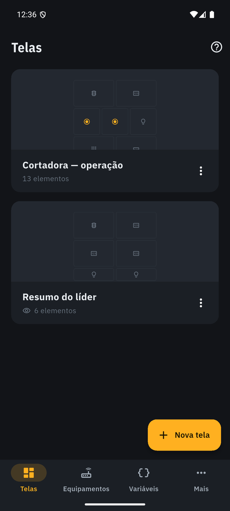
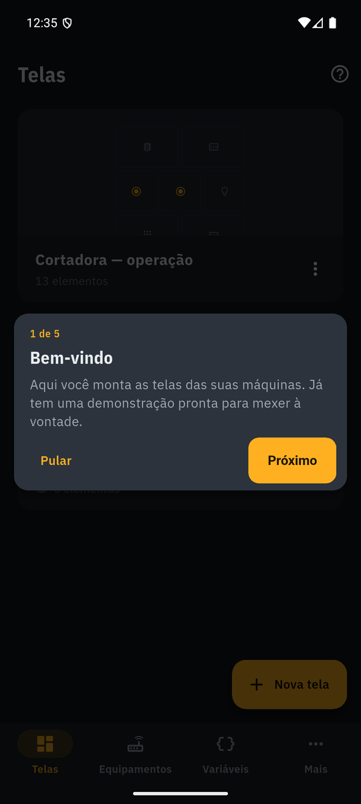

### 6.2. Tela em operação

Os elementos com valores ao vivo; faixa com o selo de cada equipamento (Online · tempo da varredura, ou o motivo da falha). Elementos de uma linha só mostram o rótulo ao lado do valor; os maiores, em cima. Lápis abre o editor. Ao sair, a leitura daqueles equipamentos para e os botões de pulso são soltos.

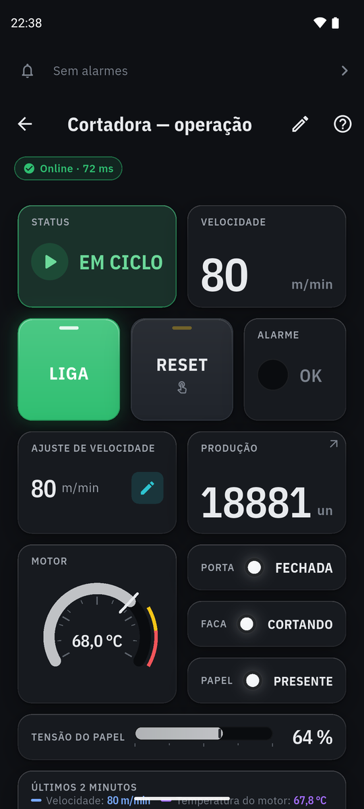
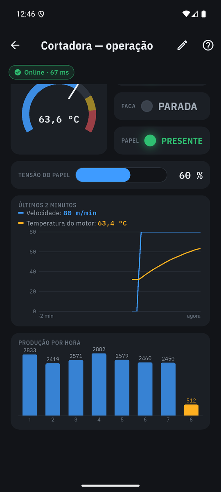

### 6.3. Editor

Grade pontilhada; "+ Elemento" abre a paleta (ícone, nome e uma frase curta). O elemento entra no primeiro espaço livre — ou na célula vazia tocada antes — e a configuração abre sozinha. Tocar seleciona (borda verde-água); arrastar o selecionado move; a bolinha do canto redimensiona; tudo encaixa na grade e nada sobrepõe. Barra inferior: sem seleção, "+ Elemento" e as regras da tela (nome, só acompanhamento, confirmar antes de gravar, apagar); com seleção, Configurar, Duplicar, Tirar e +. O topo fica só com nome, ajuda e Concluir. Os valores aparecem ao vivo durante a edição, mas nada reage a toque. No tablet deitado a configuração fica num painel fixo à direita (§6.13).

### 6.4. Configuração de elemento

Prévia ao vivo no topo, na proporção real. A variável aparece numa linha só; tocar abre uma folha com as variáveis compatíveis (cada uma com o valor atual) e "Criar variável" sem sair do editor. Campos só do que faz sentido para o tipo (modo do botão, cores de estado, limites, estados do indicador, janela do gráfico, texto, imagem). Aviso quando a variável escolhida é só leitura num elemento que grava.

Botão: sete modos, entre eles **Ir para tela** (escolhe a tela; o rótulo vira o nome dela), **Abrir câmera** (escolhe a câmera — as da máquina da tela primeiro — ou cria uma ali mesmo; o rótulo vira o nome dela, §6.14) e, nos modos liga/desliga, **Retorno da máquina** — por padrão "Mesma variável do comando", tocar escolhe outra. Imagem: **Fixa** ou **Muda com a variável**; no segundo, a variável da etapa e a lista código → imagem, com "Acrescentar imagens" (várias de uma vez) e "Importar PDF". Tabela (`table_config.dart`): as variáveis na ordem das linhas, cada uma com o valor ao vivo, **x** para tirar e a alça para arrastar; **Escolher variáveis** abre a lista com caixas de marcar (agrupada por equipamento, busca a partir de 8): cada toque marca ou desmarca e a tabela muda na hora, na ordem dos toques, até 30; "Pronto · 12 variáveis" fecha. O rótulo vira **Título (opcional)**, e o texto de ligado/desligado só aparece quando a tabela tem alguma linha liga/desliga. Demais elementos: **Ao tocar, abrir a tela** (Nada ou uma das telas), só quando o projeto tem mais de uma tela.

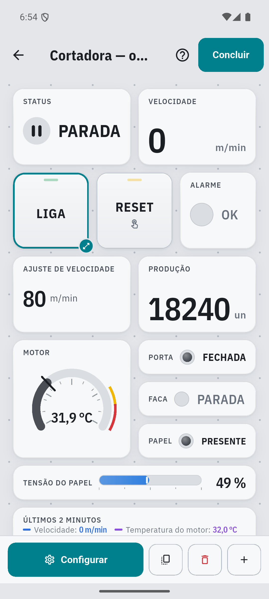
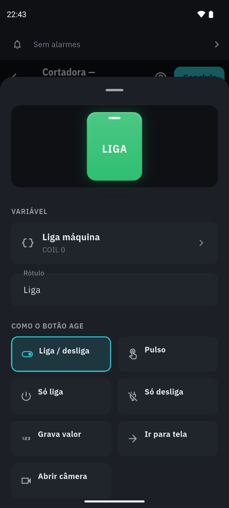

### 6.5. Equipamentos

Lista com nome, endereço e selo de comunicação. Cadastro com quatro coisas à vista: onde está (rede, cabo USB ou demonstração), nome, IP e **Testar conexão**. No **Cabo USB** o IP dá lugar ao **Adaptador USB**, e "Mais opções" traz protocolo, velocidade, bits, paridade, parada e ID (§4.20). Marca e modelo (perfil de fabricante, 4.6), porta, ID, tempo-limite e ritmo ficam em "Mais opções" (o resumo "Porta 502 · ID 1 · Inovance H3U" aparece fechado). O teste responde na hora; quando falha, mostra o que conferir, na ordem em que os problemas costumam acontecer (mesmo Wi-Fi, IP, Modbus ligado no equipamento, porta/ID). Quando o equipamento **recusa** a conexão (o IP respondeu na hora, mas nada escuta na porta — errno 111 no Android, 10061 no Windows), a mensagem vira "o equipamento recusou a conexão nesta porta" e só sobram as duas conferências que fazem sentido: porta e Modbus ligado. "Mais opções" rola a tela sozinho ao abrir, nos dois formulários. No Arduino/ESP (protocolo cru, 4.17) entra uma quinta coisa à vista, **Mensagem do equipamento**, que abre o editor do perfil com a prévia ao vivo; o teste diz se a mensagem chegou e se o perfil a entendeu.

**Procurar na rede (item 94).** No cadastro de equipamento Modbus TCP, a lupa do campo IP abre `NetworkScanSheet`, que usa `ModbusDiscovery` (`lib/services/net/modbus_discovery.dart`). A rede vem do canal `celiware/rede` (`RedeLocal.kt`): o Wi-Fi com IPv4 de rede local e, sem Wi-Fi, o cabo. A faixa varrida é a do celular, mas nunca maior que uma /24 (`LocalNetwork.neighbors`): uma máscara /16 continua sendo só a /24 em volta do celular, e uma rede menor encolhe junto. O próprio celular, o endereço de rede e o de difusão ficam de fora. Antes de varrer, o processo é preso a essa rede (`bindProcessToNetwork`), senão, com o 4G ligado, as tentativas sairiam pela operadora. Cada endereço é testado nas portas 502, 5020 (a do simulador) e na que estiver no cadastro, em duas etapas: conexão TCP com prazo de 300 ms, no máximo 32 ao mesmo tempo, cancelada pelo Parar ou ao fechar a folha; depois, só onde a porta abriu, o próprio `ModbusClientTcp` lê 1 holding register (endereço 0, ID 1), com prazo de 1 s. Resposta válida **ou exceção Modbus** conta como "responde Modbus" (a exceção também prova que do outro lado tem Modbus); silêncio, resposta que não é Modbus ou conexão derrubada aparecem como "porta aberta, sem resposta Modbus". Pior caso (ninguém responde) ≈ 5 s, medido 4,9 s. Os achados aparecem na hora, em ordem de IP; tocar num deles preenche IP e porta. Limites: fora do Android não há a rede da plataforma ("digite o IP"); só o ID 1 é testado; equipamento que demora mais de 300 ms pode faltar na primeira procura.

**Sair do cadastro** com alteração não salva pergunta "Descartar alterações?" (o mesmo `confirmDiscard` de todo cadastro, §8); o erro do IP some enquanto é corrigido; o teclado não reabre depois de Marca e modelo.

### 6.6. Variáveis

Lista agrupada por equipamento: nome, endereço (com perfil, "D200 · HR 200") e o valor ao vivo. A lista é montada sob demanda (`ListView.builder`) e só as linhas à vista ficam sendo lidas (`VisibleLiveTags` em `live_tags.dart`): com 2.000 variáveis, abrir a aba lê umas vinte, não o CLP inteiro. O ícone no topo abre **Criar várias** (4.6); o **Σ** ao lado, o cadastro de **variável calculada** (§6.12). O cadastro cabe numa tela: equipamento (só aparece se houver mais de um), nome, o que é (liga/desliga, número inteiro, número com vírgula), onde fica (lê e grava / só leitura), endereço com − / + e "pode ser alterada pela tela". Escala, unidade, decimais, lista, formatos raros (INT16, 32 bits, texto), ordem de bytes e observação ficam em "Mais opções", que abre sozinho quando algum deles está em uso; fechado, o resumo mostra o que está valendo ("÷ 10 · °C · 1 decimais"). A escala tem atalhos — Sem escala, ÷ 10, ÷ 100, ÷ 1000, × 10 — e "Outra", que abre fator e soma. Escolher ÷ 100 já acerta as casas decimais para 2. Texto mostra à vista o tamanho em registradores ("8 = até 16 letras"). No topo, **Lendo agora do equipamento**: o endereço digitado é lido a cada segundo, pela mesma conexão da varredura. O painel fica **preso no topo** enquanto o formulário rola — é a resposta de cada campo mexido, inclusive da escala lá embaixo. Variável nova já vem com o equipamento da tela em montagem ou, fora do editor, com o último cadastrado.

**Nada se perde calado** (etapa 4, EM-1 a EM-12). Voltar com alteração pendente — inclusive alarme recém-configurado — pergunta "Descartar alterações?" (Salvar · Descartar · Continuar editando); sem alteração, sai direto. Trocar o tipo avisa na hora os alarmes que deixam de valer (ficam guardados até o Salvar; voltando ao tipo, voltam) e os elementos que deixam de funcionar ("Usada em: Cortadora — operação (Medidor)"); se "Onde fica" muda junto, o campo acende por 2 s, e o "só leitura" se mantém. Sair de Texto devolve "Pode ser alterada pela tela" e o tamanho. O "Lendo agora" sugere com um toque **Inteiro com sinal** (sem sinal acima de 32767) e **palavras trocadas (CDAB)** quando um valor de 32 bits vem absurdo (NaN, acima de 10⁹, abaixo de 10⁻⁶), sem repetir ordem que já falhou. Endereço acima de 65535 tem erro próprio; hexadecimal (`0x2000`, `2000h`) é aceito e mostra "= 8192", e **Mais opções → Endereço em hexadecimal** dá o teclado com A–F. Bit de palavra pode vir de registrador de entrada (só leitura, FC04). Erro de validação abre "Mais opções" se preciso e rola até o campo. **Apagar** diz o que deixa de funcionar, um parágrafo por tipo: os elementos de tela, as contas das calculadas e as regras (na condição ou como destino) — conta e condição em qualquer profundidade, então a calculada que usa outra calculada que usa a variável também entra (`TagUse.deleteNotice` em `tag_uses.dart`, o mesmo texto no cadastro de calculada). Decimais viram − / + (0 a 6) e a unidade ganha atalhos (°C, %, bar, rpm, m/min, A, V, Hz). Com 4 ou mais equipamentos, a escolha vira uma linha que abre a lista (busca a partir de 8). O bloco de endereço mora em `address_field.dart` (`AddressInput` + `AddressField`).

**Memória do CLP** (MP-3/MP-4). Com marca e modelo no equipamento, o cadastro mostra logo depois do nome o campo **Memória do CLP** (**Parâmetro do inversor** nos perfis de inversor): "D200", "X10", "D100.3", "F3-12". Digitar preenche onde fica, endereço, bit e tipo (bit vira liga/desliga, contador de 32 bits vira INT32, entrada física exposta como coil fica só leitura), e a linha de baixo prova a tradução ("D200 → Holding 200") ou explica o erro ("X8 não existe — X conta em octal"; "D8511 com 32 bits ocuparia D8512, que não existe neste CLP"). "Onde fica" e o endereço Modbus vão para **Mais opções → Endereço Modbus**, com o endereço no resumo fechado, e continuam editáveis: mexer neles à mão reescreve a memória com o nome que o perfil dá ao endereço novo (ou deixa vazio), para não ficar um "D200" falso. `Tag.memory` é o texto digitado enquanto ele aponta para o endereço do formulário; senão, `VendorProfile.format`. Variável de antes do perfil abre com o nome do endereço dela. Com perfil, a sugestão de notação de manual some (`AddressInput.read(manual: false)`): 40001–49999 são endereços legítimos lá.

Na escolha de variável do editor, a lista é **agrupada por equipamento** (os que a tela já usa primeiro) e ganha **busca** por nome ou endereço, sem acento, a partir de 8 variáveis compatíveis.

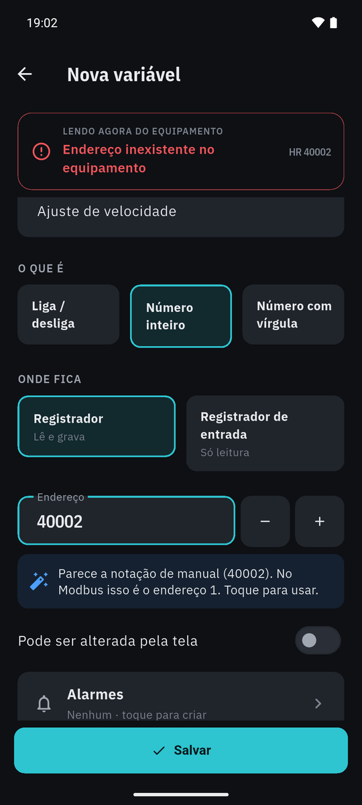
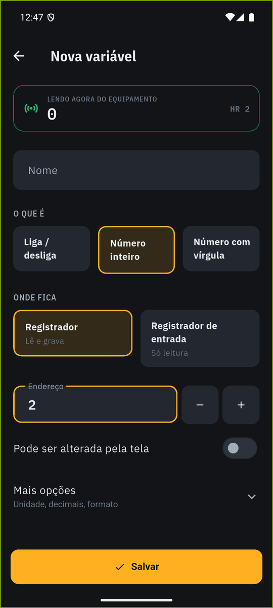
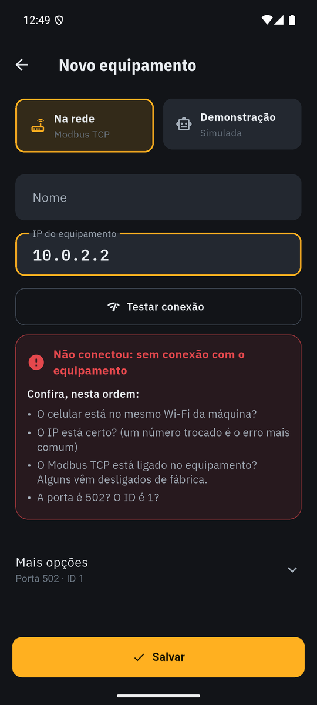

### 6.7. Ferramentas e Ajustes

A aba **Mais** saiu (reunião de 19–20/10/2026: o cliente achou as ferramentas de monitoramento "escondidas" e pediu cinco menus). O que era dela foi para três lugares:

- **Ferramentas** (quarta aba): **Registros** primeiro e maior, num cartão (§6.10); depois Câmeras (§6.14), Receitas (§6.11) e Regras (§6.12) do projeto aberto; e, em "Deste aparelho", **Voz e avisos** (§6.9) e **Procurar na rede** (a mesma procura do cadastro, §6.5: tocar num achado abre o cadastro de equipamento com o IP e a porta). As contas (variáveis calculadas) continuam em Variáveis, no Σ.
- **Projetos**: enviar, salvar e importar projeto ou planta, demonstração ("Novo projeto → Demonstração", que acrescenta em vez de substituir) e "Nova planta" no lugar de "Começar do zero" (§6.1, §5.4.1).
- **Ajustes** (engrenagem no topo de Projetos — ajuda e ajustes no topo, nunca na barra): Aparência, Tutoriais (cada trilha e "Rever todos"), Sobre e licenças, **Privacidade** (a política em texto: a Play pede a política dentro do app, e na rede da máquina um link não abriria).

### 6.8. Alarmes

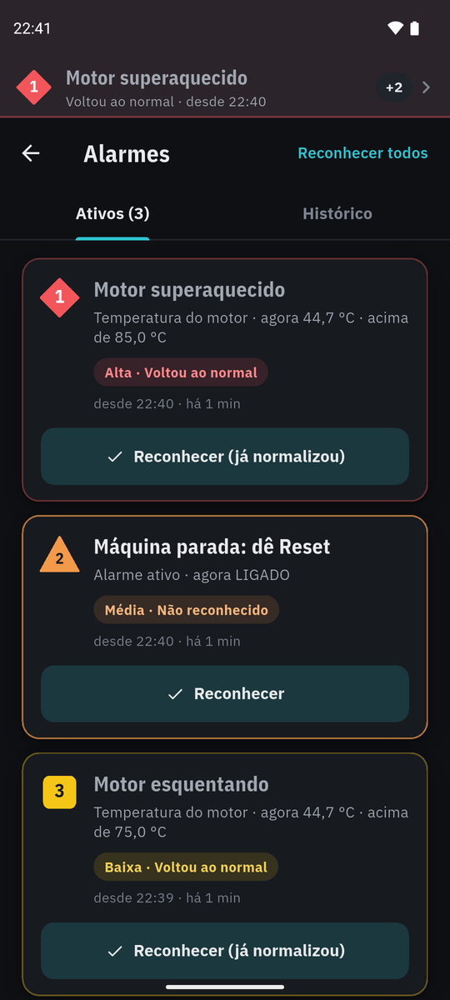
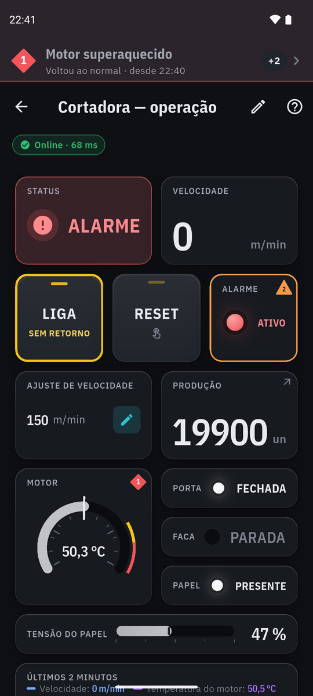

Seguem a ANSI/ISA-18.2 (resumo em `docs/PESQUISA-UI-UX.md` §1.2). O alarme **mora na variável** — configurado no cadastro dela, viaja no arquivo do projeto e some junto se a variável for apagada.

**Configurar.** No cadastro de variável, a linha **Alarmes** (resumo "Acima de 85,0 °C · …" e as formas das prioridades) abre o editor: *Quando* (acima de / abaixo de para número; quando ligar / quando desligar para liga-desliga), *Limite* na unidade da tela (já com escala), *Prioridade* em três cartões com a forma de verdade e uma frase ("Agir agora", "Agir logo", "Ficar atento") e *Mensagem para o operador* (vazia = gerada: "Temperatura do motor acima de 85,0 °C"). Texto e lista não alarmam.

**Prioridades — cor + forma + número** (cor sozinha falha para daltônico e para visão periférica):

| Prioridade | Cor (reservada) | Forma | Uso |
|---|---|---|---|
| 1 · Alta | vermelho | losango | Agir agora. |
| 2 · Média | laranja (só alarme usa) | triângulo | Agir logo. |
| 3 · Baixa | amarelo | quadrado | Ficar atento. |

**Estados** (ISA-18.2 §11.3.2): *não reconhecido* — a forma **pisca** a 1 Hz (nunca o texto); *reconhecido* — fixo; *voltou ao normal* — a condição sumiu antes de alguém ver, e o alarme fica na lista até ser reconhecido (senão passaria batido). Reconhecido + normalizado sai da lista.

**Contra alarme tagarela** (EEMUA 191): a condição precisa durar **1 s** para disparar, e a volta tem **banda morta de 1% do limite** (acima de 85 só normaliza abaixo de 84,15).

**Onde aparece.** (1) **Faixa fixa no topo do app**, acima de todas as telas, com o alarme que pede ação (o não reconhecido mais grave), o estado e a hora — sem o valor do disparo, que congelado desmentia o elemento da tela; celular deitado, a faixa cabe numa linha; o número "+2" de outros; toque abre a lista; o celular vibra quando um novo entra (som não funciona no chão de fábrica — ISA-18.2 §11.3.4); com fone, a voz fala (§6.9). Tudo reconhecido, a faixa fica discreta, mas à vista enquanto a condição existir. **Com um diálogo, folha ou menu aberto, a faixa não mexe no layout** (`AlarmBannerHost` + `AlarmsRouteObserver.popupOnTop`): a que chega aparece por cima, a que sai deixa o espaço até o diálogo fechar — encolher as telas nessa hora recentralizava a confirmação e o toque mirado no "Confirmar" caía no vazio (QA de 12/10). (2) **No próprio elemento** da tela: borda na cor e a forma no canto — o alarme aparece onde o valor está. (3) Na **lista de variáveis**: sino (tem alarme) ou a forma (em alarme agora). (4) **Aba Alarmes** (a quinta, com o número dos não reconhecidos no sino, na cor do mais grave; tocar a faixa leva a ela — com uma tela aberta por cima, a lista abre sobre a tela e o "voltar" devolve a tela): aba *Ativos* — o mais grave em cima; cada cartão com mensagem, valor de **agora** e limite, prioridade/estado, "desde 19:21 · há 3 min" e o botão **Reconhecer** (um a um; "Reconhecer todos" com confirmação quando há mais de um); aba *Histórico* — por dia, hora com segundos, Ativou / Reconhecido / Normalizou. No tablet deitado, o alarme tocado abre ao lado da lista (§6.13).

**Demonstração.** A cortadora já vem com as três prioridades: motor acima de 75 °C (baixa) e de 85 °C (alta), porta aberta (alta), pouca tensão no papel (baixa) e **máquina parada por alarme** (média — é consequência; a causa sobe como alta). A 150 m/min o motor passa de 85 °C em ~40 s, a máquina desarma e o RESET (segurar) rearma. que tem alarmes vira alarme próprio (média): sem leitura, os outros alarmes não merecem confiança. Os alarmes da variável ficam como estão até a leitura voltar.

**Vigiado em qualquer tela.** O `AlarmEngine` (`lib/services/alarms/`) mantém inscritas no runtime as variáveis com alarme enquanto o app está aberto — o equipamento continua sendo lido mesmo sem tela aberta. O histórico (últimos 300 eventos) fica em `historico-alarmes.json`, na pasta do projeto (§5.4.1): cada projeto tem o seu; é do aparelho, não vai na exportação. O piscar usa um timer de 500 ms que só corre com alarme não reconhecido (2 quadros/s, nunca animação contínua).

**Limite desta versão:** com o app em segundo plano a leitura para (bateria), então **não há alarme com o app fechado** nem notificação do Android. Resolver isso pede um serviço em primeiro plano (notificação fixa "vigiando a cortadora") — fica como próximo passo, a decidir.

**Faixa do topo e pergunta de regra.** Acima do Navigator, `AlarmBannerHost` reserva uma faixa de altura fixa em todas as telas: 56 dp em pé, 48 deitado, mais a barra de status, calculada só pela orientação e pelo tamanho de letra (`TopBand`, `lib/widgets/alarms/top_band.dart`). O que entra ou sai troca só o conteúdo da faixa, nunca a posição das telas, com ou sem diálogo aberto. Isso acaba com o "pulo da tela" (o toque seguinte caindo em outro lugar). A faixa mostra, nesta ordem: o alarme não reconhecido mais grave (ISA-18.2 §11.3.4), a pergunta de uma regra (LG-6), o alarme reconhecido ainda ativo e, por fim, "Sem alarmes" em cinza. O que fica atrás vira marca na própria faixa. A pergunta não tem botões na faixa: tocar abre a decisão (`RuleProposalDialog`, com Ignorar e o verbo da ação), e nada é gravado sem esse toque. Faixa sobreposta sem reserva foi descartada porque cobriria voltar, editar e ajuda justamente durante o alarme. Cartão no rodapé foi descartado porque cobria as abas e o Salvar e punha o "Gravar" sob o dedo. Custo: 56 dp a menos de altura em toda tela (a Tabela de valores mostra 42 de 46 variáveis sem rolar; o requisito GR-8 é 40+).

### 6.9. Voz e narração

Avisos por voz no fone (`docs/REQUISITOS-ETAPA4.md` §9.1, VZ-1 a VZ-6), em `lib/services/voice/`. A voz **nunca é a única indicação**: faixa e vibração continuam iguais, com ou sem voz, com ou sem fone.

**Fila por prioridade.** O `VoiceAnnouncer` escuta o `AlarmEngine` e tem fila própria em Dart — o `flutter_tts` só fala e para (no Windows nem tem fila). Alarme novo entra pela prioridade; mesma prioridade, ordem de chegada; **alta interrompe** média, baixa e narração, e a fala cortada volta para a frente da sua prioridade. A urgência vai na frente: "Alarme urgente: Porta aberta", "Alarme: …", "Atenção: …". O motor fica atrás da interface `SpeechEngine` — os testes usam um falso.

**Quanto fala.** Padrão: alta repete a cada 30 s enquanto ativa e não reconhecida; média fala uma vez; baixa não fala. Cada prioridade e o intervalo são configuráveis. A repetição conta do fim da fala; voltou ao normal sem reconhecimento, não repete mais.

**Silenciar ≠ Reconhecer** (OPC UA Part 9 §5.4.1.7). `AlarmEngine.silence` marca o alarme (`AlarmEntry.silenced`) e grava **Silenciado** no histórico; ele continua piscando, na faixa e pedindo reconhecimento. O botão só aparece onde a voz insiste (prioridade em "Repete"): discreto ao lado de Reconhecer no cartão, só o ícone na faixa. Reconhecer ou silenciar cala na hora, mesmo no meio da frase. O histórico grava o tipo pelo nome: a 1.3.2 lê "silenced" como "Ativou" sem quebrar; daqui em diante, tipo desconhecido (versão mais nova) é pulado em vez de virar "Ativou".

**Só com fone** (ligado por padrão). Antes de cada fala, o canal `celiware/voz` (`SaidaDeAudio.kt`) consulta `AudioManager.getDevices(GET_DEVICES_OUTPUTS)`: fone com fio, Bluetooth A2DP/SCO/LE, USB, aparelho auditivo. Sem fone a fala é pulada, mas a repetição segue — fala quando o fone voltar. Onde a plataforma não informa, a opção nem aparece e a voz não é calada por palpite. A2DP inclui caixa de som e rádio de carro: o Android não distingue.

**Android.** A fala usa o atributo de navegação (como o GPS: abaixa a música e sai no fone), pede foco de áudio transitório "abaixando os outros" e tem 300 ms de silêncio antes (o Bluetooth come a primeira sílaba). Tempo-limite folgado em cada fala: se o motor der erro no meio, a fila segue. Android 11+: `<queries>` com `android.intent.action.TTS_SERVICE` no manifesto, senão o app não enxerga o motor de voz.

**Voz pt-BR (VZ-6).** Com a voz ligada, ao abrir o app, ao abrir a folha e ao voltar para o app, `FlutterTtsEngine.check` confere: sem motor, sem português do Brasil, ou voz não baixada para uso offline. O problema aparece com nome — "Falta a voz em português (Brasil) em 'Serviços de fala do Google'" — na linha Mais → Voz e avisos e na folha, com **Abrir ajustes de voz** (`com.android.settings.TTS_SETTINGS`; se o fabricante esconder, instalar dados de voz; por fim, ajustes gerais).

**Narração de eventos (VZ-5).** No cadastro de variável, a linha recolhida **Narração por voz** (como a de Alarmes) abre o editor: *Valer X*, *Passar de X* ou *Ficar abaixo de X* → *Falar "texto"* (até 80 letras); liga/desliga: *Ao ligar* / *Ao desligar*. É o item 12 do cliente: variável de estado com um texto por valor ("1 → A máquina está iniciando", "2 → Montagem"); se um indicador de estado já mostra a variável, o editor oferece "Usar os textos do indicador". Fala só na **passagem** — nem na primeira leitura, nem na volta da comunicação (não dá para saber quando mudou) —, depois de todo alarme e no máximo uma vez por evento a cada N s (10 s). O `EventNarrator` mantém essas variáveis inscritas no runtime enquanto a narração está ligada, como o `AlarmEngine`. A demonstração narra "A cortadora parou" e "A cortadora está em ciclo".

**Preferências do aparelho** (`shared_preferences`, chave `voz`; não vão no projeto), em **Mais → Voz e avisos**: ligar, só com fone, volume, velocidade (devagar · normal · rápida) e **Falar um exemplo** (fala mesmo sem fone — é a pessoa pedindo). Em Mais opções: quanto fala cada prioridade, o intervalo da repetição, a narração e o limite por evento.

**Segundo plano: sem voz.** A varredura para (§2.4), então não há alarme novo nem o que falar. `main.dart` chama `VoiceAnnouncer.pause` (para a fala, descarta narração da fila, guarda o alarme) e `resume` (alarme que ainda pede reconhecimento fala ao voltar). Voz com o app fechado pede o serviço em primeiro plano (REQUISITOS-ETAPA4 §9.6) — fora desta entrega.
### 6.10. Registro de dados

Ferramentas → **Registros** (REQUISITOS-ETAPA4 §9.4, RG-1 a RG-6): variáveis gravadas no aparelho para ver o histórico em gráfico e mandar a planilha.

**Grupo** (`LogGroup`, em `Project.logGroups`; só vai para o arquivo quando há algum, `schemaVersion` segue 1): nome, variáveis (número e liga/desliga de valor único; texto e lista não), intervalo de 1 s a 1 h, modo **Sempre** ou **Ao mudar** (banda morta na unidade de cada variável + "gravar ao menos a cada", para valor parado não parecer buraco), retenção (padrão 7 dias) e liga/desliga. À vista na folha: nome, variáveis, ritmo e "Guardar 7 dias" com o tamanho estimado (calibrado pela medição: 13 B por linha + 8,5 B por número); o modo fica em "Mais opções".

**Motor** (`DataLogger`, `lib/services/logging/`): padrão do `AlarmEngine` — mantém inscritas as variáveis dos grupos ligados, em qualquer tela. Conferência a cada segundo, no compasso do intervalo. Sem comunicação, endereço recusado ou leitura parada (mais de 10 s ou 3 varreduras) grava **nulo**, nunca o último valor; ao abrir e ao voltar do segundo plano espera até 10 s pela primeira leitura. Linhas vão para o banco **em lote a cada 10 s**, numa transação, e na ida para segundo plano (gancho em `main.dart`, como o histórico de alarmes). Retenção conferida de hora em hora.

**Banco** (`LogStore`): o SQLite do próprio Android pelo `sqflite` (nenhuma biblioteca nativa no APK); nos testes, `sqflite_common_ffi`, só em `dev_dependencies` — o build release não roda hooks de dependência de desenvolvimento, então o SQLite embutido dele não entra no APK. **Um arquivo por grupo** em `registros/<projeto>/` (§5.4.1; cada projeto com os seus): o uso de disco é o tamanho do arquivo ("A cada 1 s · 3 variáveis · 2,4 MB") e apagar o grupo devolve o espaço na hora. **Tabela larga**: uma linha por instante (`t` em ms UTC, chave da própria tabela) e uma coluna `REAL` por variável — 15,8 MB/dia para 20 variáveis a 1 s, contra 40,7 na estreita. A tabela `colunas` guarda nome, unidade e casas do momento da gravação, então o histórico sobrevive a renomear ou apagar a variável. WAL (um fsync por lote). Banco de grupo que saiu do projeto vale até a retenção dele e depois some. A pasta fica fora do backup na nuvem (`res/xml/backup_rules.xml`, `data_extraction_rules.xml`): acima de 25 MB o Android desiste do backup inteiro, inclusive do projeto.

**Histórico** (`LogHistoryPage`): Última hora · Hoje · 7 dias · Escolher; até 3 curvas. O gráfico usa a mesma régua da tendência (`TrendScale`: poço, passos redondos, eixo duplo) e recebe do SQLite **no máximo uma fatia por pixel** com mínimo, máximo e média — uma semana a 1 s são 604.800 linhas e o pico de um segundo continua lá. A curva é interrompida onde não há linha (app fechado) e onde a fatia é toda nula (sem comunicação). Pinça aproxima (até 30 s), arrastar anda, tocar mostra hora e valor (exato, ou "mín. a máx." quando a fatia junta várias linhas).

**Planilha** (`LogCsv`): a janela à vista, no jeito do Excel pt-BR — `;`, vírgula decimal, `dd/MM/aaaa HH:mm:ss` local, cabeçalho "Nome (unidade)", UTF-8 com BOM, lacuna = célula vazia, sem `sep=;` (o Excel ignoraria o BOM). Lida em páginas de 5.000 linhas, página grande formatada num isolate, enviada pelo `share_plus`.

**Limite desta versão:** grava só com o app aberto (o histórico mostra o buraco). Com o serviço em primeiro plano basta o `DataLogger.pause` não pausar — ponto de extensão comentado lá.

**Leitura do histórico sem empurrar o gráfico.** A leitura do ponto tocado mora numa área de altura fixa, uma linha para a hora e uma por curva; sem toque, a mesma área é a legenda (com o trecho à vista na linha da hora). O nome longo encolhe, nunca o valor. O gráfico não se move com toque, arrasto ou toque longo.

### 6.11. Receitas

Ferramentas → **Receitas** (REQUISITOS-ETAPA4 §9.3, RC-1 a RC-7): os ajustes de cada produto guardados no projeto e aplicados na máquina com uma confirmação. Vocabulário da ISA-88 (`docs/pesquisa-etapa4/4-…`, seção 3): **tipo de receita** = quais parâmetros existem ("Rótulo": velocidade e comprimento); **receita** = os valores de um produto ("Rótulo 120 mm"); **máquina** = o vínculo parâmetro → variável num equipamento.

**Modelo** (`lib/models/recipe.dart`, campos em §5.5; `Project.recipeTypes` e `Project.recipes` só vão para o arquivo quando há algum, `schemaVersion` segue 1). Parâmetro: nome, unidade, casas, mín./máx. opcionais e tolerância da comparação — ou liga/desliga. Só entra variável gravável pela tela, de valor único, número ou liga/desliga (`RecipeParam.canUse`). O tipo tem uma lista de máquinas (`RecipeMachine`): a variável de cada parâmetro naquele equipamento, a condição para aplicar e o bit de receita carregada. As edições moram numa extensão (`ProjectRecipes`), para `project.dart` mudar o mínimo.

**Valores na unidade de engenharia.** A escala da variável faz a conta nos dois sentidos: 752 lido é 75,2 °C; gravar 80,5 manda 805. Digitar confere a faixa da receita e o que a variável da máquina aceita ("Nesta máquina, "Temperatura" aceita passos de 0,1"). A faixa é rígida (a tolerância é da comparação). Número lido de FLOAT32 perde o ruído (75,19999 → 75,2) com uma folga de meio passo do FLOAT32 (2⁻²⁴ do valor) — mais que isso arredondaria valor de verdade; inteiro não tem folga nenhuma (1.000.000 ≠ 1.000.001).

**Telas** (`lib/screens/recipes/`): lista por tipo; a receita com os valores (tocar edita), **Comparar** e **Aplicar** à vista e, no menu, Ler da máquina, Transferir, Versões, Renomear, Duplicar, Apagar. "Nova receita" pede o nome e oferece **Ler da máquina** (o caso comum: a máquina já está no ponto) ou Em branco. O tipo (ícone de ajuste na seção) mostra parâmetros, com faixa e tolerância, e máquinas; condição e bit ficam em "Mais opções" da máquina.

**Ler da máquina** (RC-3): cada parâmetro pela conexão da sessão (`HmiRuntime.readNow`). Receita vazia só se preenche; com valores, mostra o que muda ("Comprimento do rótulo: 120 mm → 90 mm") e pede para atualizar. O que está dentro da tolerância fica como estava (ruído de leitura não vira versão); parâmetro que não deu para ler mantém o valor antigo, e isso é dito.

**Comparar** (RC-4): só as diferenças além da tolerância, "na máquina × na receita"; o que não deu para ler e o que falta na receita aparecem à parte; tudo igual = "A máquina está com esta receita". Dali já se aplica.

**Aplicar** (RC-5, RC-6; `RecipeApplier` em `lib/services/recipes/`, pelo `readNow`/`write` de sempre):

1. prepara: lê tudo e monta a lista "de → para". Só o que difere além da tolerância é gravado; o que não deu para ler entra como "?";
2. o que impede aplicar aparece no lugar do botão: variável que falta, foi apagada ou não grava; valor fora da faixa ou que a variável não aceita; receita sem valor; sem comunicação; condição falsa ("Só aplica com "Em ciclo" DESLIGADO. Agora está LIGADO.");
3. **uma** confirmação, com Cancelar e "Aplicar N valores", e o campo opcional "Quem está aplicando" (vem com o último nome usado no aparelho);
4. confere a condição de novo — a máquina pode ter partido entre a confirmação e o toque — e desliga o bit de receita carregada;
5. grava parâmetro por parâmetro, com o progresso à vista ("Gravando 2 de 3…"); a folha não fecha enquanto grava. **Na primeira falha, para**: recusa do equipamento (endereço inexistente, valor inválido) ou do app vira "Recusado: …", falta de comunicação vira "Sem comunicação: …", e o resto fica "Não gravado: a aplicação parou antes";
6. relê o que gravou e confere a tolerância, 300 ms depois (o CLP limita o valor na varredura seguinte): "Gravou 140 m/min, a máquina ficou com 120 m/min". Com a comunicação caída não relê no escuro ("Gravado, sem conferência");
7. liga o bit de receita carregada só se tudo foi gravado e conferido.

O relatório abre com uma frase que não esconde nada — "Receita aplicada", "Aplicada com 1 divergência", "Parou no 2º de 3 valores: endereço inexistente no equipamento", "Não aplicada: …" — e uma linha por parâmetro. Não há desfazer automático: voltar atrás também grava e também pode falhar; o relatório mostra o estado de verdade, e a versão anterior da receita está em Versões.

**Condição e segurança.** "Só aplicar quando" é uma variável liga/desliga com o valor esperado ("Em ciclo" desligado = máquina parada). É conferência do app, **não intertravamento** — a folha da máquina diz isso, e a segurança continua no CLP (REQUISITOS-ETAPA4 §9.5). Liga/desliga dentro de registrador grava por leitura-modificação-escrita (§4.10): para o bit de receita carregada, prefira coil.

**Transferir** (RC-7). O mesmo tipo vale em várias máquinas, cada uma com as suas variáveis. "Ligar outra máquina" (no tipo) e "Transferir para outra máquina" (na receita) sugerem as variáveis da outra máquina (`RecipeLogic.suggestBinding`), nesta ordem: mesmo nome da variável de origem, mesma memória do CLP ("D200"), mesmo endereço (mesmo modelo de máquina), nome igual ao do parâmetro — sem acento, nunca uma variável que não grava ou de outro tipo, nunca a mesma para dois parâmetros. Máquina pronta: a aplicação abre lá. Faltando variável: abre a folha de vínculo antes.

**Versões** (RC-7). Mudou valor, versão nova; ficam as últimas 10, contando a atual (`Recipe.maxVersions`). Edições à mão seguidas, em menos de 10 min, viram uma versão só — três ajustes não empurram para fora as versões que importam; ler da máquina nunca se junta com edição. Restaurar cria versão nova com os valores antigos: nada se apaga. Renomear não muda a versão; duplicar começa na 1 ("Cópia de "Rótulo 120 mm" (versão 2)").

**Histórico de aplicações** (RC-7; ícone no topo da lista): quem, qual receita e versão, em qual máquina, quando e como terminou, com o "de → para" e o resultado de cada parâmetro. É do aparelho, como o histórico de alarmes: `historico-receitas.json` ao lado do projeto, as últimas 200, com o texto pronto (continua legível depois de renomear ou apagar receita, variável ou máquina). Resultado de uma versão mais nova do app é pulado, não vira "aplicada".

**Demonstração.** A cortadora vem com o tipo "Rótulo" (velocidade 0–150 m/min, comprimento 20–500 mm, só com "Em ciclo" desligado) e duas receitas: "Rótulo 120 mm" (80 m/min — o ajuste com que a máquina abre) e "Rótulo 60 mm" (65 m/min, abaixo do alarme baixo de temperatura do motor).

**Fora desta entrega:** gravar o nome da receita ou do lote no CLP (texto é só leitura, §4.12); elemento de tela de receita; gravação em bloco (FC16 numa faixa contínua, como a Weintek) — hoje é um pedido por parâmetro; receitas em CSV.

### 6.12. Cálculos e regras entre máquinas

REQUISITOS-ETAPA4 §9.5. A regra de ouro do ROADMAP vale para tudo aqui: **o app nunca é função de segurança da máquina** — celular lendo por Wi-Fi tem latência sem limite (Wi-Fi caiu, app fechado, Android matou o processo) e não atende NR-12 nem ISO 13849. Isso está escrito no topo da página de regras e no termo do modo automático.

**Variável calculada (LG-1 a LG-3).** O valor sai de uma conta com outras variáveis, de qualquer equipamento: "Rótulos por minuto = [Velocidade desejada] × 1000 ÷ [Comprimento do rótulo]". Lista de variáveis → ícone **Σ** no topo → cadastro próprio (`calc_tag_form_page.dart`): nome, a conta e, preso no topo, o **Lendo agora** com o resultado ao vivo — as entradas da conta ficam sendo lidas enquanto o cadastro está aberto e cada letra refaz a conta. Debaixo do campo, **Variável** cita por toque (lista agrupada por equipamento, com o valor de agora e busca a partir de 8; sem digitar nome exato) e **Função ou sinal** traz as seis funções, cada uma com uma frase, e os sinais que o teclado do celular esconde (`calc_expression_field.dart`, usado também pela condição das regras). Alarme e narração como em qualquer variável; em Mais opções, unidade, casas e observação. É sempre só leitura: aparece em qualquer elemento (no botão e no ajuste, com o aviso de só leitura de sempre), tem alarme e entra no registro de dados. Na lista, o grupo "Cálculos" mostra a conta com os nomes de agora ("= [Velocidade] * 60").

**A linguagem** (`lib/services/calc/calc_expression.dart`):

| O quê | Como se escreve |
|---|---|
| Contas | `+ − × ÷ ( )` (também `-`, `*`, `/`) e o sinal de menos |
| Comparações | `=  ≠  >  <  ≥  ≤` (também `<>`, `!=`, `>=`, `<=`, `==`) |
| Lógica | `e`, `ou`, `não`; `verdadeiro`, `falso` |
| Funções | `se(condição; se sim; se não)`, `mín(a; b; …)`, `máx(a; b; …)`, `abs(x)`, `arred(x; casas)`, `taxa([contador])` — sem diferenciar maiúscula e acento |
| Números | vírgula decimal (`0,5`; ponto também vale); `;` separa os valores das funções, como no Excel em português |
| Variáveis | `[Nome com espaço]`, `Nome` solto, `[Equipamento: Nome]` quando o nome se repete em dois equipamentos |

Da ligação mais fraca para a mais forte: `ou` · `e` · `não` · comparação (uma por vez — `a < b < c` é recusado com "junte com e") · `+ −` · `× ÷` · sinal. Liga/desliga entra em conta como 1/0 e número vale como condição se for diferente de zero. Igualdade tem folga para o ponto flutuante (0,1 + 0,2 = 0,3). O tipo sai da conta: comparação e lógica dão liga/desliga; o resto, número com vírgula (`Tag.dataType` `bool` ou `float32`). `se`, `e` e `ou` só calculam o lado que decide.

Avaliador próprio, sem `eval`, JavaScript nem `petitparser`: léxico → árvore por descida recursiva → conferência das variáveis e dos tipos → cálculo. Não há laço nem atribuição, então uma conta não trava o app. Erro em português, com o trecho (`CalcError.start/end`) marcado em vermelho debaixo do campo: "Falta fechar o parêntese", "Não existe variável "Temp"", "Nome com espaço vai entre colchetes: [Velocidade da faca]", "Separe os valores com ponto e vírgula (;)", "máx( ) compara 2 ou mais valores", "Há 2 variáveis "Temperatura" (Cortadora, Prensa): escreva [Cortadora: Temperatura]", "Compare dois valores de cada vez", texto e lista "não entram em conta". Divisão por zero na hora de calcular é erro ("divisão por zero"), nunca um número.

**Texto canônico.** `Tag.calc` (`CalcSpec`) guarda a conta com `{id}` no lugar de cada citação, mais o nome de cada uma no dia em que foi salva. Renomear a entrada não quebra nada — a tela mostra o nome de agora (`CalcGraph.display`) —, e apagar dá "A variável "Temperatura" foi apagada" em vez de um id. **Sem círculo:** "A usa B que usa A" é recusado ao salvar, na hora em que é digitado ("A conta fica em círculo: Eficiência → Meta → Eficiência"; "A conta não pode usar a própria variável"); círculo vindo de arquivo editado à mão vira erro "a conta fica em círculo", não trava.

**Taxa de contador.** `taxa([Rótulos cortados])` é quanto o contador sobe por hora (divida por 60 para por minuto), numa janela deslizante de 5 min (`RateTracker`): rápida para ver a máquina parar, lenta o bastante para uma máquina de 1 peça por minuto não pular entre 0 e 60/h. Precisa de 10 s de histórico antes de dar número ("calculando a taxa") e, se o contador voltar (zerou na troca de turno), recomeça a janela em vez de dar taxa negativa.

**No motor: equipamento virtual.** As calculadas moram no equipamento `DeviceKind.calc` "Cálculos" (`CalcDevice`, id `calculos`), que nasce com a primeira calculada salva e não aparece em Equipamentos, no "Criar várias" nem na escolha de equipamento do cadastro de variável (`Project.equipment`). O `HmiRuntime` dá à sessão dele o `CalcDriver` no lugar da rede (`_newSession`); o resto do motor não muda — inscrição, pausa em segundo plano, "lendo agora" e escrita (recusada: "é calculada: só leitura") passam pelo caminho de sempre. Por que assim, e não um `Tag.calc` solto num equipamento qualquer: (1) as listas agrupadas por equipamento (variáveis, escolha do editor, registros) mostram o grupo "Cálculos" sem mudar nada; (2) alarme, narração e registro leem o `TagStore` e não sabem a diferença; (3) a calculada não depende de qual equipamento está em uso, e as contas de várias máquinas ficam juntas.

- **Entradas em uso.** Calculada inscrita põe as entradas dela em uso também, em qualquer profundidade (`CalcGraph.expand` no `_refreshSessions`): a tela com "Eficiência" faz a cortadora ser lida; o que a conta não usa continua sem ler.
- **Modo assinatura**, como o MQTT. O driver ouve as entradas no `TagStore`: entrada nova recalcula na hora (as que chegam no mesmo bloco de leitura viram uma conta só, numa microtarefa) e publica só o que mudou; a cada `pollMs` (500 ms) recalcula e publica tudo, para a taxa andar com o relógio e o registro ver leitura fresca. Calculada que cita calculada: ordem topológica (`CalcGraph.order`).
- **Qualidade (LG-2)**, no `CalcEvaluator` — o mesmo código no motor, no "Lendo agora" e nas regras: entrada **sem comunicação** → calculada sem comunicação, com o último valor dela esmaecido ("sem comunicação com Cortadora de rótulos"), nunca uma conta com dado velho; entrada esperando a primeira leitura → esperando; entrada com erro → "erro na entrada "X"". O alarme de falta de comunicação de uma calculada com alarme é o do equipamento da entrada que caiu ("Sem comunicação com Cortadora de rótulos"), nunca "com Cálculos" (`AlarmEngine._lostDevice`).

**Regras entre máquinas (LG-4 a LG-7).** Ferramentas → **Regras**, em duas seções: **Deste projeto** e **Da planta** (as que usam variáveis de qualquer projeto, §5.4.1; o editor é o mesmo, com as variáveis de todos os projetos — as dos outros com o nome do projeto na frente — e liberar "aceita escrita por regra" grava no projeto dono da variável): "Quando [condição] durar [T s], então gravar [valor] em [variável]". A lista mostra, por regra, o que vigia, o que faz e como está agora (vigiando · condição presente, 4 de 10 s · agiu · parada: motivo · desligada), com a chave de ligar; o ícone do topo abre o histórico.

| Requisito | Como ficou |
|---|---|
| LG-4 | Condição na mesma linguagem das calculadas (precisa dar liga/desliga), com o estado ao vivo no cadastro ("Agora: a condição está presente"); tempo Na hora · 5 s · 10 s · 30 s · 1 min · 5 min. Age **uma vez** por passagem e só volta a valer quando a condição some — nunca em laço. |
| LG-5 | O destino precisa de "Aceita escrita por regra" (`Tag.ruleWritable`, em Mais opções do cadastro de variável). Escolher no cadastro da regra um destino sem a marca pergunta "Permitir que regras gravem em …?" antes de marcar. Sem a marca, a regra fica parada e vira alarme; tirar a marca com uma pergunta na tela retira a pergunta. |
| LG-6 | Padrão **perguntar antes**: a pergunta ("Parar a cortadora?", "Grava DESLIGADO em "Liga máquina" (Cortadora de rótulos)", Ignorar · Desligar) aparece por cima de qualquer tela (`RuleProposalHost`, acima do Navigator, como a faixa de alarme), o celular vibra, e nada é gravado sem o toque. Condição que passa antes da resposta retira a pergunta. **Gravar sozinha** só depois do termo ("o app não é intertravamento de segurança…") e só para parar — valor desligado ou zero; regra que ligaria sempre pergunta, até vinda de arquivo editado à mão. |
| LG-7 | Sem comunicação (na condição ou no destino), condição com erro ou destino sem permissão: a regra **não roda** (não conta tempo), a pergunta pendente sai e vira alarme médio "Regra "X" parada: motivo", que normaliza quando volta. App em segundo plano: nada roda, a pergunta pendente é retirada — gravar depois, com a situação já outra, seria pior que não gravar — e, na volta, se ficou parado 10 s ou mais, alarme baixo "As regras ficaram paradas 2 min: app em segundo plano". Automática que não conseguiu gravar também vira alarme. Todo disparo, pergunta, gravação, recusa, retirada e parada vai para o histórico (`historico-regras.json`, ao lado do projeto, últimos 300; do aparelho, não vai na exportação). |

O `RuleEngine` (`lib/services/rules/`) segue o padrão do `AlarmEngine`: mantém inscritas as entradas das condições e os destinos das regras ligadas, em qualquer tela; avalia a cada entrada nova e a cada segundo (o tempo da condição); e levanta alarme pelo `AlarmEngine.raise/clear`, os alarmes que não vêm de variável. `main.dart` chama `pause`/`resume` no ciclo de vida.

**Demonstração.** Traz um exemplo de cada, sem tela nova (o vídeo toca as telas pela posição): a calculada **Rótulos por minuto** = `[Velocidade] × 1000 ÷ [Comprimento do rótulo]` (a velocidade de verdade: máquina parada dá 0; a 80 m/min com rótulo de 120 mm, 667 un/min), que traz o equipamento "Cálculos" junto; e a regra **Diminuir a velocidade**, **desligada** e no modo propor: quando a temperatura do motor passa de 80 °C por 10 s, pergunta se grava 65 m/min na velocidade desejada (que por isso já vem com "Aceita escrita por regra"). Ligada, a pergunta aparece uns 3 min depois de ligar a cortadora a 80 m/min (o motor vai para ~81,6 °C) — antes de a máquina desarmar sozinha a 85 °C.

**Limite desta versão:** calculadas e regras só rodam com o app aberto, como alarmes e registro (o serviço em primeiro plano é a entrega separada da §9.6 dos requisitos). JavaScript continua fora (§1.2).

### 6.13. Tablet

REQUISITOS-ETAPA4 §5.2, TB-1 a TB-6. As peças moram em `lib/widgets/common/adaptive.dart`. A regra: **o celular fica exatamente como era**. Tudo só age a partir de 600 dp de largura, e nunca com altura compacta (abaixo de 480 dp). O celular deitado passa de 600 dp, às vezes de 840, mas continua com a barra e as telas de celular.

| Janela (`WindowClass`) | O que muda |
|---|---|
| < 600 dp, ou altura < 480 (celular, inclusive deitado) | Nada: barra embaixo, cadastro empilhado por cima. |
| 600–839 dp (tablet em pé) | Trilho lateral. Cadastro de equipamento e de variável abre no lugar da lista, com o trilho à vista. Um painel por vez. |
| ≥ 840 dp (tablet deitado) | Lista de 360 dp à esquerda e cadastro ao lado, em Equipamentos, Variáveis e Alarmes. Editor com painel fixo de configuração. |

- **Trilho (TB-1).** `NavigationRail` com as mesmas cinco áreas, ícone e rótulo sempre à vista, na cor da barra (`navigationRailTheme`). A chave do tutorial (`navKey`) vai no que estiver à vista, então o passo "O caminho" acha o alvo nos dois casos. Alvo alto e estreito ganha o balão ao lado (`_TourLayer`).
- **Lista + detalhe (TB-2).** `ListDetail` envolve a página da lista. O cadastro mora num `Navigator` próprio do painel, e por isso os formulários não precisam saber onde estão:
  - Salvar e Apagar fazem `Navigator.pop` e fecham só o painel;
  - o "voltar" do Android fecha o cadastro e não a página (um `PopScope` só age na aba à vista, via `ActiveTab`, e respeita o tutorial aberto);
  - tocar noutro item fecha o atual pelo caminho normal, então o "Descartar alterações?" da variável continua valendo, e só depois abre o novo.
  
  O item aberto fica marcado na lista: fundo na cor de seleção, mais o contorno no cartão de equipamento. Com dois painéis, o detalhe ganha o tom de cartão (`Ind.surface`), sem linha divisória. Em Alarmes o detalhe mostra o valor de agora em letra grande, Reconhecer/Silenciar e o que já aconteceu com aquele alarme, pelo texto, porque o evento do histórico não guarda a chave. Sem toque, abre o mais grave.
- **Formulários (TB-3).** `FormWidth` limita campos e Salvar a 640 dp, centralizados. Está em equipamento, variável, calculada, Criar várias, Ferramentas e Ajustes, e nas páginas que saem de Ferramentas: Regras (lista e cadastro), Receitas (lista, receita, tipo, histórico de aplicações) e Registros (lista). O histórico de um registro fica com a largura toda de propósito: é gráfico, e cada pixel a mais é uma fatia a mais. Abaixo de 680 dp não muda nada. As folhas de baixo já têm 640 dp de máximo no Material 3.
- **Editor (TB-4).** A partir de 840 dp, a configuração fica num painel fixo à direita, com ~30% da largura (entre 320 e 440 dp). O layout é o `SupportingPaneScaffold` (painel de apoio, reaproveitável). O conteúdo é a mesma `ElementConfigSheet` com `panel: true`, parada no tamanho do painel. Tocar noutro elemento troca o painel sem fechar. Sem seleção, o painel mostra as regras da tela. A barra de baixo fica sob a grade, com no máximo 640 dp, só com acrescentar, duplicar e tirar.
- **Grade fina (TB-5).** Ver §5.3: até 1.200 dp de largura útil fora do celular deitado.
- **Estado (TB-6).** A Activity não é recriada ao girar nem na multijanela (`configChanges` no manifesto). Basta a árvore não descartar nada:
  - as abas da casca, a lista, o `Navigator` do painel, as abas de Alarmes e a grade do editor vivem em `GlobalKey`s e mudam de lugar sem perder estado;
  - `FormWidth` tem a mesma estrutura em qualquer largura;
  - um cadastro aberto no painel que encolheu até o tamanho de celular continua aberto, no lugar da lista;
  - um cadastro empilhado no celular continua por cima ao virar tablet;
  - a rolagem da grade é refeita em linhas quando a célula muda (`_GridScroll`), então a mesma linha continua no topo.
  
  Fica de fora o processo morto pelo Android em segundo plano (restauração de estado), que é outro mecanismo.

Capturas para a ficha da loja (TB-7) em `docs/imagens/tablet/`: Pixel Tablet emulado (2560 × 1600, 1280 × 800 dp), tema escuro, demonstração rodando. São cinco: operação em pé, Variáveis e Equipamentos com o cadastro ao lado, editor com o painel e Alarmes com o detalhe.

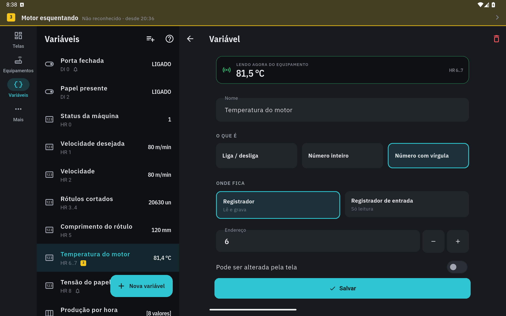
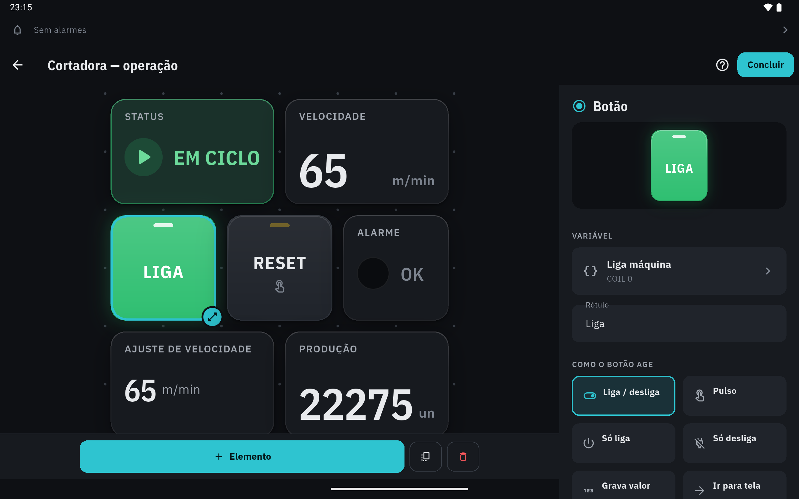

**Tablet deitado: a tela em escala.** Quando a célula passaria de 64 dp (a do celular em pé), a tela é desenhada na célula do celular e ampliada até 2× (`hmi_canvas.dart`): texto, ícone, respiro, borda e alvo de toque crescem juntos, e o rótulo fica proporcional ao cartão (STATUS ocupa 10,3% da altura do cartão, como no celular de 412 dp; antes 6,7%). Deitado, a altura decide a célula: 6 linhas à vista. O teto da célula passou de 96 para 128 dp, e o tablet em pé usa a largura inteira. No celular o zoom é 1 — nada muda.

### 6.14. Câmeras

REQUISITOS-ETAPA4 §9.2, CM-1 a CM-5: câmera IP ligada à máquina, aberta em tela cheia por um botão da tela de operação ou por Ferramentas → **Câmeras**. Peças: modelo em `lib/models/camera.dart`; sessão, player, cofre e foto em `lib/services/cameras/`; telas em `lib/screens/cameras/`; selo, senha e escolha do botão em `lib/widgets/cameras/`; o vídeo em `android/app/src/main/kotlin/com/celiware/ihm/CameraRtsp.kt`.

**Cadastro (CM-1).** À vista: nome, **máquina** (os equipamentos em chips; projeto de uma máquina só já vem com ela), **endereço do vídeo** (RTSP), usuário e senha. "Não sabe o endereço?": **Hikvision** ou **Intelbras / Dahua** pedem só o IP e preenchem vídeo, fluxo leve e foto. Endereço colado com usuário e senha dentro (`rtsp://admin:1234@…`, inclusive com `%40`) é separado na hora: usuário e senha vão para os campos e o endereço fica limpo. Quando o endereço segue um padrão conhecido — Hikvision `/Streaming/Channels/101` (e o `/main/` do firmware antigo), Intelbras/Dahua `subtype=0`, Tapo `/stream1` —, uma sugestão põe o **fluxo leve** com um toque. Em Mais opções: fluxo leve e endereço da foto; erro lá dentro abre a seção. "Descartar alterações?" como nos outros cadastros; apagar diz quantos botões ficam sem câmera e tira a senha do cofre. A lista agrupa por máquina e avisa "falta a senha neste aparelho" (projeto importado).

**Por que um modo do Botão e não um elemento próprio (CM-2).** Abrir a câmera é navegação, como o "Ir para tela": não grava, não lê variável e funciona em tela só de acompanhamento. A tela de operação não toca vídeo embutido (vídeo na grade gastaria rede e bateria o tempo todo), então um elemento próprio seria só um botão com outro nome na paleta — e mexeria em enum, catálogo, renderizador e paleta. O Botão já traz tamanho, cor, rótulo e o caminho sem variável; a mudança ficou no modo `camera` com `cameraId` (`control_elements.dart`) e numa seção da configuração (`CameraPick`). Versão antiga do app lê o modo desconhecido como liga/desliga sem variável: aparece "escolha a variável" e nada é gravado. Câmera apagada vira "CÂMERA APAGADA" no botão, e o toque avisa em vez de abrir uma tela vazia.

**Tela cheia (CM-2, CM-3).** Fundo preto, barras do Android escondidas (voltam com um gesto), o vídeo na proporção dele e, no alto, o nome e o selo. Sem imagem, o centro mostra o estado em letra grande, o motivo e o único botão que resolve. Menu: alta qualidade (fluxo principal) ou fluxo leve, usuário e senha, editar. Com endereço de foto, o botão de foto. A sessão (`CameraSession`) traduz o player:

| Situação | Na tela |
|---|---|
| Abrindo | "Conectando…". |
| Imagem andando | "Ao vivo · atraso ~0,3 s". |
| Câmera desligada, IP ou porta errados | "Sem sinal" com o motivo — recusou a conexão (IP e porta 554), não respondeu, endereço que a câmera não conhece, celular em outra rede ("o celular está em 192.168.0.x e a câmera em 192.168.1.64", pelo `LocalNetwork` de §4.14) — e a mesma espera crescente dos equipamentos (1, 2, 4, 8, 10 s), com a contagem no selo e **Tentar agora**. A nova tentativa continua "Sem sinal · tentando…" até a imagem voltar; volta sozinha. |
| Câmera ligada sem imagem | O RTSP do player dá fim de entrada em 4 s sem pacote; a sessão também vigia imagem parada (5 s) e o primeiro quadro (15 s). Vira "Sem sinal" e tenta de novo. |
| Senha errada (RTSP 401) | "Senha recusada", **sem** tentar de novo sozinha — muita câmera bloqueia o usuário depois de algumas tentativas erradas — e **Digitar a senha**. |
| Senha que não está no aparelho (projeto importado) | "Falta a senha": o diálogo abre sozinho, antes de qualquer conexão. |
| App em segundo plano, tela fechada | O player é **descartado**: nada fica recebendo nem decodificando. Na volta ao app, abre de novo. |

**Latência (CM-3).** O selo mostra o atraso que o aparelho põe: vídeo já recebido e ainda não mostrado (posição carregada − posição na tela), em média móvel, de 0,1 em 0,1 s. É o piso do atraso: não conta a câmera codificando, a rede nem a tela. Medida ponta a ponta no emulador (AVD Pixel 7, Android 36) com a câmera falsa, que grava o relógio do PC com milissegundos na imagem: captura feita pelo próprio emulador (`screenrecord screenshot` no console, que responde em 1–2 ms) × hora do PC no envio do comando. Com a GPU do PC e o decodificador do emulador: 0,95 · 0,90 · 0,89 · 1,05 · 0,94 · 0,93 s (média 0,94 s), selo em ~0,3 s; com GPU e decodificador por software, 1,16–1,19 s, selo em ~0,6 s. A diferença entre o selo e o total é o caminho do emulador (rede NAT, decodificador, composição). Falta medir num aparelho com câmera de verdade.

**O player: ExoPlayer num canal próprio.** Os dois caminhos usam o mesmo ExoPlayer (Media3 1.9.2); o tamanho foi medido no APK arm64 release, sobre o mesmo `main`:

| | `video_player` 2.14.1 | Canal próprio (`CameraRtsp.kt`) |
|---|---|---|
| RTSP no Android | sim | sim |
| Começar a tocar | depois de 2,5 s de vídeo guardado (buffer padrão do ExoPlayer; o plugin só deixa mudar o "back buffer") → atraso mínimo de 2,5 s | com 250 ms; passou de 0,7 s guardado, acelera 25% até ~0,35 s; passou de 3 s, pula para perto do fim |
| Fluxo ao vivo | duração 0: a posição fica presa em 0 e `isCompleted` liga ao abrir (no emulador, o vídeo "terminava" e reabria a cada 3–4 s) | posição e carregado a cada 500 ms (o atraso do selo) |
| Erro | só "Source error": não distingue senha recusada de câmera desligada | o código do erro e a causa ("DESCRIBE 401", "ECONNREFUSED", "timeout") |
| Módulos | Media3 + HLS + DASH + SmoothStreaming + RTSP | Media3 + RTSP |
| APK, com o cofre da senha | +675.704 B (0,64 MB): `classes.dex` +662 KB, sem contar o Dart das câmeras | +543.828 B (0,52 MB): `classes.dex` +338 KB e o Dart das câmeras +192 KB |
| Licença | BSD-3 (Media3 Apache-2.0) | Apache-2.0 (Media3) |

Base: 22.403.498 bytes; com as câmeras: 22.947.326 bytes. `media_kit`/libmpv (+~6 MB por ABI, LGPL) e `fvp` (libmdk fechada, ~10 MB) não se justificaram: o ExoPlayer configurado fica abaixo de 1 s. Fora do Android o canal não existe e o player vira "este celular não consegue mostrar o vídeo", sem travar (a versão Windows pediria o `fvp`, como na pesquisa).

Detalhes do canal `celiware/camera`: `abrir` cria uma textura (`SurfaceProducer`) e o ExoPlayer com `RtspMediaSource` (4 s sem pacote = fim, em vez de 8: tenta TCP mais cedo e percebe a câmera parada); `fechar` solta player e textura; o nativo manda `estado` (fase, erro, posição, carregado, largura, altura). Ao saber o tamanho do vídeo, a textura recebe `setSize` e o player a superfície nova. O RTSP tenta UDP e cai para TCP. Câmera sem som: volume zero, para não tirar a música nem a voz dos alarmes do fone.

**Senha (CM-5).** O projeto guarda só `secretRef`; a senha vai para o cofre (`CameraVault`: `flutter_secure_storage` 11.2.0, AES-GCM com a chave no Android Keystore, chave `camera-senha:<ref>`). O arquivo exportado é o mesmo JSON: sem senha. **Importar** troca toda `secretRef` por uma nova (`withFreshCameraSecrets`), então a senha é pedida de novo — em outro aparelho e também no mesmo (a chave antiga podia existir aqui e daria a senha de outra câmera). Apagar um projeto (ou substituir a planta) apaga do cofre as senhas das câmeras dele; duplicar copia a senha para a chave nova da cópia. O cofre fica fora do backup do Android (`backup_rules.xml`, `data_extraction_rules.xml`): restaurado sem a chave do Keystore, não abriria. Para o player, a senha vai dentro da URL (`rtsp://usuário:senha@…`, com `@ : / #` codificados); o ExoPlayer responde ao Basic e ao Digest da câmera. A URL com senha não aparece na tela nem em log.

**Foto (CM-4).** Com o endereço HTTP da câmera (Hikvision `/ISAPI/Streaming/channels/101/picture`, Intelbras/Dahua `/cgi-bin/snapshot.cgi`), o botão de foto busca um JPEG na hora (`CameraSnapshot`: `HttpClient` do Dart com Basic e Digest, uma tentativa só com a senha, 6 s de tempo-limite, até 12 MB, e confere pelos primeiros bytes que é JPEG ou PNG — câmera às vezes devolve a página de login com 200). A folha mostra a foto com a data e a hora e **Enviar** (`share_plus`). Antes da foto e do vídeo, `LocalNetwork.prepare` (§4.14).

**Fora desta entrega.** *Descoberta ONVIF:* é WS-Discovery por multicast UDP, que a rede do emulador (NAT) não deixa passar, e no Android pede `MulticastLock`; sem câmera não dá para testar ponta a ponta, e uma busca que falha calada é pior que digitar o IP — os modelos por marca cobrem o caso comum. Também: gravação, vídeo embutido na grade, Windows, opção "forçar TCP" (hoje: UDP e, sem pacote em 4 s, TCP) e H.265 (depende do decodificador do aparelho).

**Achado: H.264 com várias fatias por quadro.** Pelo RTSP do Media3 1.9.2, um fluxo com cada quadro cortado em fatias (o `-tune zerolatency` do x264 faz uma por núcleo; `--fatias 4` na câmera falsa) aparece cinza com o decodificador do emulador e só com a faixa de baixo com o decodificador por software; o mesmo fluxo abre limpo no ffmpeg. Com uma fatia por quadro — o padrão da câmera falsa —, normal. Conferir na primeira câmera de verdade.

**Testar sem câmera** (`tool/camera/camera_falsa.dart`). O ffmpeg sozinho não serve RTSP a um player (o `-rtsp_flags listen` é só de entrada). A câmera falsa usa o ffmpeg para gerar barras de teste com o relógio do PC com milissegundos e manda o RTP para um servidor RTSP mínimo em Dart: OPTIONS, DESCRIBE (com SPS/PPS no SDP, que o ExoPlayer exige), SETUP (461 ao UDP, e o player passa para TCP), PLAY (começa no quadro-chave, com o `RTP-Info` dele), GET_PARAMETER e TEARDOWN, com o vídeo intercalado na conexão TCP. `--usuario`/`--senha` pedem Basic do DESCRIBE em diante; `--http` serve a foto; o PID do ffmpeg sai na partida, para simular "câmera ligada sem imagem". No emulador o PC é `10.0.2.2`; não use a porta 8554, que é o gRPC do emulador.

```
dart run tool/camera/camera_falsa.dart --porta 18554 --http 18080 [--usuario admin --senha 1234] [--fatias 4]
rtsp://10.0.2.2:18554/live    http://10.0.2.2:18080/foto.jpg
```

Conferido no emulador com ela: abrir e ver a imagem, latência, derrubar a câmera (sem sinal) e religar (volta sozinha), encoder parado, senha faltando, errada (uma tentativa, "Senha recusada") e certa pelo diálogo, foto com senha, segundo plano soltando o player e reabrindo.

### 6.15. Atualização pela Play

Reunião de 19–20/10/2026 (D2): no futuro a versão antiga poderá ser obrigada a atualizar. A 1.4.0 não tem como saber que existe versão nova; a partir desta, o app usa a API oficial **Play In-App Updates** (pacote `in_app_update` 5.0.0, que traz `com.google.android.play:app-update` 2.1.0).

- Ao abrir (depois do primeiro quadro) e ao voltar para o app (no máximo a cada 6 h), `UpdateChecker` pergunta à Play (`PlayUpdateGateway`).
- **Flexível** (o normal): a Play baixa em segundo plano; terminado, um aviso embaixo oferece **Reiniciar**. Nunca reinicia sozinho no meio da operação.
- **Imediata**: quando a versão publicada tem `inAppUpdatePriority` ≥ 4 (definida no envio, `PUBLICACAO.md` §12), a Play mostra a tela cheia de atualização. Se a pessoa cancelar, não pede de novo por 24 h (marca em `shared_preferences`, vale entre aberturas); com prioridade 5 pede a cada volta ao app. "Em andamento" (`developerTriggeredUpdateInProgress`) sozinho não vira imediata.
- **Já baixada**: o `installStatus` da Play vai junto (`UpdateInstall`); flexível baixada numa abertura anterior oferece **Reiniciar** em vez de baixar de novo, e baixando espera terminar.
- **Sem internet, instalado fora da Play, em depuração, qualquer erro ou 10 s sem resposta: nada acontece** e o app segue operando — é IHM de máquina e funciona offline (NR-12: a falta de rede não pode impedir de operar).

A decisão (`UpdatePolicy.decide`) é uma função pura em `lib/services/update/update_check.dart`, testada sem a Play; a chamada nativa fica em `play_update_gateway.dart`. Nos testes de widget o app é montado sem verificador. A biblioteca não acrescenta permissão ao manifesto (conferido no manifesto final: só a atividade `PlayCoreDialogWrapperActivity`). Só dá para ver funcionando com a app instalada pela Play e uma versão mais nova publicada (teste interno).

## 7. Tutoriais dentro do app

Método do onboarding da Retífica (`sinapse/07-FONTES/onboarding-dentro-do-sistema.md`), portado para Flutter em `lib/widgets/tour/tour.dart`, com os textos centralizados em `lib/screens/tours.dart`.

| Regra da Retífica | Como ficou aqui |
|---|---|
| Realce sem biblioteca | Camada escura com recorte (Path evenOdd) no retângulo do alvo + contorno verde-água (o destaque do app). |
| Passo essencial não depende de dado na tela | `essential: true` aparece centralizado sem alvo; não essencial sem alvo é pulado. |
| Overlay não pode sobreviver e travar o app | O tour vive dentro da página (`TourHost`) e morre com ela; nenhuma camada global. |
| Rearme por versão na chave | `tour:v{versão}:{id}` no `shared_preferences`; subir a versão reapresenta a trilha. |
| Ajuda sempre no topo | "?" no topo de toda página; a barra inferior tem só as 5 áreas (Projetos, Equipamentos, Variáveis, Ferramentas, Alarmes). |
| Testes dispensam o tour | Os testes de widget marcam as trilhas como vistas antes de montar o app. |

Trilhas: primeiros passos, operar uma tela, montar uma tela, cadastrar equipamento, criar variável. Com a etapa 4: "O caminho" lembra que receitas, registros e regras ficam em Ferramentas (versão 2 da trilha, com o passo "Projetos" na seta do topo); o passo do editor se chama "Regras da tela" (como o botão — "Regras" sozinho é o de Mais) e cita a grade fina; e a trilha de variável (versão 2) ganhou um passo para o **Σ** e o **Criar várias** do topo. As três do caminho principal (primeiros passos, operar, montar) aparecem sozinhas na primeira visita; equipamento e variável só pelo "?" ou por Mais → Tutoriais — no QA, com as cinco automáticas, o primeiro minuto do app era uma fila de tutoriais. O realce nunca passa da borda da tela (o "?" no canto tinha o contorno cortado). O balão se posiciona onde cabe (abaixo, acima, ao lado de um alvo alto e estreito como o trilho do tablet, ou sobre o rodapé) e nunca sob a barra de status; o passo de lista realça o primeiro item, não a lista inteira.

Câmeras, Ferramentas, Alarmes, Ajustes e a lista de projetos também têm o "?": todas as páginas principais explicam a si mesmas. Os textos de "Primeiros passos", "Montar uma tela" e "Cadastrar um equipamento" citam os modelos de tela, o OEE e a procura na rede.

## 8. Identidade visual

"Pegada industrial", seguindo a ISA-101 (IHM de alto desempenho) e a pesquisa de 27/09/2026 (`docs/PESQUISA-UI-UX.md`): **fundo neutro, cor só quando comunica estado ou interação**. O que tem cor é o que merece o olhar do operador.

**Dois temas, os mesmos nomes de cor** (`IndPalette.escuro` e `IndPalette.claro` em `lib/core/theme/app_theme.dart`). O código pede "cartão", "texto secundário", "alarme" — nunca um hex — e cada tema decide o tom. Em Mais → Aparência: **Auto** (segue o claro/escuro do celular; padrão), **Claro** ou **Escuro**, guardado por aparelho (o tablet preso na máquina quer luz fixa). Claro lê melhor de dia e no sol (NN/g, FAA HFDS §5.3.8); escuro serve para noite e sala fechada. A troca redesenha a árvore inteira no lugar — a pessoa continua na mesma tela; pintores de gráfico comparam `Ind.revision`.

| Token | Escuro | Claro | Uso |
|---|---|---|---|
| `well` | #0A0C0F | #DADDE2 | Face rebaixada do instrumento: arco do medidor, trilho da barra, poço da lâmpada, fundo do gráfico. |
| `bg` | #0E1014 | #E4E6EA | Fundo da tela. |
| `surface` | #171A1F | #F7F8FA | Cartão. |
| `surfaceHigh` / `surfaceHigher` | #20242B / #2A2F37 | #EBEDF0 / #DDE0E5 | Controle sobre o cartão / pressionado. |
| `raised` | #1C2026 | #FFFFFF | Folha, diálogo. |
| `accent` | #2EC4D0 | #00808C | **Interação**: ação principal, seleção, foco, tutorial. Verde-água — o âmbar antigo colidia com amarelo/laranja de alarme. |
| `ok` · `alarm` · `warn` · `info` | #2FBF71 · #F2555A · #F5C518 · #4C9EFF | #1F9D57 · #D9363C · #F2B705 · #2F7FE0 | Estado. Cada um tem **versão de texto** (`Ind.textFor`): amarelo de preencher não se lê como texto no claro. |
| `series` | #78A9FF · #A56EFF · #FF7EB6 | #2F6FE0 · #8A4FE0 · #D9468C | Curvas e barras de gráfico — nunca cor de estado (curva verde parecia "ok"). |

**Relevo sem enfeite.** No escuro, profundidade vem de luminosidade em camadas, não de sombra (Material dark, Linear, Grafana). Todo cartão tem borda de 1 px quase invisível, sombra em duas camadas e **brilho de 1 px no topo** que some até 40% da altura (`CardEdge`) — "luz vindo de cima". Nada de vidro/desfoque (custa 7–47 ms por quadro no Android), degradê de fundo ou 3D.

**Elementos.** Lâmpada é LED num poço: apagada = poço vazio; acesa = núcleo com reflexo de lente e halo. Estilo **alto desempenho** (padrão): ligado = brilho + palavra, cor só no anormal (vermelho/amarelo continuam coloridos); estilo **painel clássico** (IEC 60073): acende na cor escolhida. Botão é tátil: degradê leve, faixa de LED no alto (apagada na cor a 35%, acesa quando ligado), afunda 1,5 px ao tocar, texto legível sobre qualquer cor. Medidor: arco rebaixado, régua de marcas, faixas de atenção/alarme **por fora** do arco, preenchimento neutro que só ganha cor dentro de uma faixa. Barra: trilho rebaixado, régua e **ponteiro** na ponta (a ISA-101 prefere ponteiro a barra). Indicador de estado: ícone por cor (marcha, alarme, atenção, informação, parado) + tinta de 14% no cartão. Tendência: área em degradê sob a 1ª curva e ponto no valor atual. Gráfico de barras: hora em curso cheia, anteriores esmaecidas.

Espaçamento por tokens (`Ind.space` 16, `Ind.spaceLarge` 28, `Ind.page` 20 de margem), cantos de 16 px (peça interna 10, concêntrica). A borda de estado aparece só quando comunica algo (cor de interação = falta configurar, vermelho = erro).

Tipografia IBM Plex (licença OFL): Sans para texto e rótulos (caixa alta com espaçamento), Sans Condensed SemiBold com **dígitos tabulares** para números (não "dançam" quando o valor muda e cabem mais dígitos que na mono), Condensed para títulos e textos lidos do equipamento, Mono só em eixos. Com a fonte do sistema grande (130%), a barra de abas segura a escala em 115%; o resto do app acompanha. Com cinco áreas, cada uma tem 64 dp num celular de 320 dp, e "Equipamentos" na Plex normal a 12 sp ocupa 83 dp: os rótulos da barra e do trilho usam a Plex Condensed e encolhem o necessário (de 12 até 9 sp) para a palavra caber inteira, sem quebrar nem "…" (`ShellState._labelStyle`; medido em `test/widgets/projects_test.dart` com a letra de verdade).

**Desempenho medido** (emulador Pixel 7, SurfaceFlinger): rolagem a 60 quadros/s sem quadro lento; partida a frio 1,1–2 s; 72 MB de memória. Tela parada desenha só quando um valor muda: a barra anima apenas em mudança de mais de 3%, a lâmpada troca na hora e cada elemento tem a própria camada (`RepaintBoundary`) — a operação com a máquina em ciclo caiu de 38 para 12 quadros/s. A cor de estado é salva no projeto pelo nome, então o tom pode ser ajustado sem quebrar arquivos.

**Grade densa (GR-9).** *Só o que mudou redesenha:* a varredura publica uma leitura nova a cada ciclo, mesmo com o valor igual (carimbo de hora novo), e o `TagBuilder` reconstruía o elemento a cada uma. Agora ele compara o que aparece — valor, qualidade e motivo — e ignora o resto; motor de alarmes e registro continuam ouvindo o runtime direto e recebem toda leitura (o atraso de 1 s do alarme e o "leitura parada" do registro dependem disso). Na tela de teste de 48 elementos com varredura de 500 ms (`test/widgets/grid_performance_test.dart`), contado com os ganchos de reconstrução e de pintura do Flutter: equipamento parado → **0** reconstruções por varredura (eram 58, uma por leitura à vista); três valores mudam → 3 reconstruções e só esses 3 elementos repintam; rolar a tela por ~1 s → nenhum elemento repinta (as camadas só se movem); tudo muda → 58 e 48 (contraprova). *Quadros por segundo:* `tool/bench/gr9_rolagem.dart` roda a mesma tela em modo profile, rolando sem parar, e anota o `FrameTiming` de cada quadro (com uma fase de referência na tela de operação da demonstração). Medido num AVD Pixel 7 próprio (Android 36, Impeller sobre OpenGLES traduzido para a GPU do PC): na rodada com o PC folgado, 22,5 quadros/s com a máquina em ciclo e 24,3 com todas as leituras mudando; montagem na thread da interface com mediana de 1,6–2,0 ms e desenho com mediana de 28–33 ms. As rodadas seguintes, com o PC a 91–100% de CPU (outros emuladores abertos), foram descartadas — até a referência caiu para 27–30 quadros/s. **O GR-9 ainda não está comprovado:** a interface sobra; o tempo vai no desenho, que no emulador passa por tradução de OpenGL. Falta medir num aparelho de verdade (Pixel 7 e um de entrada) com o mesmo medidor. Se o aparelho confirmar, o primeiro suspeito é o acabamento dos cartões — sombra em duas camadas e brilho do topo — multiplicado pelos ~25 cartões que a grade fina põe à vista de uma vez.

**Ícone.** Medidor em arco no verde-água do destaque (#2EC4D0, `Ind.accent` do tema escuro), ponteiro e lâmpada verde sobre grafite — o âmbar da marca antiga saiu em 12/10/2026, junto do resto do app desde a 1.2.0. `tool/gerar_icone.py` lê a cor de `app_theme.dart` e confere o contraste antes de gravar (8,0:1 sobre o grafite, 9,9:1 sobre preto); gera os mipmaps, o adaptativo, `store/icone-512.png` e os ícones do site. No Android 12+ a abertura usa o ícone adaptativo sobre o fundo do app (`values-v31` e `values-night-v31`: #E4E6EA no claro, #0E1014 no escuro).

**Rótulos sem jargão.** Em "Mais opções", o rótulo fala a língua do chão de fábrica e o termo do manual vem entre parênteses ou na dica: "Número na rede (ID do escravo)", "Bastidor (rack)" e "Posição da CPU", "Caminho (endpoint)", "Tópico de queda (LWT)", "Sinal de vida (s)" (keep-alive), "Nome no broker (client ID)", "Endereço (NodeId)", "Conferência da mensagem (checksum)". As chaves salvas no projeto não mudaram.

**Componentes de interface únicos (`lib/widgets/common/common.dart`).** Cada padrão visual repetido tem um componente só, e as telas não montam a sua versão. `SectionHeader` é o único cabeçalho de seção (caixa alta condensada); o respiro vem por `padding`, a letra nunca muda. `StepButton` é o único botão − / + (e das setas de mover): quadrado com fundo, desabilitado no limite. `StepperField` (campo numérico, com o rótulo que encolhe para caber em vez de cortar) e `StepperCounter` (rótulo, valor, − e +) usam esse botão e deixam o − e o + na mesma coluna. `DecisionDialog` é a pergunta com até três saídas no padrão Material 3: em linha à direita quando cabe, senão empilhada com a largura toda, principal em cima, destrutiva em vermelho. `confirmDiscard`/`LeaveChoice` é o "Descartar alterações?" de todo cadastro (variável, calculada, câmera, regra, equipamento). `AdaptiveTitle` é o título da barra de cima que encolhe ou vai para duas linhas antes de cortar (tela, editor e as páginas de nome longo). `TextFit` mede texto com a letra real (com cache) para escolher o arranjo antes de recorrer a "…". O `HmiFrame` usa essa medida no rótulo dos elementos: ao lado se cabe e o corpo continua legível (`minBodyWidth`), em cima se não cabe, encolhido só na grade fina.

Nos elementos, cor é só para estado: barra e medidor têm preenchimento neutro e faixas `warn`/`alarm` (a barra azul antiga passa a neutra). A régua dos gráficos (`TrendScale.range`) respeita os limites de alarme e as casas decimais da variável (série parada em 0 vai de 0 a 10, não de 0 a 1). O gráfico de barras rotula com a hora real (`axis: hour`, a última barra é a hora atual) ou por posição (`axis: index`). Todo texto do tema declara a família Plex — botão preenchido, chips, subtítulo de lista, barra de baixo e trilho do tablet saíam na letra do sistema.

## 9. Padrões de projeto

| Padrão | Onde |
|---|---|
| Template method | `ModbusClient` implementa as funções; cada transporte só implementa `transact`. |
| Strategy | Transporte TCP real × simulado, escolhido por tipo de equipamento. |
| Observer | `ValueNotifier` por variável no `TagStore`; `TagBuilder` redesenha só o elemento afetado. |
| Injeção de dependência | `AppScope` (InheritedNotifier) entrega controlador e runtime. |
| Objeto imutável + copyWith | Device, Tag, HmiScreen, HmiElement, Project. |
| Contagem de referência | Inscrições por variável decidem o que é varrido. |
| Função pura | `ModbusPdu`, `ScanPlanner`, `TagCodec` — testáveis sem rede. |
| Catálogo único | `ElementCatalog` é o único lugar que interpreta `HmiElement.props`. |
| Gravação atômica | `ProjectRepository.save`. |

## 10. Manutenção e extensão

### 10.1. Acrescentar um tipo de elemento

1. Valor novo em `ElementType` (`lib/models/hmi_screen.dart`).
2. Ficha em `ElementCatalog.all` e propriedades iniciais em `defaultProps` (`lib/widgets/hmi/element_catalog.dart`); documente as chaves na tabela do catálogo.
3. Renderizador em `lib/widgets/hmi/elements/`, usando `HmiFrame` + `TagBuilder` (a moldura já trata os estados de problema) e `WriteActions` se gravar.
4. Caso novo no `switch` de `HmiElementView` e campos na `ElementConfigSheet` (configuração grande vai num arquivo próprio, como `table_config.dart`).
5. Valor novo sempre **no fim** do enum. Elemento que inscreve as próprias variáveis (como a tabela, que só lê as linhas à vista) sai de `HmiScreen.liveTagIds`; `tagIds` continua com todas (faixa de equipamentos, "usada em").

### 10.2. Acrescentar um perfil de fabricante

O protocolo não muda; muda onde cada área começa. O perfil mora só em `lib/models/vendor_profiles.dart`; o resto do app continua recebendo `Tag` com área + endereço Modbus.

1. Uma constante `VendorProfile` em `VendorProfiles`, com `id` estável — ele vai para o arquivo do projeto (`Device.profile`), nunca renomeie —, marca, família, origem (`official` · `thirdParty` · `benchValidated`), fonte, observações de conexão e a ordem de 32 bits mais comum da marca.
2. Uma `AreaRule` por área do manual: prefixo, área Modbus, trechos `Segment(primeira, última, endereço inicial)` com a numeração já decodificada (X377 em octal = 255), base (`octal` em X/Y), `wordsPerItem` e `forcedType` (contador de 32 bits), `readOnly` (entrada física exposta como coil), rótulo e `variant` quando a letra se repete (T contato × T valor). A ordem da lista é a dos chips em "Criar várias" e decide a letra repetida quando ninguém disse o tipo.
3. Inversor: `kind: ProfileKind.drive`, uma `ParameterRule` (estilo de numeração) e os `TagTemplate` dos modelos prontos.
4. Acrescente ao `VendorProfiles.all` — o cadastro de equipamento e o "Criar várias" passam a oferecer sozinhos.
5. Teste em `test/models/vendor_profiles_test.dart`: uma linha por linha da tabela do manual, os dois extremos de cada trecho, com os números **escritos à mão** a partir do manual (derivar do perfil só repetiria o código). O teste de sobreposição pega trecho que invade outra área; o de octal vale para toda família com X/Y.
6. Tabela de terceiros fica "não validado em bancada" até conferir num CLP de verdade; depois, `origin: ProfileOrigin.benchValidated`.

Corrigir uma tabela não muda sozinho o endereço das variáveis já criadas (ele é gravado na variável); `VendorProfiles.remap` recalcula a partir de `Tag.memory`. O cadastro de equipamento já oferece isso ao trocar a marca.

### 10.3. Acrescentar outro protocolo

Desde a etapa 4 o motor é dividido em dois. A `DeviceSession` é dona do laço, da espera crescente depois de uma queda e da saúde da conexão — vale para todo protocolo. O que é de protocolo mora num **driver** (`lib/services/runtime/drivers/`), atrás do contrato `DeviceDriver`: `connect`, `scan` (lê as variáveis em uso e publica no `TagStore`), `readOnce`, `write`, `ping` e `tagsChanged`. Falha de comunicação sai como `CommError` (`lib/core/comm/`), que a sessão trata igual para todos: "sem comunicação" com o último valor esmaecido. Falha de uma variável só (endereço inexistente, pedido fora do limite) o driver resolve publicando a qualidade daquela variável.

`ModbusDriver` é o primeiro: agrupamento (`ScanPlanner`), isolamento do endereço errado, codec e escrita. Para Modbus sobre outro meio (RTU por serial ou gateway) basta outro transporte com a interface de `ModbusClient`. Protocolo diferente (OPC UA) é um driver novo, escolhido em `DeviceDriver.forDevice` pelo tipo do equipamento. `MqttDriver` (4.18) é o segundo e o modelo para os de assinatura: `scan` reconcilia assinaturas e os valores chegam sozinhos; `reportsScanTime` falso tira o tempo de varredura do selo. `S7Driver` (4.16) é o modelo para outro protocolo de varredura: planejador e codec ao lado do driver (`s7_tag_codec.dart`), o endereço da variável num objeto opcional da `Tag` (`Tag.s7`, como `Tag.mqtt`), a configuração num da `Device` (`Device.s7`), e os campos dos cadastros em arquivos próprios (`s7_device_fields.dart`, `s7_tag_fields.dart`) com ganchos pequenos nos formulários (`if (s7) … else if (mqtt) … else`). `OpcUaDriver` (4.19) é o terceiro de varredura e o mais simples: o servidor responde nó a nó, então não há planejador nem isolamento — um Read com os nós em uso —, e o tipo para gravar vem do servidor, não da variável. `RawDriver` (4.17) também é de assinatura: o `scan` só confere validades, e o socket é dividido pelo `RawLinkPool` com as ferramentas do cadastro. Variável de um protocolo num equipamento de outro (tópico MQTT, endereço S7 ou campo cru num Modbus; endereço Modbus num cru) vira erro de configuração daquela variável — nunca uma leitura do HR 0 no lugar dela. O cabo USB (§4.20) não é protocolo novo: é outro cano (`SerialLink`) para dois que já existiam, e o `forDevice` escolhe `ModbusDriver` ou `RawDriver` pelo `SerialConfig.protocol`; um meio novo (COM no Windows) seria outra `UsbSerialPlatform` ou outro `SerialLink`, sem mexer em driver. O `CalcDriver` (§6.12) é o driver sem rede: lê o `TagStore` e publica o resultado das contas, e o `HmiRuntime` o entrega à sessão do equipamento virtual pelo `driverFactory`. `test/runtime/device_driver_test.dart` mostra o contrato com um driver de mentira. Plano completo dos protocolos: `docs/REQUISITOS-ETAPA4.md` §8.

### 10.4. Mudar o formato do arquivo

Mudança compatível (campo novo com valor padrão): só o `fromJson`. Mudança incompatível: subir `Project.schemaVersion` e migrar o formato antigo em `ProjectRepository.decode` antes do `fromJson`.

A planta (§5.4.1) é o exemplo: o arquivo da planta subiu para `schemaVersion` 2 (`Plant.schemaVersion`), e `ProjectRepository.decodeFile`/`decodePlant` migram o projeto avulso (1) para uma planta com um projeto. O projeto avulso continua em 1 de propósito, para a versão anterior abrir o que a nova manda.

### 10.5. Mudar um tutorial

Textos em `lib/screens/tours.dart`. Mudou a trilha de verdade: suba o `version` dela — reaparece para todos. Todo passo responde "e se a tela estiver vazia?".

### 10.6. Rodar e testar

```
flutter pub get
flutter run                 app no emulador/celular (abre com a demonstração)
flutter test                testes (protocolo, TCP real, codec, runtime, telas)
flutter analyze             análise estática (deve dar "No issues found")
python tool/gerar_icone.py  regera os ícones
node tool/gerar_docx.js     regera este documento em Word
```

## 11. Código crítico explicado

### 11.1. Um pedido por vez (`ModbusClientTcp.transact`)

O ciclo inteiro — montar MBAP, enviar, esperar a resposta com o mesmo Transaction ID ou o tempo-limite — roda dentro de uma trava FIFO assíncrona. A recepção monta frames a partir do campo Length do MBAP; resposta de TID diferente do pendente é descartada (era de um pedido que já estourou o tempo).

### 11.2. Agrupamento (`ScanPlanner.plan`)

Por área, ordena as variáveis pelo endereço e vai estendendo o bloco enquanto a próxima variável começa até `maxGap` posições depois do fim atual e o bloco continua dentro do limite do protocolo. Variáveis isoladas (endereço suspeito) ganham bloco próprio.

### 11.3. Laço de varredura (`DeviceSession._loop`)

Cada `start()` ganha um número de geração; um laço antigo que ainda esteja no meio de uma leitura percebe que foi substituído e termina — sem isso, fechar e reabrir a tela rápido deixaria dois laços varrendo juntos. O laço dorme sem variável em uso e acorda na hora por `wake()` (escrita, variável nova).

### 11.4. 32 bits (`TagCodec._word32`)

Primeiro desfaz a troca de bytes de cada registrador (se a ordem troca bytes), depois a troca de palavras (se troca palavras), e monta `(w0 << 16) | w1`. A escrita faz o inverso, na ordem inversa. O float passa por `ByteData`.

### 11.5. Realce do tutorial (`_HolePainter`)

Pinta um retângulo escuro na tela inteira menos (`PathOperation.difference`) o retângulo arredondado do alvo, e contorna o buraco em âmbar. O alvo é medido com `localToGlobal` relativo ao `TourHost` depois do quadro, e o alvo fora da tela é trazido com `Scrollable.ensureVisible`.

## 12. Correções em relação à base anterior

| Problema na base (machine_monitor / InoRobot) | Correção |
|---|---|
| Falha de leitura devolvia lista vazia — endereço errado, rede fora e resposta corrompida eram iguais. | Exceções tipadas; cada caso tem visual e mensagem próprios. |
| `_applyEndianness` do InoRobot trocava registradores vizinhos de lugar em vez dos bytes. | Ordem de bytes por variável, no codec, com as 4 ordens testadas. |
| Flag global `isLittleEndian` trocava bytes de todo registrador. | Removida; registradores voltam crus (big-endian, como a norma). |
| Vários pedidos pendentes no mesmo socket. | Um pedido por vez + agrupamento de leituras. |
| Leituras contínuas FC02/FC04 removidas no machine_monitor. | FC01–FC04 disponíveis. |
| Singleton por equipamento (InoRobot). | Uma sessão por equipamento, criada sob demanda. |
| Permissão INTERNET só no manifesto de debug — o app de loja não conectaria. | Permissão no manifesto principal. |
| `applicationId` `com.example.*` (recusado pela Play Store). | `com.celiware.ihm`. |
| Release assinado com chave de debug. | Assinatura por `key.properties` fora do git; o `.aab` da loja não sai sem ela; debug só no APK de teste. |
| Mapas de memória fixos no código (monitor, TEX). | Variáveis e telas configuradas pelo usuário, salvas em arquivo. |

## 13. Testes

| Arquivo | O que cobre |
|---|---|
| `test/core/modbus_pdu_test.dart` | Montagem de pedidos, limites, respostas de exceção, lógica do escravo. |
| `test/core/modbus_client_tcp_test.dart` | Cliente TCP real × escravo Dart por socket: leitura/escrita, endereço inexistente, 50 pedidos paralelos, timeout, queda e reconexão, desconexão manual, IP morto, porta fechada = "recusou nesta porta". |
| `test/runtime/tag_codec_test.dart` | 4 ordens de 32 bits, float, sinal, bit em registrador, listas, faixa, vírgula brasileira, formatação; escala ida e volta (÷ 10, deslocamento 4–20 mA, lista), passo e faixa na unidade da tela, casas implícitas, JSON; texto ASCII (zero final, bytes trocados, caractere inválido, só leitura). |
| `test/core/local_network_test.dart` | Faixa de IP, rede privada, diagnóstico do teste de conexão ("redes diferentes", "sem Wi-Fi"), rótulo da rede e leitura do mapa vindo do Android. |
| `test/core/modbus_serial_test.dart` | CRC16 e LRC com vetores conhecidos, fim de quadro pelo código da função; RTU e ASCII sobre TCP por socket real: leitura e escrita, endereço inexistente, adaptador com eco, CRC corrompido, ID errado = sem resposta, porta fechada = recusou. |
| `test/core/s7_test.dart` | Siemens S7. Endereços (alemão/inglês, `%`, `P#`, erros) e codecs. Vetores de referência: COTP CR, Setup Communication, Read/Write Var. Por socket real contra o `S7TestServer`: vários itens num pedido, divisão por itens e por PDU, item maior que a PDU, bit com transporte BIT, REAL/STRING, item com erro sem derrubar os outros, PUT/GET desligado, tempo esgotado, resposta atrasada descartada, pedidos em paralelo, resposta picada (TCP e COTP), queda e reconexão, porta fechada, rack/slot errados. |
| `test/core/rawlink_test.dart` | Protocolo cru: os quatro tipos de delimitação, mensagem partida e grudada, lixo, buffer cheio, ressincronização do binário; checksum com vetores conhecidos (CRC16, NMEA), certo/errado, BCC depois do ETX; campos chave=valor, CSV, regex e binário nas quatro ordens; comandos de texto e binários; JSON do perfil ida e volta; cliente contra o Arduino falso por TCP e UDP (streaming, polling, comando, silêncio, queda, porta fechada). |
| `test/runtime/s7_device_test.dart` | CLP S7 pelo caminho de produção contra o `S7TestServer`: testar conexão, ler na varredura num pedido só (DB juntado, M, I), gravar bit sem mexer nos vizinhos e palavra, entrada só leitura, faixa na unidade da tela; erro por item isolando só a errada (DB inexistente, fora do DB, acesso negado) e voltando ao corrigir; PUT/GET desligado no teste e na varredura, voltando sozinho; família errada, certa e "Outro"; porta recusada; queda e reconexão; "lendo agora" soltando a conexão; tipo que não cabe e variável de outro protocolo; tipo sugerido, mensagens com o endereço certo, lista, byte e escala, item juntado; arquivo ida e volta e projeto antigo idêntico. |
| `test/widgets/s7_forms_test.dart` | Cadastro com S7: protocolo em Mais opções troca porta e campos, família do CLP e "Outro" com rack e slot, volta ao Modbus; testar conexão com PUT/GET desligado mostrando o passo a passo do TIA e depois respondendo; variável com o endereço do TIA no lugar do Modbus (sem hexadecimal e ordem de bytes), erro curto, tipo pelo tamanho, entrada só leitura, prova da leitura e "lendo agora" contra o CLP de teste; prova e sugestão de tipo como funções puras. |
| `test/core/opcua_test.dart` | OPC UA. Codec contra vetores do asyncua 2.1.0 (Hello, NodeId nas seis formas, Variant, DataValue, Read/Write/Browse byte a byte, respostas lidas), pedaços de MSG, mensagem cortada; NodeId em texto e erros; SHA-1 (FIPS 180), chave do X.509, senha cifrada conferida contra a Python. Por socket real contra o `OpcUaTestServer`: anônimo lendo vários nós, gravando e navegando; usuário certo e errado; senha cifrada; só endpoint seguro; caminho errado; respostas em pedaços e continuação; limite de nós do servidor; renovação do canal; sessão esquecida reaberta; tempo esgotado e resposta atrasada; queda e reconexão; desconexão pedida; porta fechada. |
| `test/runtime/opcua_device_test.dart` | Servidor OPC UA pelo caminho de produção: testar, ler num Read só (nó repetido vai uma vez), gravar no tipo do nó (UInt16, Boolean, Float), escala, faixa e passo; nó inexistente só nele e voltando; sem comunicação com o equipamento num nó só; anônimo não aceito, usuário errado, segurança exigida; caminho errado e porta fechada; queda e reconexão; "lendo agora" soltando a sessão; cadastro que não fecha e protocolo errado; navegação (raiz sem o namespace 0, valor, permissão, tipo, casas, lista); codec puro; arquivo ida e volta e projeto antigo igual. |
| `test/widgets/opcua_forms_test.dart` | Cadastro com OPC UA: protocolo em Mais opções (4840, sem ID e marca), segurança dita na tela, endereço colado separado em IP, porta e caminho, usuário e senha, salvar e voltar ao Modbus; testar conexão com usuário errado (o que conferir) e certo; variável com NodeId no lugar do Modbus (sem hexadecimal, ordem e formatos de registrador), erro curto, prova, "nó inexistente" no "Lendo agora", Navegar e escolher preenchendo NodeId, nome, tipo e casas, sessão solta ao sair. |
| `test/runtime/raw_device_test.dart` | Equipamento cru pelo caminho de produção contra o Arduino falso: TCP em streaming (testar, ler na hora, gravar pelo comando e a confirmação), polling, escala desfeita e comando próprio da variável, valor que não cabe e falta de comando, checksum errado descartado, teste "não entendeu" × "nada chegou", equipamento mudo e volta na hora, campo que parou de vir, queda e reconexão, UDP em streaming para a porta local e em polling com comando, um socket só para telas + teste + ouvir + prévia, prévia reinterpretando ao mexer no perfil e mandando a pergunta do polling, "Lendo agora" (campo que não veio, nada chegou, soltar ao sair), variável do protocolo errado, arquivo do projeto ida e volta, codec e modelos prontos. |
| `test/widgets/raw_forms_test.dart` | Cadastro com Arduino: protocolo em Mais opções, TCP/UDP e porta deste celular, mensagem à vista; variável com campo e comando do equipamento como dica; editor do perfil com a prévia ao vivo contra o Arduino falso (problema, trocar o modelo e dar nomes reinterpreta sem mensagem nova, checksum errado), "Testar conexão" falhando e passando; "Ouvir o equipamento" preenche campo, tipo e nome. |
| `test/runtime/rtu_device_test.dart` | Equipamento atrás de gateway RS-485 pelo caminho de produção (fábrica → driver → sessão): testar, ler na varredura e gravar em RTU e ASCII; envelope no arquivo do projeto. |
| `test/core/usb_serial_test.dart` | Cabo USB contra a porta simulada (`test/support/fake_usb_serial.dart`). Parâmetros da linha: tempo de caractere, t3.5 (1,75 ms acima de 19200), JSON. Adaptador escolhido × plugado (número de série, mapa do Android). Porta dividida: uma abertura para vários canos, fecha com o último, parâmetros de cada um na fila, cabo puxado avisando todos e reabrindo noutro caminho, permissão negada sem caixa atrás de caixa. RT-2: quadro partido em pacotes de 1 byte, ASCII 7E1 com lixo antes do `:`, eco com e sem "descartar eco" (e eco percebido sozinho), byte espúrio, pausa no meio do quadro, pacotes com pausa de 16 ms não partindo o quadro, CRC errado, velocidade diferente, bytes sem resposta, t3.5 entre quadros a 1200, cabo puxado com pedido no ar, dois escravos na mesma linha. |
| `test/runtime/usb_device_test.dart` | Cabo USB pelo caminho de produção (`HmiRuntime` → fábrica → driver → `UsbSerialPool` → porta simulada): RTU e ASCII testando, lendo na varredura e gravando; eco; quadro partido com byte espúrio; CRC errado; velocidade/paridade e ID errados; cabo puxado (último valor esmaecido, motivo no selo) e volta sozinho; dois inversores no mesmo adaptador com o teste na fila; nenhum adaptador, dois sem escolha, sem permissão, fora do Android; permissão negada perguntada uma vez só pela varredura; Arduino no cabo (testar, ler, gravar pelo comando, DTR) e com velocidade errada; arquivo do projeto (só o que difere, Arduino só com o perfil, rede igual, arquivo impossível). |
| `test/widgets/usb_forms_test.dart` | Cadastro com o cabo USB: terceiro cartão, adaptador no lugar do IP achado sozinho, Mais opções (protocolo, velocidade, paridade, ID; ASCII com 7E1 só se os bits não foram mexidos; Marca e modelo), salvar e reabrir; testar conexão com a explicação antes da pergunta do Android ("Agora não" e "Continuar"), respondendo e falhando com o que conferir; lista dos adaptadores com o chip e o aparelho sem driver apagado; adaptador tirado; Arduino no cabo (mensagem à vista, sem ID nem marca, teste entendendo, variável com campo da mensagem). |
| `test/runtime/device_driver_test.dart` | Contrato do driver com um driver de mentira (não Modbus): a sessão publica, grava e trata queda igual. |
| `test/core/mqtt_codec_test.dart` | Curingas `+`/`#` e `$SYS`, filtro válido; mensagem → valor (vírgula, escala, liga/desliga em várias convenções, texto, JSON com caminho e posição de lista, campo que não veio); valor → comando (formatos de liga/desliga, escala, passo, JSON com o campo); campos para o "ouvir". |
| `test/runtime/mqtt_device_test.dart` | Equipamento MQTT pelo caminho de produção contra o broker de teste: testar, ler e gravar; "lendo agora" esperando e soltando o broker ao sair; número, texto, booleano e JSON; retain na hora; comando no tópico certo sem retain; validade vencida; broker que cai e volta; testamento do equipamento; troca de tópico sem reconectar e keep-alive; porta recusada e senha errada; ouvir o broker; variável do protocolo errado; arquivo do projeto ida e volta. |
| `test/widgets/mqtt_forms_test.dart` | Cadastro com MQTT: protocolo em Mais opções troca porta e campos, TLS e usuário; variável com tópico, campo do JSON e tópico de comando no lugar do endereço Modbus; "Ouvir o broker" contra o broker de teste, tocar preenche tópico, campo, tipo e nome. |
| `test/runtime/scan_planner_test.dart` | Agrupamento, buracos, limite de 125, áreas separadas, isolamento. |
| `test/runtime/voice_announcer_test.dart` | Fila de voz com motor falso e relógio controlado (`fake_async` + `clock`): prioridade, ordem de chegada, alta interrompendo no meio da frase, repetição a cada 30 s, reconhecer/silenciar calando, só com fone, narração com limite por evento, segundo plano, voz pt-BR ausente com nome; `AlarmEngine.silence`; narração na Tag (JSON ida e volta, arquivo antigo, descarte); histórico com "Silenciado" lido pela 1.3.2. |
| `test/widgets/voice_test.dart` | No app: alarme alto fala e repete; Silenciar (faixa e cartão) cala sem reconhecer e entra no histórico; folha Voz e avisos (exemplo, desligar, velocidade, quem repete, gravado no aparelho); falta de voz pt-BR com o nome do motor; linha de narração no cadastro de variável. |
| `test/runtime/alarm_logic_test.dart` | Condição com banda morta (acima/abaixo), liga/desliga, valor inválido, mensagem padrão com unidade, alarmes no JSON, descarte de alarme incompatível com o tipo, prioridades. |
| `test/runtime/hmi_runtime_test.dart` | Inscrição, isolamento do endereço errado, escrita, queda com último valor, soltura insistente do pulso, variável apagada, bit de registrador de entrada (FC04, só leitura). |
| `test/widgets/tag_form_test.dart` | Cadastro de variável, EM-1 a EM-12: descartar alterações, aviso de alarmes e de elementos ao trocar o tipo, realce de "Onde fica", volta de Texto, sugestões de sinal e de CDAB no "Lendo agora", endereço acima de 65535, hexadecimal, bit de registrador de entrada, rolar até o erro, decimais e unidade, escolha entre muitos equipamentos; Apagar avisando os elementos de tela e a regra que vigia a variável; Memória do CLP com perfil (D200 preenche e fica guardado ao editar, X em octal e só leitura, 32 bits no último D recusado, endereço Modbus em Mais opções) e sem sugestão de notação de manual (MP-3/MP-4); leitura de endereço, sugestões, usos da variável e o texto do Apagar (telas, contas e regras, em qualquer profundidade) como funções puras. O aviso de apagar cita também o tipo de receita (parâmetro, condição ou bit de carregada) e o registro que usam a variável. |
| `test/widgets/stepper_field_test.dart` | Campo de inteiro com − / +: só algarismos (o "." do teclado numérico não entra) e o + soma. |
| `test/widgets/app_flow_test.dart` | Primeira abertura, valores ao vivo, botão com confirmação ligando a máquina, tela só acompanhamento, editor com paleta, escolha de variável e configuração; escala e texto na tela do líder, troca de tela pelo botão e pelo mostrador, botão com retorno aguardando com a porta aberta; celular deitado com célula no teto e grade centralizada; busca de variável sem acento; troca de aparência no meio do uso; alarme ponta a ponta (não dispara antes de 1 s, faixa no topo, marca no elemento, reconhecer, normalizar, histórico) e alarme que normaliza sem ninguém ver continuando na faixa. |
| `test/runtime/log_group_test.dart` | Grupo de registro no arquivo (ida e volta, projeto antigo sem grupo, valores impossíveis corrigidos), só número e liga/desliga, estimativa de disco contra a medição (15,8 MB/dia), textos de tamanho e ritmo, limiar de buraco. |
| `test/runtime/data_logger_test.dart` | SQLite real (ffi) e relógio controlado: periódico, compasso com timer atrasado, "ao mudar" com banda morta e máximo entre amostras, lacuna sem comunicação/endereço recusado/leitura parada, folga da primeira leitura, lote e descarga, segundo plano, retenção, apagar grupo, banco órfão, ponta a ponta com equipamento simulado caindo. |
| `test/runtime/log_store_test.dart` | Consulta reduzida (mín./máx. por fatia, pico preservado, lacuna com contagem zero, uma linha por fatia quando cabe), colunas que sobrevivem a renomear e sair do grupo; CSV: vírgula decimal, data local, cabeçalho com unidade e aspas, BOM, `;`, CRLF, isolate igual ao caminho direto. |
| `test/widgets/logs_page_test.dart` | Ferramentas → Registros: criar com aviso sem variável, gravar sem tela aberta, uso de disco na lista, histórico com pinça, arrastar e valor sob o dedo, outro período, desligar; apagar o registro apaga o arquivo.; o "?" de Registros, Receitas e Regras abre a explicação da página (três passos de texto, não abre sozinho). |
| `test/models/recipe_test.dart` | Receitas, regra pura: comparação com tolerância (borda, ruído do FLOAT32, inteiro grande, liga/desliga) mostrando só as diferenças; formato pt-BR e limpeza do FLOAT32; faixa da receita e o que a variável aceita (passo da escala); versões (10 contando a atual, edição juntada em 10 min, restaurar, duplicar); variáveis sugeridas para outra máquina e problemas da máquina; JSON ida e volta, projeto antigo byte a byte igual, `schemaVersion` 1, valores impossíveis; histórico de aplicações (ordem, último nome, 200, resultado desconhecido pulado). |
| `test/runtime/recipe_apply_test.dart` | Aplicar pelo caminho de produção com a máquina de demonstração: grava só o que difere, relê, confere e liga o bit; escala nos dois sentidos; condição falsa ao preparar e entre a confirmação e o toque; recusa no 2º valor (1º gravado, 3º não tentado, bit desligado); comunicação que cai na 3ª gravação (ordem das gravações, sem releitura); CLP que limita o valor (divergência, bit não liga); sem comunicação ao preparar; transferir para outra máquina. |
| `test/widgets/recipes_page_test.dart` | Ferramentas → Receitas: criar lendo da máquina, comparar só a diferença, aplicar com uma confirmação "de → para", relatório e histórico (nome já preenchido na próxima; Cancelar não grava); condição que impede aplicar; tipo novo com faixa, tolerância e condição; atualizar pela máquina com confirmação e restaurar versão. |
| `test/widgets/trend_axis_test.dart` | Eixo da direita do gráfico de tendência: cobre os dados, mesmo número de passos, passo redondo, sem eixo negativo para grandeza positiva (inclusive valor constante 0). |
| `test/widgets/tour_test.dart` | Tutorial aparece na primeira visita, "já vi" com versão na chave, rearme por versão nova, "voltar" fecha o tutorial e não a página. |
| `test/widgets/tablet_test.dart` | Tablet (TB-1 a TB-6) em 390, 600, 700, 840 e 1280 dp. Barra × trilho, inclusive o celular deitado com barra. Passo do tutorial no trilho, com o balão ao lado. Aba mantida ao girar. Lista + detalhe: equipamento ao lado sem rota nova e com o item marcado; Salvar fecha só o painel; um painel por vez em 600 e "voltar" fecha o cadastro; celular empilha como antes; trocar de variável com e sem alteração ("Descartar alterações?"); alarme aberto ao lado com o valor de agora. Formulários com até 640 dp e centralizados, inclusive calculada, regra, lista de regras e receita. Painel do editor com ~30%, trocando de elemento sem fechar. Grade fina com até 1.200 dp, e presa pela altura no celular deitado. Cadastro meio preenchido atravessando 1280 → 700 → 390 → 1280 (o mesmo estado). Editor mantendo seleção e linha do topo ao girar. |
| `test/models/vendor_profiles_test.dart` | Uma linha por linha de tabela de cada perfil (extremos de cada trecho, ida e volta texto ⇄ endereço), octal com as vizinhas certas em toda família, prefixo mais longo, contador de 32 bits, bit de registrador, mensagens de memória inexistente, áreas sem sobreposição, notação de manual só sem perfil, parâmetros MD500/GD20 (com e sem EEPROM), modelos prontos, recalcular ao trocar de perfil. |
| `test/models/profile_json_test.dart` | `Device.profile` e `Tag.memory` no JSON: ida e volta, ausentes no genérico, arquivo antigo, id de perfil desconhecido preservado, `schemaVersion` 1. |
| `test/services/tag_batch_test.dart` | Criar várias: faixa (contagem, nomes, passo de 32 bits, octal, contador de 32 bits, buraco entre trechos, par de 32 bits), limites 256/1000, leituras por ciclo, conflitos pular/substituir (substituir mantém id, alarmes, narrações, marca de escrita por regra e memória do manual), parâmetros e modelos de inversor; CSV (separadores, aspas, BOM, Latin-1, cabeçalho opcional, erro por linha, contato × valor); `saveTags` com um aviso e uma gravação. |
| `test/widgets/bulk_tags_test.dart` | Criar várias pela interface (faixa em 32 bits, prévia, criar e substituir; X8 recusado; CSV com linha ruim), marca e modelo no equipamento com recalcular endereços, lista com 2.000 variáveis montando e lendo só as visíveis e rolando até a última. |
| `test/services/calc_expression_test.dart` | Linguagem das calculadas: tabela de precedência e associatividade (vírgula decimal, × ÷ −, ≥ ≠, e/ou/não), funções, variáveis pelo nome (solto, colchete, sem acento, [Equipamento: Nome]), tipo do resultado, divisão por zero; erros com o trecho exato (parêntese, colchete, valor e sinal que faltam, variável que não existe, nome com espaço, nome repetido, texto e lista, função desconhecida, partes erradas, vírgula no lugar de ";", comparação encadeada); texto canônico, renomear e apagar; círculo, ordem e entradas em qualquer profundidade; taxa de contador (janela, zerou, pouco histórico); qualidade das entradas (sem comunicação com o último valor, esperando, erro). |
| `test/runtime/calc_runtime_test.dart` | Calculadas pelo caminho de produção com a máquina de demonstração: calculada em uso põe as entradas em uso e acompanha a gravação de uma delas; calculada de calculada; alarme numa calculada; entrada sem comunicação → calculada sem comunicação com o último valor e alarme do equipamento de verdade, voltando depois; só leitura e "lendo agora"; círculo de arquivo; entrada apagada; a calculada da demonstração (0 parada, 667 un/min a 80 m/min). |
| `test/models/calc_json_test.dart` | `Tag.calc`, `ruleWritable`, equipamento `calc` e `LogicRule` no arquivo: ida e volta, padrões fora do arquivo, normalização (calculada só leitura; automática que ligaria volta a propor; modo desconhecido), projeto antigo igual byte a byte, projeto com calculada e regra. |
| `test/widgets/calc_form_test.dart` | Cadastro de calculada: citar por toque com busca, resultado ao vivo, erro com o trecho, função com o cursor dentro, salvar (equipamento virtual nasce), grupo "Cálculos" na lista com a conta e o valor, fora de Equipamentos; editar com o nome de agora, círculo recusado, resultado liga/desliga; calculada num elemento de tela; descartar alterações. |
| `test/runtime/rule_engine_test.dart` | Regras com relógio simulado (`fake_async`) sobre o caminho de produção: propõe só depois do tempo, confirmar grava, uma vez por passagem, ignorar não grava, condição que passa retira a pergunta; destino sem permissão recusado e em alarme, marcado volta a valer, permissão tirada retira a pergunta; automático só para parar; sem comunicação não roda e vira alarme; segundo plano retira a pergunta, nada grava e avisa na volta; a regra de exemplo da demonstração (desligada não vigia; ligada, propõe 65 m/min e grava com o toque). |
| `test/widgets/rules_page_test.dart` | Regras pela interface: aviso de segurança, condição ao vivo, destino pede permissão, automático pede termo e recusa "Ligar", pergunta aparece em outra tela só depois do tempo e grava com o toque, histórico; regra parada na lista e chave de ligar; "Aceita escrita por regra" no cadastro de variável e marca preservada ao salvar outra coisa. |
| `test/widgets/table_element_test.dart` | Tabela de valores (GR-7): tamanhos nas duas grades, arquivo ida e volta, `liveTagIds` sem as linhas, "usada em" aceitando texto; valores ao vivo com unidade, liga/desliga com o texto da tabela e texto lido, na ordem configurada; endereço recusado só na linha dele, alarme marcando a linha, queda com o último valor esmaecido e volta; tocar na linha gravável abre o teclado, confirma e grava (liga/desliga, só leitura e tela só acompanhamento não); tabela que rola lê só as linhas à vista e troca a inscrição ao rolar; pelo editor: paleta na grade fina, escolher várias, reordenar pela alça, tirar. GR-8: 390×844 dp com barras de Android e de recorte de câmera, contando as variáveis inteiras à vista (46 e 44). |
| `test/widgets/privacy_page_test.dart` | Ajustes → Privacidade abre a política em texto; o texto do app e `site/privacidade.html` dizem as mesmas coisas (senha de broker, "Quem está aplicando", backup, voz, permissões) e têm as mesmas seções. |
| `test/widgets/grid_performance_test.dart` | GR-9: tela fina de 48 elementos (a mesma de `tool/bench/gr9_rolagem.dart`) com varredura de 500 ms, contando reconstruções por leitura e camadas repintadas: nada muda → 0; três mudam → 3, e só esses repintam; rolar ~1 s → nenhum elemento repinta; tudo muda → 58 e 48 (contraprova de que o contador conta). |
| `test/models/camera_test.dart` | Câmera no arquivo: projeto sem câmera igual byte a byte e `schemaVersion` 1; câmera ida e volta sem senha; campos vazios fora; URL com senha num arquivo editado à mão (a senha some e a câmera passa a pedir); importar troca a chave do cofre só de quem tem senha; apagar. Endereços: separar usuário e senha da URL (com `%40` e `@` no caminho), juntar codificado para o player, IP, erros em palavras, fluxo leve de Hikvision, Intelbras/Dahua e Tapo (nunca devolvendo a senha), modelos das marcas. |
| `test/services/camera_session_test.dart` | Sessão com player falso e relógio simulado: fluxo leve com usuário e senha codificados, ao vivo com o atraso e a resolução; alta qualidade com player novo; câmera desligada → sem sinal com o motivo, espera de 1 e 2 s com a contagem, "tentando" continua sem sinal, volta e zera; senha recusada sem nova tentativa e senha nova reabrindo; imagem parada (5 s) e primeiro quadro (15 s); segundo plano solta o player e a volta reabre; senha fora do aparelho pede sem abrir; câmera sem senha; erros do ExoPlayer em palavras (401 dentro de IP ou porta não é senha). |
| `test/services/camera_snapshot_test.dart` | Foto contra um servidor HTTP de verdade no teste: senha Basic respondendo ao pedido da câmera, câmera sem senha, senha errada com uma tentativa só, 404, página no lugar da foto, câmera muda (tempo-limite), JPEG e PNG pelos primeiros bytes. |
| `test/services/exo_camera_player_test.dart` | Lado Dart do player nativo com o canal `celiware/camera` simulado: abrir, estado do ExoPlayer traduzido (fase, posição, carregado, tamanho, erro com o 401), estado de outro player ignorado, fechar a textura; descartado antes da resposta fecha a textura nova; sem o canal vira erro de vídeo. |
| `test/widgets/cameras_test.dart` | Câmeras pela interface com player falso e cofre em memória: cadastro com URL colada com senha (separa, sugere o fluxo leve, máquina já escolhida), senha no cofre e fora do arquivo; tela cheia de "Conectando…" a "Ao vivo · atraso ~0,6 s", segundo plano soltando e reabrindo, alta qualidade pelo menu, sem sinal com o motivo e a contagem, fechar para o fluxo; senha recusada sem insistir e senha nova pelo diálogo; projeto importado avisando na lista e pedindo a senha antes do vídeo; botão "Abrir câmera" configurado no editor (sem variável), abrindo em tela só de acompanhamento e avisando quando a câmera foi apagada. |
| `test/services/modbus_discovery_test.dart` | Procurar na rede com sockets de verdade: responde, responde com exceção (também é Modbus), só atende outro ID, porta que fala outra coisa, porta fechada; faixa /24 (uma /16 não alarga, /28 encolhe), escolha da rede, no máximo 32 ao mesmo tempo, progresso, cancelamento. |
| `test/widgets/device_form_test.dart` | Lupa só no Modbus TCP, achados tocáveis preenchem IP e porta, Parar e fechar a folha, sem Wi-Fi; "Descartar alterações?" em 8 tipos de equipamento; erro do IP some ao corrigir; teclado não reabre; 320 dp com a fonte real. |
| `test/services/screen_templates_test.dart` | Cada modelo e jeito de comandar: dentro da grade, sem sobrepor, alvo de gravação ≥ 3×3, variável certa para cada elemento, MD500/GD20 com os endereços e códigos do mapa, nada inventado sem mapa, reaproveitamento sem duplicar, JSON ida e volta, runtime não lê nem grava endereço a configurar. |
| `test/widgets/screen_templates_render_test.dart`, `test/widgets/new_screen_test.dart` | Modelos desenhados de 320 dp ao tablet, claro e escuro, em todos os estados (alvo ≥ 48 dp, nada cortado); fluxo de "Nova tela" em branco e de modelo, pendente → cadastro → salvar tira a marca. |
| `test/widgets/oee_element_test.dart` | OEE: conta em 0–1 e 0–100, fora da faixa, sem leitura, sem comunicação, faixas e arredondamento; arquivo com vagas na posição; render sem corte em 320/360/390 dp e tablet; configuração no editor. |
| `test/widgets/layout_stability_test.dart` | Em dp, com a fonte real: botão da tela parado quando a faixa entra e sai (com e sem diálogo), pergunta de regra fora das abas e do Salvar, gráfico do histórico parado no toque, tablet deitado em escala. |
| `test/widgets/componentes_qa_test.dart` | Rótulo da lâmpada e do indicador inteiros (320–412 dp), "Descartar alterações?" alinhado, barra neutra e colorida só na faixa, título do editor inteiro, um − / + e um cabeçalho só, régua e horas dos gráficos. |
| `test/widgets/rotulos_e_ajuda_test.dart` | Rótulos sem jargão inteiros em 320 e 360 dp (campo vazio, o pior caso) e o "?" de Câmeras e Ferramentas abrindo o tutorial. |
| `test/services/plant_store_test.dart` | Planta no aparelho: o projeto único das versões antigas vira o primeiro projeto com históricos e registro (byte a byte), migração interrompida retomada sem duplicar, demonstração na primeira vez, lista perdida refeita pelas pastas; criar e importar acrescentam (o anterior intacto no disco), último aberto lembrado, renomear e duplicar (senha da câmera em chave nova), apagar (pasta, registro e cofre; o último não); histórico de alarmes e registro de dados isolados por projeto, mesmo com o mesmo id de grupo. Revisão de 21/10: planta que não abre cai no modo de socorro e migra na abertura seguinte; migração que copiou sem apagar termina sem duplicar; pasta inicial com outro projeto não é sobrescrita; uma cópia `.corrompido-…` só; "Demonstração" mexida vira "Meu projeto" e a intacta não muda; cópias de segurança listadas e abertas somando. |
| `test/services/plant_test.dart` | Arquivo da planta (`schemaVersion` 2, ida e volta, projeto avulso em 1, versão mais nova recusada) e migração do arquivo antigo; referência qualificada ⇄ visão; motor recebe só o que as regras ligadas citam (com as entradas da calculada); regra da planta ligando duas máquinas de projetos diferentes, com qualquer um aberto; exportar, somar (regras apontando para os projetos novos), substituir com cópia antes e Nova planta. |
| `test/services/update_check_test.dart` | Atualização pela Play: decisão (sem versão, flexível, prioridade 4–5 imediata, retomar a interrompida) e verificador que não faz nada sem internet, fora da Play, com erro ou sem resposta; flexível baixa uma vez; voltar ao app só confere de novo depois de 6 h; já baixada oferece reiniciar sem baixar de novo; "em andamento" sem prioridade alta não vira imediata; imediata cancelada fica 24 h sem reabrir (mesmo reabrindo o app), menos a prioridade 5. |
| `test/widgets/projects_test.dart` | Barra com as cinco áreas (celular e trilho), Registros primeiro em Ferramentas, rótulos inteiros numa linha a 130% em 320 e 360 dp com a letra de verdade; abre dentro do projeto, seta e "voltar" levam à lista com o resumo; Novo projeto em branco acrescenta; apagar pergunta antes e o último não tem "Apagar"; Nova planta pergunta e guarda a cópia; Cópias de segurança (aviso no singular, lista com a data, Abrir soma); tablet: trocar de projeto fecha o cadastro aberto ao lado; Regras com "Deste projeto" e "Da planta". |

Os testes de widget rodam no relógio simulado do Flutter: varredura, demonstração e animações avançam por passos, sem depender da velocidade da máquina. Toque que não acerta o alvo é falha, não aviso (`hitTestWarningShouldBeFatal`). Eles já pegaram seis defeitos reais antes do aparelho: quatro transbordos de layout (cartão de tela, legenda do gráfico, lâmpada estreita em dois tamanhos), leitura publicando depois do encerramento e toque sem retorno em tela só acompanhamento.

## 14. Próximos passos

- **Etapa 3 — Play Store:** o lado técnico e a ficha estão prontos (`docs/loja/`); falta o que é do dono — D-U-N-S em mãos ([D-U-N-S], 13/10); faltam domínio e site no ar, conta de organização, chave de upload. Roteiro em `docs/PUBLICACAO.md`.
- **Perfis de fabricante:** validar em bancada (Inovance H3U/H5U primeiro, o manual da série H não foi aberto).
- **Teste de campo:** cortadora de rótulos do cliente (mapa Modbus já preparado no CLP).
- **OPC UA:** conferir num servidor industrial (S7-1500 com a licença, Kepware, CODESYS) e num CLP; depois Sign/SignAndEncrypt (40–60 h) e Subscription (12–20 h) — `docs/pesquisa-etapa4/7-spike-opcua.md`.
- **Siemens S7:** conferir num S7-1200 de verdade (kit) — PUT/GET, DB não otimizado, família no "Testar conexão" e o tempo da varredura com PDU 240.
- **Cabo USB:** primeira bancada com adaptador CH340/FTDI e um CLP ou escravo serial — roteiro na §4.20.
- **Câmeras:** prova com câmera de verdade (uma H.264 e uma H.265, do tipo que o cliente vende): latência filmando um cronômetro, Digest, várias fatias por quadro (§6.14), Wi-Fi caindo, 10 aberturas sem vazar memória. Depois disso, decidir a descoberta ONVIF.
- **Ideias registradas:** script livre na variável (as calculadas da §6.12 cobrem as contas; JavaScript segue fora), texto gravável pela tela, backup e comparação de parâmetros de inversor, conversores RS-485/CANopen, Siemens, licenciamento.
- **Referência de recursos:** levantar no editor de IHM da Inovance (e no WinCC da Siemens) o que ainda falta de "básico de IHM", para não descobrir as faltas uma a uma.
- **Alarme e registro com o app fechado:** serviço em primeiro plano + notificação do Android (hoje alarmes, voz e registros só valem com o app aberto). Também "adiar" (shelve) um alarme com motivo e prazo.
- **Próximas fases do visual:** faixa de status no topo da operação, miniatura real das telas, comando em 3 fases visíveis.
