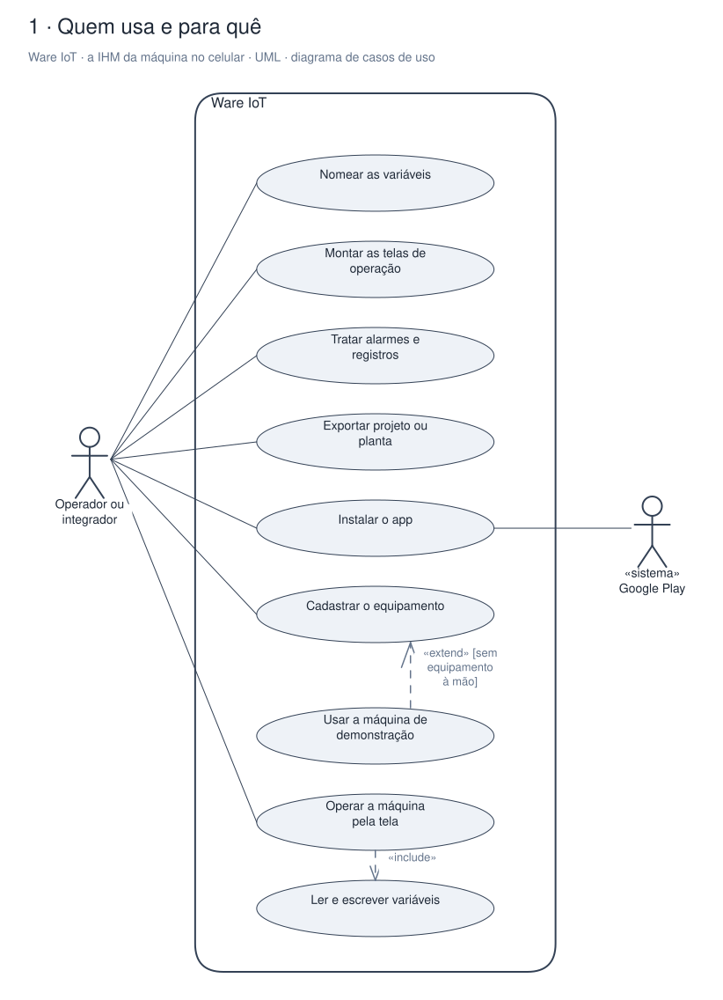
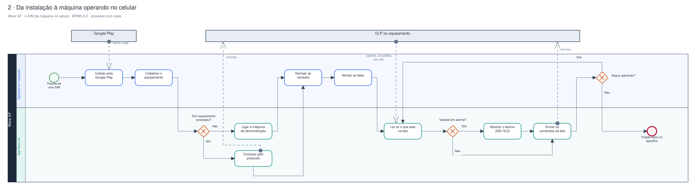
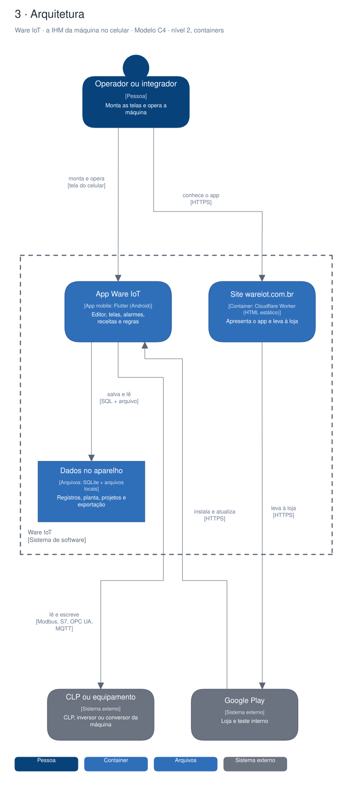

# Arquitetura

Diagramas gerados a partir do Sinapse (o segundo cérebro do Pedro). Cada projeto tem três vistas,
cada uma numa notação padrão:

1. **Quem usa e para quê**: UML, diagrama de casos de uso.
2. **O processo principal**: BPMN 2.0, com raias por quem executa.
3. **A arquitetura**: modelo C4, nível 2 (containers).

## Ware IoT · a IHM da máquina no celular

App Flutter para Android, grátis na Play, que transforma o celular na IHM da máquina: o usuário cadastra o equipamento, dá nome às variáveis e monta as telas de operação sem programar. A receita da Celiware vem do hardware da loja.

### Quem usa e para quê (UML)

### Da instalação à máquina operando no celular (BPMN 2.0)

### Arquitetura (C4, containers)

Editável: [`celiware-ihm.excalidraw`](./celiware-ihm.excalidraw), abre em [excalidraw.com](https://excalidraw.com) ou no VS Code com a extensão Excalidraw.

A fonte destes arquivos é o vault do Sinapse (`09-DESENHOS/`); alterações feitas aqui são sobrescritas na próxima publicação.
